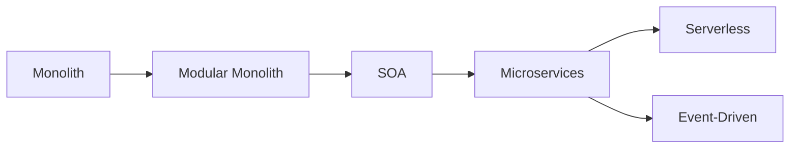
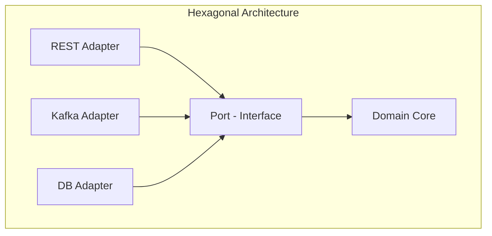

# Architectural Foundations

> The mental models every architect lives by. Before patterns, understand principles.

---

## Architecture Styles — The Evolution

| Style                 | Description                                              | When to Choose                                     |
|:----------------------|:---------------------------------------------------------|:---------------------------------------------------|
| **Monolith**          | Single deployable unit, shared DB                        | Small teams, early stage — start here              |
| **Modular Monolith**  | Clear internal boundaries, single deploy                 | Pre-microservices step; enforce internal contracts |
| **SOA**               | Coarse-grained services over ESB(Enterprise Service Bus) | Legacy enterprise; ESB = central coupling risk     |
| **Microservices**     | Fine-grained services, independent deploy, own data      | Scale teams independently; well-understood domain  |
| **Serverless / FaaS** | Event-triggered functions, no infra management           | Bursty, event-driven, cost-sensitive workloads     |
| **Event-Driven**      | Events as first-class citizens, async by default         | Loose coupling at scale, workflows, integrations   |

→ **[Deep Dive: Architecture Styles](01.01-architecture-styles.md)** — Monolith to microservices evolution, when to choose each

## Application Architecture Patterns

| Pattern                          | Core Idea                                                                         | Key Characteristic                                       |
|:---------------------------------|:----------------------------------------------------------------------------------|:---------------------------------------------------------|
| **Layered (N-tier)**             | Controller → Service → Repository                                                 | Simple; tight coupling across layers leaks               |
| **Hexagonal (Ports & Adapters)** | Business core isolated from infra; ports = interfaces, adapters = implementations | Testability-first; swap adapters without touching domain |
| **Onion Architecture**           | Concentric rings; domain at center, infra at outermost                            | Dependency rule: inner rings know nothing about outer    |
| **Clean Architecture**           | Onion + explicit Use Case layer                                                   | Uncle Bob's formalization of hexagonal                   |
| **Pipe and Filter**              | Data flows through independent processing stages                                  | Kafka Streams, ETL pipelines, request interceptor chains |
| **CQRS**                         | Separate read (Query) and write (Command) models                                  | High read/write ratio; independent scaling               |

!!! tip "Onion vs Hexagonal vs Clean"
    These are the same idea with different vocabulary. The key: domain logic has zero dependency on frameworks, databases, or HTTP. All dependencies point inward.

→ **[Deep Dive: Application Architecture Patterns](01.02-app-architecture-patterns.md)** — Hexagonal, Onion, Clean Architecture, Pipe and Filter

---

## Key Architecture Principles

### CAP Theorem

A distributed system can guarantee only **2 of 3**:

- **C**onsistency — every read gets the latest write
- **A**vailability — every request receives a response
- **P**artition Tolerance — system continues despite network splits

> Partition tolerance is non-negotiable in distributed systems. The real choice is **CP vs AP**.

| CP Systems                                               | AP Systems                                       |
|:---------------------------------------------------------|:-------------------------------------------------|
| Strong consistency; may reject requests during partition | Always respond; may return stale data            |
| Banking, inventory, payment                              | Social feeds, product recommendations, analytics |
| PostgreSQL, HBase, Zookeeper                             | Cassandra, CouchDB, DynamoDB (eventual mode)     |

→ **[Deep Dive: CAP Theorem](01.03-cap-theorem.md)** — CP vs AP trade-offs, PACELC, consistency tuning

---

### BASE vs ACID

#### ACID — Atomicity, Consistency, Isolation, Durability
- **Atomicity**: Transaction completes entirely or not at all; no partial updates
- **Consistency**: Database moves from one valid state to another; constraints are never violated
- **Isolation**: Concurrent transactions don't interfere with each other
- **Durability**: Committed data survives failures

#### BASE — Basically Available, Soft state, Eventually consistent
- **Basically Available**: System is available and responsive most of the time; some requests may fail gracefully
- **Soft state**: Data may be in flux; not immediately consistent across all replicas
- **Eventually consistent**: All replicas converge to the same state given enough time

|                 | ACID                                          | BASE                                                   |
|:----------------|:----------------------------------------------|:-------------------------------------------------------|
| **Used by**     | Relational DBs                                | NoSQL, distributed systems                             |
| **Consistency** | Strong (immediate)                            | Eventual                                               |
| **Trade-off**   | Slower; less scalable                         | Faster; complex application logic                      |

→ **[Deep Dive: ACID vs BASE](01.04-acid-vs-base.md)** — Transaction models, isolation levels, eventual consistency patterns

---

### Conway's Law

> *"Organizations design systems that mirror their own communication structure."*

- Siloed teams → tightly coupled services
- **Inverse Conway Maneuver:** intentionally structure teams to get the architecture you want
- **Team Topologies** (Skelton & Pais): Stream-aligned, Platform, Enabling, Complicated-subsystem teams

→ **[Deep Dive: Conway's Law](01.05-conways-law.md)** — Inverse Conway Maneuver, Team Topologies, aligning org and architecture

---

### Core Design Principles

| Principle                    | What It Means                                      |
|:-----------------------------|:---------------------------------------------------|
| **Loose Coupling**           | Change one service without breaking others         |
| **High Cohesion**            | Related logic together; unrelated things apart     |
| **Design for Failure**       | Assume every downstream call will eventually fail  |
| **Single Responsibility**    | One service = one business capability              |
| **Fail Fast**                | Surface problems immediately; don't swallow errors |
| **Immutable Infrastructure** | Don't patch production — replace it                |
| **Everything as Code**       | Infra, config, pipelines — versioned in Git        |
| **Separation of Concerns**   | Each layer/service has one job                     |

→ **[Deep Dive: Core Design Principles](01.06-core-design-principles.md)** — Coupling, cohesion, fail fast, immutable infrastructure

---

## 📝 Knowledge Check

<quiz>
Your payment service and inventory service share one database schema so they can join tables and stay 'consistent.' Which foundational principle does this violate, and what's the biggest production risk?
- [ ] Conway's Law — the teams will reorganize around the schema
- [x] Database-per-service / loose coupling — a schema change or outage in one team's tables can break or lock the other service; you also can't scale or version them independently
- [ ] The CAP theorem — you can't have consistency and availability anyway
- [ ] BASE — you should never aim for consistency in microservices

a shared schema is the tightest possible coupling. It creates a single point of failure, forces coordinated deployments, and makes service ownership blurry. Consistency across services should be handled with sagas and events, not shared tables.
</quiz>
<quiz>
During a network partition between two data centers, your product catalog must keep accepting writes (business says downtime costs more than stale data). Per CAP, which store fits, and what must you implement?
- [ ] A CP store like etcd — availability is more important
- [x] An AP store (e.g., Cassandra-style quorum reads/writes below quorum) — plus a conflict-resolution strategy like last-write-wins or CRDTs for when the partition heals
- [ ] Any ACID database — partitions don't affect single-node writes
- [ ] A CA system — you can have both if the partition is short-lived

during a partition, CA is impossible; you must pick C or A. Choosing availability means accepting divergence, so you need a merge/conflict strategy for healing. "CA system" is a common trap — you can't opt out of partitions in a distributed system.
</quiz>
<quiz>
An org has a 'frontend team,' 'backend team,' and 'DBA team.' What architecture will Conway's Law predict they produce?
- [ ] Microservices aligned to business capabilities
- [x] A three-tier monolith (UI layer, service layer, DB layer) — the system mirrors the communication structure of the org that built it
- [ ] Event-driven architecture, because async boundaries form where teams don't talk
- [ ] Whatever the architects design — org structure is irrelevant

Conway's Law: systems mirror the communication paths of the organization. Layered teams produce layered architectures. This is why the **Inverse Conway Maneuver** — restructure teams to match the architecture you want — is a real architectural tool.
</quiz>
<quiz>
Which signal most reliably tells you a 'microservice' boundary is wrong in production?
- [ ] The service has more than 1,000 lines of code
- [x] Two services must almost always be deployed together, and most requests cross their boundary synchronously
- [ ] The service has its own repository and CI pipeline
- [ ] The service exposes both REST and gRPC endpoints

lockstep deployment and chatty synchronous coupling mean the boundary split a single cohesive capability in two. You got the operational cost of distribution without the independence benefit — the worst of both worlds. Boundaries should follow business capabilities / bounded contexts.
</quiz>