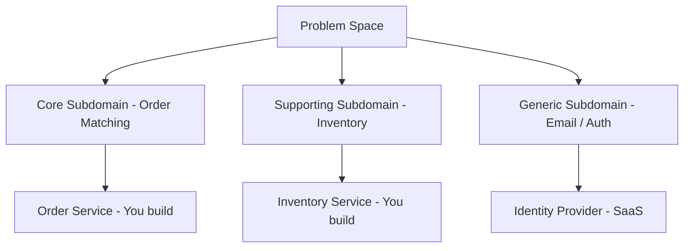
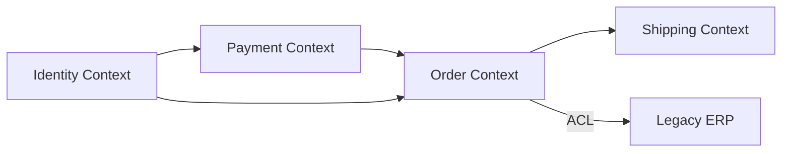
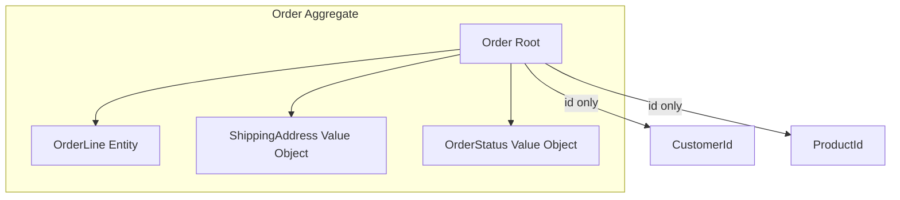

# Domain-Driven Design (DDD)

> DDD is the language microservices are written in. It answers: *how do you draw service boundaries?*

---

## Why DDD Matters for Microservices

The hardest part of microservices is not the technology — it's knowing **where to cut**. DDD provides:

- A vocabulary shared by developers and domain experts
- A principled way to identify service boundaries
- Building blocks for rich domain models

---

## Strategic DDD — The Big Picture

### Bounded Context

The single most important concept. A **bounded context** is an explicit boundary within which a domain model is valid and consistent. The word "Customer" means something different in Sales vs Billing — that's two bounded contexts.

- Each microservice typically maps to **one bounded context**
- Boundaries enforced via explicit APIs and event contracts
- Teams own bounded contexts; one team per context is the goal

### Ubiquitous Language

A shared vocabulary used **consistently** by developers and domain experts, **within a bounded context**. No translation needed inside the context; translation happens at boundaries.

### Subdomains

| Type | Description | Strategy |
|------|-------------|----------|
| **Core** | Competitive advantage; what makes you unique | Build it yourself; invest deeply |
| **Supporting** | Necessary but not differentiating | Build or buy; less investment |
| **Generic** | Commodity functionality | Buy SaaS or use open source |

---

## Context Mapping — How Bounded Contexts Relate

| Pattern | Relationship | Use When |
|---------|-------------|---------|
| **Shared Kernel** | Two teams share a domain model subset; changes require joint agreement | Transitioning; keep small |
| **Customer / Supplier** | Upstream shapes what downstream gets; downstream can negotiate | Clear producer-consumer relationship |
| **Conformist** | Downstream conforms to upstream with no negotiation power | Third-party APIs you can't influence |
| **Anti-Corruption Layer (ACL)** | Translation layer protecting your model from external/legacy systems | Integrating with legacy; strangling monolith |
| **Open Host Service** | Upstream publishes a well-defined protocol multiple consumers can use | Shared platform services |
| **Published Language** | Well-documented shared schema (Avro, JSON Schema, Protobuf) | Event-driven integration contracts |
| **Separate Ways** | No integration; teams solve problems independently | When integration cost exceeds value |

---

## Tactical DDD — Building Blocks

| Building Block | Description | Example |
|----------------|-------------|---------|
| **Entity** | Has a unique identity; mutable over time | `Order` identified by `orderId` |
| **Value Object** | No identity; defined entirely by attributes; immutable | `Money(amount, currency)`, `Address` |
| **Aggregate** | Cluster of entities and value objects; one **Aggregate Root** controls all access | `Order` root containing `OrderLine` entities |
| **Domain Event** | Immutable fact: something happened in the domain | `OrderPlaced`, `PaymentFailed` |
| **Domain Service** | Logic that doesn't belong to any single entity | `PricingService`, `TaxCalculator` |
| **Repository** | Abstraction for persisting and loading aggregates | `OrderRepository.save(order)` |
| **Factory** | Encapsulates complex object creation | `OrderFactory.createFromCart(cart)` |
| **Application Service** | Orchestrates use cases; thin layer above the domain | `OrderApplicationService.placeOrder(cmd)` |

---

## Aggregate Design — Rules of Thumb

- Model aggregates around **invariants** (business rules that must always hold)
- Keep aggregates **small** — include only what must change atomically together
- Reference other aggregates by **ID only**, never by object reference
- **One transaction = one aggregate** — cross-aggregate changes use domain events
- Cross-aggregate consistency is **eventual**, coordinated by events

---

## DDD and Microservices — The Alignment

| DDD Concept | Microservices Equivalent |
|-------------|-------------------------|
| Bounded Context | Microservice boundary |
| Ubiquitous Language | Service API vocabulary |
| Domain Event | Integration event published to Kafka |
| Aggregate | Unit of transactional consistency |
| Anti-Corruption Layer | Adapter translating external API |
| Context Map | Service dependency diagram |

!!! note "The common mistake"
    Decomposing by technical layer (UserController, UserService, UserRepo as separate services) instead of by business capability. DDD prevents this.

→ **[Deep Dive: Strategic DDD](02.01-strategic-ddd.md)** — Bounded contexts, ubiquitous language, subdomains in depth

→ **[Deep Dive: Context Mapping](02.02-context-mapping.md)** — ACL, Shared Kernel, Customer-Supplier relationships

→ **[Deep Dive: Tactical Building Blocks](02.03-tactical-building-blocks.md)** — Entities, Value Objects, Domain Events, Repositories

→ **[Deep Dive: Aggregate Design](02.04-aggregate-design.md)** — Invariants, sizing aggregates, cross-aggregate consistency

→ **[Deep Dive: DDD and Microservices Alignment](02.05-ddd-microservices-alignment.md)** — Mapping DDD to service boundaries

---

## 📝 Knowledge Check

<quiz>
Your sales team says 'customer' means a lead; support says it means a paying account; billing says it means a legal entity with a tax ID. One `Customer` table tries to serve all three. What DDD concept does this violate and what's the fix?
- [ ] Event sourcing — record customer changes as events
- [x] Bounded Context — 'Customer' is three different models in three contexts; create separate bounded contexts (Sales, Support, Billing), each with its own Customer model and ubiquitous language, mapped via context mapping
- [ ] The repository pattern — add three repositories
- [ ] Microservices — split the table into three

the same word meaning different things to different departments is the classic bounded-context signal. Forcing one model guarantees every context is poorly served and changes collide. Each context gets its own consistent model; integration happens explicitly at the boundaries (context map, ACLs, events).
</quiz>
<quiz>
What makes a language 'ubiquitous' in the DDD sense — and what breaks it in practice?
- [ ] It's the company-wide glossary everyone must use
- [x] It's the shared language developed *within* a bounded context, used identically by domain experts, developers, and the code itself — it breaks when code uses different terms than the business ('order' vs 'purchase'), or the same term silently means different things across contexts
- [ ] It's English instead of the local language
- [ ] It's the API documentation

ubiquitous language is per-bounded-context, not company-wide. The test: a domain expert reading your method names should recognize their vocabulary, and a developer in a meeting should use the same words as the business. Translation layers in code ('adapter' renaming everything) are a smell the language drifted.
</quiz>
<quiz>
Classify: (a) a recommendation engine unique to your company, (b) user authentication, (c) standard invoicing. How should investment differ?
- [ ] All get equal investment — consistency matters
- [x] (a) Core domain — build in-house with your best people, this is your differentiation; (b) generic subdomain — buy/use a commodity (Auth0, Cognito); (c) supporting subdomain — build simply or outsource, it must work but doesn't differentiate
- [ ] Outsource all three — focus on features
- [ ] Build all three — security requires ownership

subdomain classification drives investment: core domains deserve senior talent and careful modeling; generic subdomains are solved problems (don't build your own auth); supporting subdomains need adequate but not excellent implementations. Wasting core-domain effort on a generic subdomain is the most common misallocation.
</quiz>
<quiz>
An aggregate rule of thumb: 'one transaction = one aggregate.' Why, and what's the correct pattern when a use case must change two aggregates?
- [ ] The rule is wrong — always lock both aggregates in one transaction
- [x] Modifying two aggregates in one transaction couples their availability and scalability; instead, commit the first aggregate, publish a domain event, and let the second aggregate update in its own transaction (eventual consistency via saga/process manager)
- [ ] Denormalize both aggregates into one table
- [ ] Use a distributed lock

an aggregate is a consistency boundary enforced by a transaction. Stretching a transaction across two aggregates means a lock on one blocks the other and both services' availability is chained. Events + eventual consistency is the DDD-endorsed answer; if you *constantly* need atomic updates across two aggregates, your boundary is probably wrong.
</quiz>
<quiz>
In practice, what does it mean that a bounded context 'aligns' with a microservice?
- [ ] Each bounded context becomes exactly one database table
- [x] The service's API, data, and team are owned within one bounded context's model; integration to other contexts goes through explicit contracts (events, ACLs, published language) — never shared tables or leaking the other context's model
- [ ] One service can host many contexts if they're small
- [ ] Bounded contexts are only for the monolith

bounded context is the *candidate boundary* for a service: it already separates a consistent model with its own language. Aligning means the service owns that model end-to-end and talks to other contexts through deliberate translation (ACL) or published contracts. If a service must join another service's tables, the bounded context was violated.
</quiz>