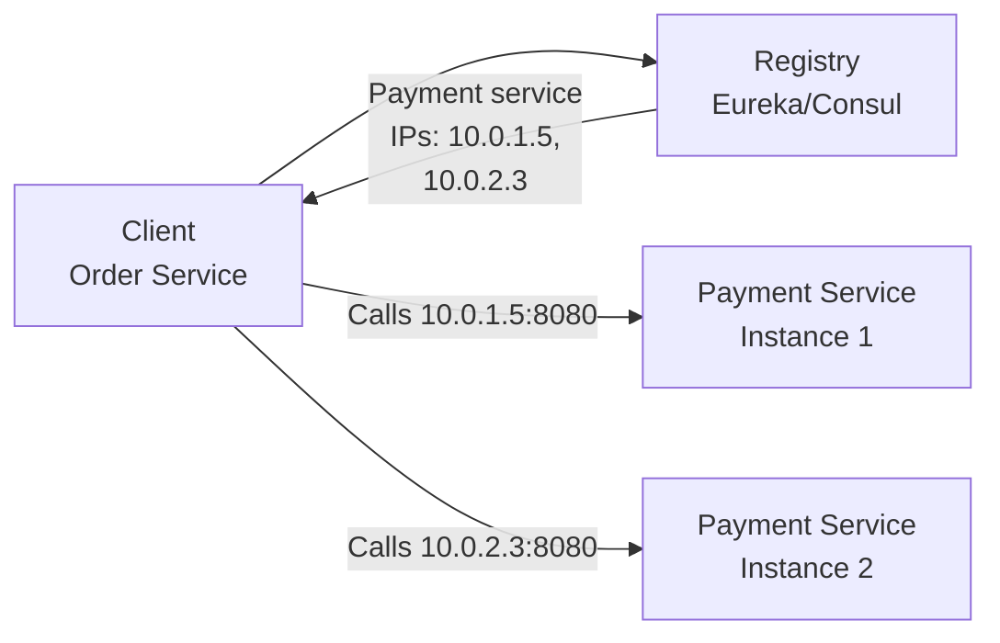
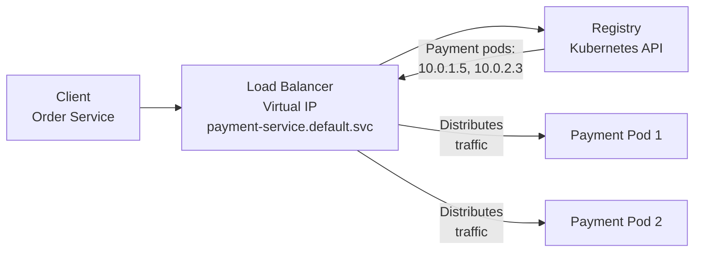
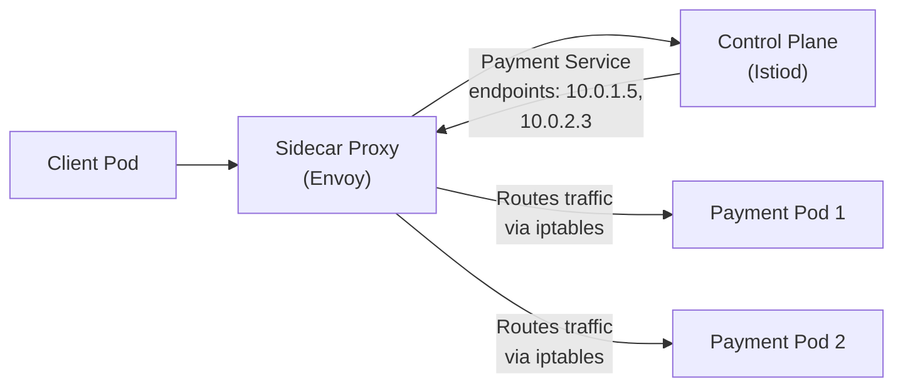

# Service Discovery & Load Balancing — Deep Dive

> **Level:** Intermediate
> **Pre-reading:** [03 · Microservices Patterns](03-microservices-patterns.md) · [05 · API & Communication](05-api-communication.md)

---

## The Problem: Finding Services Dynamically

In monoliths, all services run on known IPs. In microservices, services come and go:

```
Problem:
  Service A needs to call Service B
  But Service B has 5 instances across 3 availability zones
  IPs change as pods restart
  How does A discover B's current IPs?
```

**Service Discovery** solves this: a registry that tracks "Service B is at 10.0.1.5:8080, 10.0.2.3:8080, 10.0.3.7:8080 right now."

---

## Service Discovery Patterns

| Pattern | How It Works | When to Use |
|:--------|:------------|:-----------|
| **Client-side** | Client queries registry; picks instance | Small, known set of services |
| **Server-side** | Load balancer queries registry; client calls LB | Separation of concerns; simpler clients |
| **Kubernetes DNS** | CoreDNS serves `service.namespace.svc.cluster.local` | Kubernetes-native (easiest) |
| **Service Mesh** | Sidecar proxy intercepts; service discovery abstracted | Large scale; language-agnostic |

---

## Client-Side Service Discovery

**Client directly queries service registry and picks an instance.**



### Eureka (Spring Cloud)

```yaml
# In Spring Boot application.yml
spring:
  application:
    name: order-service
  cloud:
    eureka:
      client:
        serviceUrl:
          defaultZone: http://eureka-server:8761/eureka/
```

```java
// Order Service queries Eureka
@RestController
public class OrderController {
    
    @Autowired
    private DiscoveryClient discoveryClient;
    
    @GetMapping("/orders/{id}")
    public Order getOrder(@PathVariable String id) {
        // Get all Payment Service instances from Eureka
        List<ServiceInstance> instances = 
            discoveryClient.getInstances("payment-service");
        
        if (instances.isEmpty()) {
            throw new ServiceUnavailableException("payment-service");
        }
        
        // Client-side load balancing: pick instance 0
        ServiceInstance instance = instances.get(0);
        String url = instance.getUri() + "/api/payments/" + id;
        
        return restTemplate.getForObject(url, Order.class);
    }
}
```

### Pros & Cons

| Pros | Cons |
|:-----|:-----|
| Client control over load balancing logic | Every client language needs discovery logic |
| Custom load balancing (affinity, canary) | Service Registry client library required |
| No proxy overhead | Clients tightly coupled to discovery mechanism |

---

## Server-Side Service Discovery

**Load balancer queries registry; clients call load balancer.**



### Kubernetes DNS (Easiest)

```java
// In Kubernetes, just use DNS name
// Kubernetes CoreDNS handles discovery + load balancing
@RestTemplate
public Order callPaymentService() {
    String url = "http://payment-service.default.svc.cluster.local:8080/api/payments";
    return restTemplate.getForObject(url, Order.class);
}
```

**How it works:**

1. Order pod requests `payment-service.default.svc.cluster.local`
2. CoreDNS resolves to ClusterIP (virtual IP): `10.96.1.5`
3. kube-proxy on every node maintains iptables rules
4. iptables redirects `10.96.1.5:8080` to an actual pod IP

**Benefits:**

- Zero client-side code needed
- Works across any language
- Built-in health checking (if pod fails, removes from endpoints)

### Consul (HashiCorp)

Enterprise-grade service discovery with health checks and multi-DC support:

```plaintext
# consul-config.hcl
service {
  name = "payment-service"
  port = 8080
  check {
    http     = "http://localhost:8080/health"
    interval = "10s"
    timeout  = "5s"
  }
}
```

```java
// Client fetches from Consul
public String discoverPaymentService() {
    Response<List<CatalogService>> response = 
        consul.getCatalogClient().getService("payment-service");
    
    List<CatalogService> instances = response.getValue();
    CatalogService instance = instances.get(0); // pick one
    return instance.getServiceAddress() + ":" + instance.getServicePort();
}
```

---

## Service Mesh (Abstracted Service Discovery)

Service mesh (Istio, Linkerd) handles discovery transparently via sidecars.



**Transparent to application:**

```java
// App just calls the service name; sidecar handles discovery
public Order callPaymentService() {
    // Sidecar intercepts; resolves payment-service automatically
    return restTemplate.getForObject("http://payment-service:8080/api/payments", Order.class);
}
```

**Service Mesh Benefits:**

- Service discovery + load balancing + circuit breaker + observability all in proxy
- Language-agnostic
- Canary, circuit breaker rules defined in config, not code

---

## Load Balancing Algorithms

Once a service discovers multiple instances, how to pick one?

| Algorithm | Behavior | When to Use |
|:----------|:---------|:-----------|
| **Round Robin** | Rotate through instances | Uniform load; stateless requests |
| **Least Connections** | Route to instance with fewest active connections | Long-lived connections; streaming |
| **IP Hash** | Same client IP → same instance | Session affinity; connection pooling |
| **Random** | Pick random instance | Simple; low overhead |
| **Weighted** | Favor certain instances (e.g., canary: 90% old, 10% new) | Gradual rollouts |

### Example: Round-Robin vs Least Connections

```
Scenario: 3 instances, requests arrive
Instance 1: 10 active requests, avg processing time 100ms
Instance 2: 5 active requests, avg processing time 100ms
Instance 3: 2 active requests, avg processing time 100ms

Round-Robin would send new request to Instance 1 (next in rotation)
→ Queues up; longer latency

Least Connections would send to Instance 3
→ Faster response
```

---

## Health Checks & Deregistration

Service registry must detect dead instances and remove them.

### Active Health Checks (Registry → Service)

```
Registry polls: GET http://payment-service-pod:8080/health
Response: 200 OK { "status": "UP" }
If poll fails 3x in a row → deregister instance
```

### Passive Health Checks (Client → Service)

```
Client calls payment-service:8080 → 500 error
Circuit breaker counts failure
After threshold → remove from load balancing rotation
```

### Kubernetes Health Probes

```yaml
apiVersion: v1
kind: Pod
metadata:
  name: payment-pod
spec:
  containers:
  - name: payment
    livenessProbe:  # Is app alive?
      httpGet:
        path: /health/live
        port: 8080
      initialDelaySeconds: 10
      periodSeconds: 10
    readinessProbe:  # Is app ready for traffic?
      httpGet:
        path: /health/ready
        port: 8080
      initialDelaySeconds: 5
      periodSeconds: 5
```

**Behavior:**

- **Liveness fails** → Kubelet restarts pod
- **Readiness fails** → Service removes pod from endpoints; no traffic sent

---

## Client-Side Load Balancing Library

Spring Cloud LoadBalancer (modern replacement for Ribbon):

```java
@Configuration
public class LoadBalancerConfig {
    
    @Bean
    public RestTemplate restTemplate(RestTemplateBuilder builder) {
        return builder
            .interceptors((request, body, execution) -> {
                // LoadBalancer intercepts; resolves service name via DiscoveryClient
                return execution.execute(request, body);
            })
            .build();
    }
}

@RestController
public class OrderController {
    
    @Bean
    public RestTemplate restTemplate() {
        return new RestTemplate();
    }
    
    @Autowired
    private RestTemplate restTemplate;
    
    @GetMapping("/orders")
    public List<Payment> getPayments() {
        // LoadBalancer resolves "payment-service" to actual IP
        return restTemplate.getForObject(
            "http://payment-service/api/payments",
            List.class
        );
    }
}
```

---

## When to Use Each Pattern

| Pattern | Use When |
|:--------|:---------|
| **Kubernetes DNS** | Running in Kubernetes; simplest option; recommended default |
| **Client-side (Eureka)** | Not in Kubernetes; need sophisticated routing logic (canary, affinity) |
| **Server-side (Consul)** | Multi-DC; need strong health checks; legacy infrastructure |
| **Service Mesh (Istio)** | Large microservices fleet; want decoupling from discovery mechanism; language diversity |

---

??? question "Why not just use a load balancer IP (VIP) for every service?"
    VIPs work but don't scale: in Kubernetes with 500 microservices, managing 500 VIPs is operational overhead. DNS + CoreDNS scales naturally; new service = new DNS record, automatic.

??? question "How does Kubernetes CoreDNS differ from Consul?"
    CoreDNS is Kubernetes-native; scales well for K8s workloads; limited health checks. Consul is external; multi-cloud; richer API; more overhead. For Kubernetes, CoreDNS is sufficient; use Consul only if multi-cloud or on-prem hybrid.

??? question "Can I use Round-Robin load balancing with long-lived connections?"
    No; will saturate old instances. Use Least Connections instead, or IP Hash for session affinity.

??? question "How does Istio's load balancing differ from Kubernetes service load balancing?"
    Kubernetes service load balancing is basic (round-robin at kube-proxy). Istio adds circuit breaker, canary weights, outlier detection, and observability without application code changes.


---

## 📝 Knowledge Check

<quiz>
Why can't you hardcode `http://10.0.1.5:8080` for service calls in Kubernetes — and what does `http://order-service` actually resolve to?
- [ ] Hardcoding is just ugly, works fine
- [x] Pod IPs are ephemeral — every rollout/scale event changes them. `order-service` resolves via cluster DNS to a stable virtual IP (ClusterIP) that kube-proxy load-balances across the current healthy pod endpoints — the registry IS the EndpointSlice list maintained from readiness probes
- [ ] It resolves to the ingress controller
- [ ] Pod IPs are stable in K8s, only VMs change

in K8s, 'service discovery' is mostly free: the Service object + DNS gives you a stable name, kube-proxy distributes connections across ready endpoints, and readiness probes continuously update the endpoint list. The catch: it's L4 — no per-request L7 balancing, no client-side control — which is where meshes/client-side discovery differ.
</quiz>
<quiz>
Round-robin sends an equal share to a slow, GC-paused instance and a healthy one. Which algorithm handles unequal capacity better — and what's still needed?
- [ ] Random — it averages out
- [x] Least-connections / least-outstanding-requests: route to the instance with fewest in-flight calls, naturally steering away from stragglers; still needed: health checks to eject truly dead instances, and weights when instances genuinely differ in capacity (different instance sizes)
- [ ] IP-hash — stickiness fixes it
- [ ] Round-robin is optimal — slow instances catch up

round-robin assumes equal cost per request and equal capacity per instance — both false under GC pauses, noisy neighbors, or mixed instance sizes. Least-connections adapts to real load signals. Caveat: it needs server- or proxy-side visibility into in-flight counts (Envoy does this; DNS-level balancing can't), and health checks remain the ejection mechanism — least-connections alone will still send *some* traffic to a hung instance.
</quiz>
<quiz>
A pod's process is alive but deadlocked — readiness probe succeeds (TCP open), all requests hang. What health-check design catches this?
- [ ] TCP probes are sufficient
- [x] Active *application-level* health checks: the readiness endpoint must exercise real dependencies/work (e.g., return 200 only if the app can actually serve — often a dedicated `/health/ready` that checks the request path, not just the socket); combine with liveness to restart truly stuck pods
- [ ] Check CPU usage instead
- [ ] Passive health checks from the mesh fix this

TCP-open proves a socket exists, not that the service works. A deadlocked thread pool passes TCP forever. Design readiness to reflect 'can I serve *traffic*' — but be careful making readiness depend on downstreams (a DB blip shouldn't unready every pod — use a separate deep check). Liveness should catch true deadlock for restart; readiness should only gate traffic.
</quiz>
<quiz>
When is client-side load balancing (e.g., a library like Ribbon/gRPC-lookaside) still the right answer inside Kubernetes?
- [ ] Never — K8s DNS covers everything
- [x] When you need per-request L7 control kube-proxy can't give: gRPC's long-lived HTTP/2 connections bypass L4 balancing (one connection = one pod forever), or you need weighted/zone-aware/sticky routing logic in the client
- [ ] Only for HTTP/1
- [ ] When you want to skip health checks

the classic gotcha: gRPC over ClusterIP load-balances *connections*, so all requests on one multiplexed connection hit one pod — scaling out doesn't help the hot connection. Fixes: client-side/lookaside LB (client picks per-RPC), headless services + client logic, or a mesh (Envoy does per-request L7 balancing). For plain short-lived HTTP, ClusterIP is fine.
</quiz>
<quiz>
Eureka returns 3 instances; one has been dead for 40 seconds. A well-designed client-side LB setup differs from a naive one how?
- [ ] There's no difference — stale entries are inevitable
- [x] The robust setup combines: short heartbeat/renewal so death is detected fast, client-side retry-with-failover (try next instance on connect-failure), and ejection of failed endpoints after N errors — naive setups send every Nth request to the corpse until the registry expires it
- [ ] Use DNS instead — it's never stale
- [ ] Restart Eureka to clear entries

registries are eventually consistent by design; you cannot make them fast enough to be truth. So clients must treat the registry as a *hint*: try instance, on failure mark down and retry next, periodically re-check. This 'registry + client ejection + retry' triple is what makes client-side discovery production-grade; the naive 'trust the list' version fails on every rolling deploy.
</quiz>