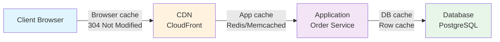
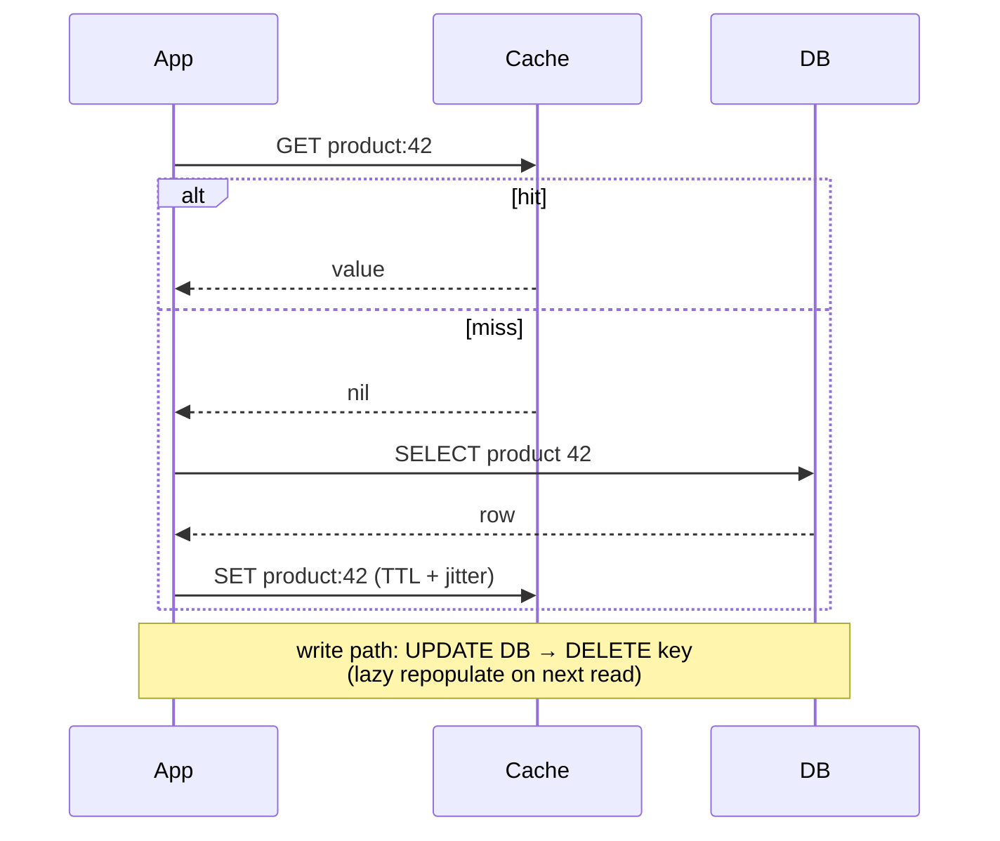
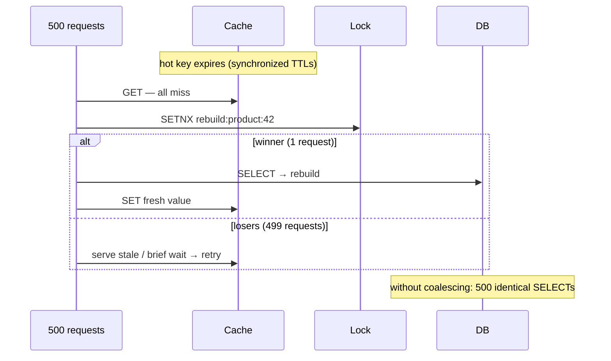
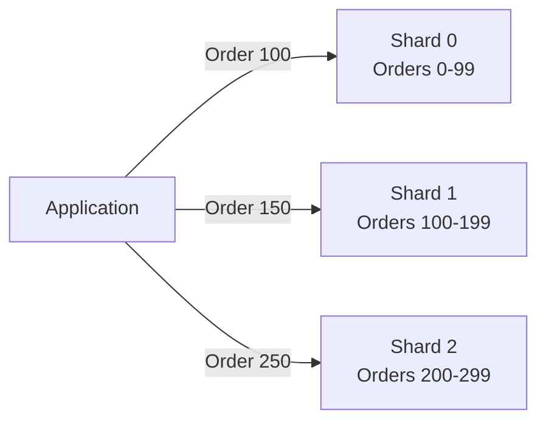

# Cache Patterns & Strategies — Deep Dive

> **Level:** Intermediate
> **Pre-reading:** [03 · Microservices Patterns](03-microservices-patterns.md) · [09 · Deployment & Infrastructure](09-deployment.md)

---

## Caching Layers



| Layer | Examples | TTL | Invalidation |
|:------|:---------|:----|:-------------|
| **Browser/CDN** | Static assets, HTML | Hours to days | Cache headers; URL versioning |
| **Application** | API responses, objects | Minutes to hours | Event-based; TTL |
| **Database** | Row-level caching | Milliseconds to seconds | Query result cache; invalidation on write |
| **Hardware** | CPU L1/L2/L3 cache | Nanoseconds | Automatic; CPU managed |

---

## Cache-Aside Pattern (Lazy Loading)

**Logic:** Check cache → miss → load from DB → store in cache → return.

```java
@Service
public class ProductService {
    
    @Autowired
    private RedisTemplate<String, Product> redisTemplate;
    
    @Autowired
    private ProductRepository productRepository;
    
    public Product getProduct(String productId) {
        // 1. Check cache
        String cacheKey = "product:" + productId;
        Product cached = redisTemplate.opsForValue().get(cacheKey);
        if (cached != null) {
            return cached;  // Cache hit; return immediately
        }
        
        // 2. Cache miss; load from DB
        Product product = productRepository.findById(productId)
            .orElseThrow(() -> new ProductNotFoundException());
        
        // 3. Store in cache (with TTL of 1 hour)
        redisTemplate.opsForValue().set(
            cacheKey,
            product,
            Duration.ofHours(1)
        );
        
        // 4. Return
        return product;
    }
}
```

### Pros & Cons

| Pros | Cons |
|:-----|:-----|
| Simple to implement | Cache warming on startup needed; slow first request |
| Only caches accessed items | Stale data possible (expired items) |
| Easy to remove cached items | Cache stampede: many threads reload same key |

---



## Write-Through Pattern

**Logic:** Write to cache AND DB together.

```java
@Service
public class ProductService {
    
    public void updateProduct(String productId, Product product) {
        // 1. Write to cache
        String cacheKey = "product:" + productId;
        redisTemplate.opsForValue().set(cacheKey, product, Duration.ofHours(1));
        
        // 2. Write to DB
        productRepository.save(product);
    }
}
```

### Pros & Cons

| Pros | Cons |
|:-----|:-----|
| Cache always consistent with DB | Writes slower (must wait for both DB + cache) |
| No stale reads possible | Extra load on cache during writes |

---

## Write-Behind (Write-Back) Pattern

**Logic:** Write to cache immediately; async flush to DB.

```java
@Service
public class ProductService {
    
    @Autowired
    private RedisTemplate<String, Product> redisTemplate;
    
    public void updateProduct(String productId, Product product) {
        // 1. Write to cache immediately (fast)
        String cacheKey = "product:" + productId;
        redisTemplate.opsForValue().set(
            cacheKey,
            product,
            Duration.ofHours(1)
        );
        
        // 2. Async write to DB (deferred)
        asyncDbWriter.schedule(() -> {
            productRepository.save(product);
        }, Duration.ofSeconds(5));
    }
}
```

### Pros & Cons

| Pros | Cons |
|:-----|:-----|
| Writes fast (cache only) | Stale DB; data loss if cache fails before flush |
| Batching: flush 10 updates in 1 DB call | Complex; need flush logic |

### When to Use Write-Behind

- **High-write scenarios:** Analytics, counters, logs
- **Non-critical data:** Recommendations, statistics

### When NOT to Use

- **Financial transactions:** Critical data must be in DB immediately
- **Inventory:** Overselling risk if cache fails

---

## Cache Invalidation Strategies

> **Two hard problems in CS:** Cache invalidation and naming things.

### TTL-Based (Time-To-Live)

```java
// Cache expires after 1 hour
redisTemplate.opsForValue().set(
    "product:123",
    product,
    Duration.ofHours(1)  // TTL
);
```

**Pro:** Simple; automatic cleanup. **Con:** Stale data until expiry.

### Event-Based

```java
@Service
public class ProductService {
    
    @Autowired
    private RedisTemplate<String, Product> redisTemplate;
    
    @Autowired
    private ApplicationEventPublisher eventPublisher;
    
    public void updateProduct(String productId, Product product) {
        // Update DB
        productRepository.save(product);
        
        // Invalidate cache
        redisTemplate.delete("product:" + productId);
        
        // Publish event for other services
        eventPublisher.publishEvent(new ProductUpdatedEvent(productId));
    }
}
```

**Pro:** Immediate consistency. **Con:** Must remember to invalidate everywhere.

### Cache-Aside with Versioning

```java
@Service
public class ProductService {
    
    public Product getProduct(String productId) {
        // Version-based cache key
        int version = productVersionRepository.getVersion(productId);
        String cacheKey = "product:" + productId + ":v" + version;
        
        Product cached = redisTemplate.opsForValue().get(cacheKey);
        if (cached != null) {
            return cached;
        }
        
        Product product = productRepository.findById(productId).orElseThrow();
        redisTemplate.opsForValue().set(cacheKey, product, Duration.ofHours(1));
        return product;
    }
    
    public void updateProduct(String productId, Product product) {
        productRepository.save(product);
        productVersionRepository.incrementVersion(productId);
        // Old cache keys become orphaned; automatic cleanup via TTL
    }
}
```

**Pro:** No explicit invalidation needed. **Con:** Cache fragmentation over time.

---



## Cache Stampede Prevention

**Problem:** Multiple requests hit expired cache key; all reload from DB simultaneously.

```
Cache expires: product:123
100 requests arrive at same time
All miss cache → all query DB
DB gets 100 queries; slow
```

### Solution 1: Probabilistic TTL

```java
public Product getProduct(String productId) {
    Product cached = redisTemplate.opsForValue().get("product:" + productId);
    
    if (cached != null && !shouldRefresh()) {
        return cached;  // Use stale cache
    }
    
    // Refresh cache
    Product fresh = productRepository.findById(productId).orElseThrow();
    redisTemplate.opsForValue().set("product:" + productId, fresh, Duration.ofMinutes(60));
    return fresh;
}

private boolean shouldRefresh() {
    // 10% chance to refresh; spreads load
    return Math.random() < 0.1;
}
```

### Solution 2: Distributed Lock

```java
public Product getProduct(String productId) {
    Product cached = redisTemplate.opsForValue().get("product:" + productId);
    if (cached != null) {
        return cached;
    }
    
    // Prevent thundering herd with distributed lock
    String lockKey = "lock:" + productId;
    if (!redisTemplate.opsForValue().setIfAbsent(lockKey, "1", Duration.ofSeconds(5))) {
        // Another thread has lock; wait and retry cache
        Thread.sleep(100);
        return getProduct(productId);
    }
    
    try {
        // This thread refreshes
        Product fresh = productRepository.findById(productId).orElseThrow();
        redisTemplate.opsForValue().set("product:" + productId, fresh, Duration.ofHours(1));
        return fresh;
    } finally {
        redisTemplate.delete(lockKey);
    }
}
```

---

## Database Sharding for Horizontal Scaling

**Problem:** Single database becomes bottleneck.

**Solution:** Split data across multiple databases (shards).



### Sharding Strategies

| Strategy | Example | Pros | Cons |
|:---------|:--------|:-----|:-----|
| **Range-based** | Orders 0-99 → Shard A; 100-199 → Shard B | Simple; range queries fast | Uneven distribution (hot shards) |
| **Hash-based** | hash(orderId) % num_shards | Uniform distribution | Expensive range queries |
| **Geographic** | US data → Shard A; EU → Shard B | Data locality; compliance | Complex to rebalance |
| **Directory-based** | Lookup table: orderId → shard | Flexible; easy rebalancing | Extra lookup overhead |

### Hash-Based Sharding Example

```java
@Repository
public class ShardedOrderRepository {
    
    private List<JdbcTemplate> shards;
    
    public Order findById(String orderId) {
        int shardId = Math.abs(orderId.hashCode()) % shards.size();
        JdbcTemplate shard = shards.get(shardId);
        
        return shard.queryForObject(
            "SELECT * FROM orders WHERE id = ?",
            new OrderRowMapper(),
            orderId
        );
    }
    
    public void save(Order order) {
        int shardId = Math.abs(order.getId().hashCode()) % shards.size();
        JdbcTemplate shard = shards.get(shardId);
        
        shard.update(
            "INSERT INTO orders (id, total) VALUES (?, ?)",
            order.getId(),
            order.getTotal()
        );
    }
}
```

### Rebalancing Shards

When adding new shard: rehash all data; move subset to new shard.

```
Before: 3 shards
  Shard 0: 1/3 data
  Shard 1: 1/3 data
  Shard 2: 1/3 data

Add Shard 3:
  Rehash all data: hash(orderId) % 4
  1/4 of data moves to Shard 3
  Shard 0, 1, 2 each lose 1/12 of data
  
Downtime: Yes (migration required)
```

---

## Redis Cluster for Distributed Caching

Scale beyond single Redis instance:

```yaml
# Redis Cluster: 6 nodes (3 primary + 3 replica)
redis-node-1 (primary, slots 0-5461)
redis-node-2 (primary, slots 5462-10922)
redis-node-3 (primary, slots 10923-16383)
redis-node-4 (replica of node-1)
redis-node-5 (replica of node-2)
redis-node-6 (replica of node-3)
```

**Feature:**

- Sharding built-in
- Failover: replica promoted if primary fails
- Cluster-aware clients

---

## Cache Warming

Pre-populate cache on startup; avoid slow first requests.

```java
@Component
public class CacheWarmer {
    
    @Autowired
    private ProductService productService;
    
    @Autowired
    private RedisTemplate<String, Product> redisTemplate;
    
    @EventListener(ApplicationReadyEvent.class)
    public void warmCache() {
        // Load top 1000 products on startup
        List<Product> topProducts = productService.getTopProducts(1000);
        
        topProducts.forEach(product -> {
            String key = "product:" + product.getId();
            redisTemplate.opsForValue().set(key, product, Duration.ofHours(1));
        });
        
        log.info("Cache warmed with {} products", topProducts.size());
    }
}
```

---

??? question "Should I cache at the application layer or database layer?"
    Both: app layer (Redis) for hot data; DB layer (query cache) for expensive queries. App layer is faster and decouples services.

??? question "How much memory should I allocate to Redis?"
    Rule of thumb: cache working set (80% of queries touch 20% of data). Monitor hit ratio; target > 90%. Start with 10–20% of dataset size.

??? question "What happens when Redis runs out of memory?"
    Eviction policy kicks in: LRU (least recently used), LFU (least frequently used), or TTL-based. Configure with `maxmemory-policy` in redis.conf.


---

## 📝 Knowledge Check

<quiz>
Cache-aside on a hot key expires → 500 concurrent requests miss simultaneously → all hit the DB. Name the failure and two mitigations.
- [ ] Cache poisoning — flush the cache
- [x] Cache stampede/thundering herd. Mitigations: (1) request coalescing / distributed lock — first misser recomputes while others wait or serve stale; (2) probabilistic early refresh — recompute before expiry with probability rising as TTL nears; also stale-while-revalidate and jittered TTLs to prevent synchronized expiry
- [ ] Increase DB connections to absorb it
- [ ] Use a bigger Redis instance

synchronized expiry is the classic cache failure: identical TTLs set at the same moment die together. The lock/coalescing pattern (e.g., Redisson lock or Redis `SET NX`) makes one worker rebuild; stale-while-revalidate serves old data during rebuild; jitter (TTL ± 10%) prevents mass expiry in the first place. More DB capacity just raises the cliff edge.
</quiz>
<quiz>
Write-behind caching gives you very fast writes. What do you accept in exchange — and when must you refuse to use it?
- [ ] Nothing — it's strictly faster
- [x] You accept durability risk: writes are acknowledged before they reach the DB, so a cache-node crash loses recent writes, and ordering/consistency is eventual. Refuse it for anything that cannot lose acknowledged writes — payments, inventory counts, audit records
- [ ] Only works with Redis
- [ ] It's fine for payments if you add a WAL

write-behind is 'DB is eventually updated.' It's excellent for write-heavy telemetry/counters where occasional loss is tolerable and you can coalesce many writes into one. It is categorically wrong where '200 OK' must mean 'durable.' If tempted, ask: 'what does the user believe happened when we acknowledged this write — and can we afford to be wrong?'
</quiz>
<quiz>
Product-service publishes `ProductUpdated`. What's the *correct* cache-invalidation flow — and why is 'delete then update' or 'update then delete' both subtly racy?
- [ ] Any order works — it's just a delete
- [x] The safe pattern: update DB → then delete cache entry (or publish event → consumer deletes). Races: 'delete-then-update' lets a concurrent read repopulate the cache with the OLD value between the two steps; 'update-then-delete' can interleave with a miss that reads pre-update and repopulates after your delete. Perfect consistency isn't achievable — bound the window, use versioned values, keep the window tiny
- [ ] Write-through eliminates all races
- [ ] Use a DB trigger instead

there's a famous non-atomicity: cache and DB aren't one transaction. The standard mitigation is 'update DB, delete cache' + versioned payloads (cache stores value+version; late repopulation with an older version is rejected on read) or CDC-driven invalidation. Accept the residual window — the honest design goal is 'briefly stale' not 'never stale.'
</quiz>
<quiz>
You're sharding a customer dataset across 4 nodes and want to add a 5th. Why does `customerId % N` hurt — and what do production systems use instead?
- [ ] Mod sharding is fine — just rerun it
- [x] `mod N` remaps ~75% of keys when N changes (only keys where `id % 4 == id % 5` stay) — a massive data migration and cache-bust. Production uses **consistent hashing** (ring: only ~1/N of keys move) or a slot/lookup-table indirection (e.g., Redis Cluster's 16,384 slots reassigned between nodes)
- [ ] Add a 5th replica — reads scale
- [ ] Use UUIDs so keys distribute evenly

this is the difference between 'reshard weekend' and 'add node, done.' Consistent hashing bounds the remapping to the new node's fair share; slot-based schemes (Redis Cluster, Couchbase vbuckets, Kafka partitions) make movement explicit and incremental. Even distribution of *keys* is easy — it's *moving* them gracefully that's the design problem.
</quiz>
<quiz>
Redis Cluster with 3 primaries + 3 replicas: a primary dies and its replica is promoted. What's the data-loss edge case, and which config determines your exposure?
- [ ] No loss — replicas are synchronous
- [x] Replication is async: the promoted replica may lag the dead primary by a small window — acknowledged writes can be lost. Your exposure is set by `min-replicas-to-write`/`min-replicas-max-lag` (refuse writes if replicas are too far behind) plus WAIT/WAITAOF semantics — you cannot get CP guarantees from a default async setup
- [ ] Redis Cluster is CP — loss is impossible
- [ ] Use AOF everysec — it fixes replication

Redis Cluster is AP-ish: failover elects a replica that might be behind, and in a partition the majority side may even lose minority-side writes after healing. `min-replicas-to-write` trades availability for durability (refuse writes when no replica is caught up). For a cache, accept the loss; for anything durable, treat Redis as a cache in front of a real store — not the system of record.
</quiz>