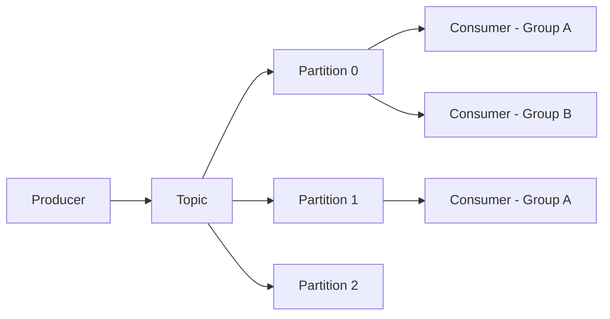
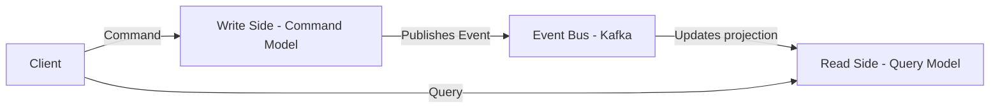
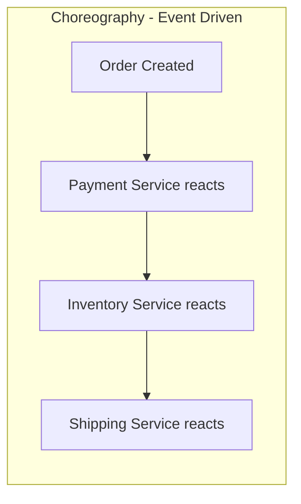
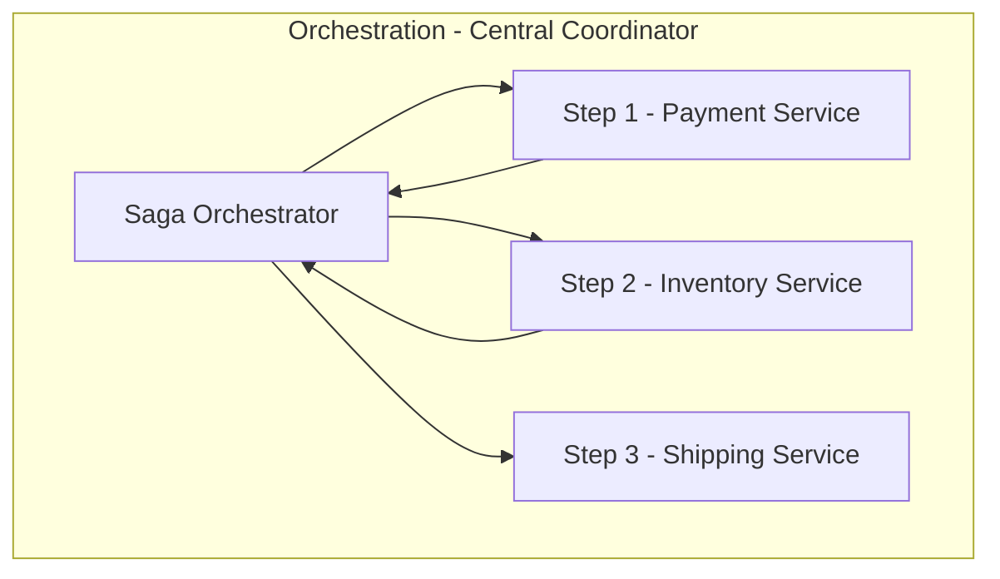

# Event-Driven Architecture

> Events decouple producers from consumers. They are the backbone of scalable, resilient microservices.

## Event Types

| Type                  | Description                                                        | Example                            |
|:----------------------|:-------------------------------------------------------------------|:-----------------------------------|
| **Domain Event**      | Fact within a bounded context                                      | `OrderPlaced`, `InventoryReserved` |
| **Integration Event** | Domain event published across service boundaries                   | Same events but via Kafka topics   |
| **Command**           | Request to do something; directed at one receiver; can be rejected | `PlaceOrder`, `ShipOrder`          |
| **Query**             | Request for data; no side effects; read-only                       | `GetOrderStatus`                   |

> **Key distinction:** An event is a *fact* (past tense, already happened). A command is a *request* (may succeed or fail).

→ **[Deep Dive: Event Types and Patterns](04.01-event-types-and-patterns.md)** — Domain vs integration events, event-carried state transfer

## Event-Driven Patterns

| Pattern                          | Description                                             | When to Use                                |
|:---------------------------------|:--------------------------------------------------------|:-------------------------------------------|
| **Event Notification**           | Publisher fires event; doesn't care about consumers     | Loosest coupling; audit, notifications     |
| **Event-Carried State Transfer** | Event contains full payload — no follow-up query needed | Avoids query fan-out; larger events        |
| **Event Sourcing**               | Events *are* the record; state derived by replay        | Audit, time-travel, complex state machines |
| **CQRS via Events**              | Write side emits events; read side builds projections   | High read/write ratio; independent scaling |

## Kafka Architecture

| Concept                     | Description                                                                                    |
|:----------------------------|:-----------------------------------------------------------------------------------------------|
| **Topic**                   | Named stream of events; logical category                                                       |
| **Partition**               | Ordered, immutable append-only log; unit of parallelism                                        |
| **Offset**                  | Position of a message in a partition; consumer tracks this                                     |
| **Consumer Group**          | Group of consumers splitting a topic; each partition goes to exactly one consumer in the group |
| **Broker**                  | Kafka server; stores and serves partitions                                                     |
| **Replication Factor**      | Copies of each partition across brokers for fault tolerance                                    |
| **Retention**               | How long messages are kept — time-based or size-based                                          |
| **Log Compaction**          | Keep only the latest message per key; others discarded                                         |
| **Schema Registry**         | Central schema store (Avro, Protobuf, JSON Schema); prevents schema breakage                   |
| **Dead Letter Queue (DLQ)** | Separate topic for poison-pill messages after max retries exhausted                            |

→ **[Deep Dive: Kafka](04.02-kafka-deep-dive.md)** — Partitions, consumer groups, delivery guarantees, Schema Registry

### Delivery Guarantees

| Guarantee         | Description                                                | Use When                   |
|:------------------|:-----------------------------------------------------------|:---------------------------|
| **At most once**  | May lose messages; no duplicates                           | Metrics, non-critical logs |
| **At least once** | No loss; may duplicate; default Kafka behavior             | Most business events       |
| **Exactly once**  | No loss, no duplicates; idempotent producer + transactions | Financial, inventory       |

## CQRS — Command Query Responsibility Segregation

| Aspect          | Command Side                  | Query Side                               |
|:----------------|:------------------------------|:-----------------------------------------|
| **Purpose**     | Business logic, state changes | Fast reads, projections                  |
| **Model**       | Rich domain model             | Denormalized, read-optimized             |
| **Storage**     | Relational DB / Event Store   | Elasticsearch, Redis, materialized views |
| **Consistency** | Immediate                     | Eventual                                 |

- Read and write models scale independently
- Cost: two models to design and maintain; eventual consistency between sides

→ **[Deep Dive: CQRS](04.03-cqrs.md)** — Command vs query separation, projections, read model strategies

## Event Sourcing

| Concept              | Description                                                                    |
|:---------------------|:-------------------------------------------------------------------------------|
| **Event Store**      | Append-only log; each event = one row; never updated, never deleted            |
| **Current State**    | Derived by replaying all events for an aggregate from the beginning            |
| **Snapshot**         | Periodic state capture to speed up replay (don't replay 10k events every time) |
| **Projection**       | Read model built from events — one projection per query pattern                |
| **Event Versioning** | Handle schema evolution; old events must still be readable (upcasting)         |

**When to use:** Audit trails required, complex state machines, time-travel debugging, regulatory compliance.

**When NOT to use:** Simple CRUD, team unfamiliar with the pattern, no audit requirement — the complexity cost is real.

→ **[Deep Dive: Event Sourcing](04.04-event-sourcing.md)** — Event stores, snapshots, projections, schema versioning

## Saga Pattern — Distributed Transactions Without 2PC

> Each saga step is a local transaction. On failure, compensating transactions undo previous steps.

### Choreography vs Orchestration

| Aspect               | Choreography                                  | Orchestration                         |
|:---------------------|:----------------------------------------------|:--------------------------------------|
| **Coordination**     | Events; each service reacts                   | Central orchestrator directs steps    |
| **Coupling**         | Lower; services don't know each other         | Orchestrator knows all participants   |
| **Visibility**       | Harder to trace the full flow                 | Easy to see state in orchestrator     |
| **Failure handling** | Compensating events published by each service | Orchestrator manages rollback         |
| **Tools**            | Kafka, EventBridge                            | Temporal.io, AWS Step Functions, Axon |

### Compensating Transactions

| Step  | Forward Action    | Compensating Action  |
|:------|:------------------|:---------------------|
| 1     | Reserve inventory | Release reservation  |
| 2     | Charge payment    | Issue refund         |
| 3     | Create shipment   | Cancel shipment      |

→ **[Deep Dive: Saga Pattern](04.05-saga-pattern.md)** — Choreography vs orchestration, compensating transactions, Temporal.io

## Outbox Pattern — Guaranteed Event Publishing

**Problem:** Writing to the DB and publishing to Kafka are two separate operations. Either can fail independently.

**Solution:**

1. Write business data **and** an outbox record in the **same database transaction**
2. A separate Outbox Poller or CDC tool (Debezium) reads pending records
3. Publishes to Kafka; marks record as published

This guarantees **at-least-once** delivery without distributed transactions.

→ **[Deep Dive: Outbox Pattern](04.06-outbox-pattern.md)** — Atomic publish, Debezium CDC, handling duplicates

---

## Messaging Patterns

Building reliable event-driven systems requires handling ordering, duplicates, and failures.

| Pattern | Problem Solved |
|---------|----------------|
| **Partition Key Ordering** | Ensure related messages process in order using partition key |
| **Idempotency Key** | Detect and skip duplicate messages; prevent side effects of retries |
| **Dead Letter Queue** | Route poison messages (failures) to separate topic for manual review |
| **Consumer Groups** | Distribute partitions across multiple consumers; horizontal scaling |
| **Batch Processing** | Accumulate messages; process in bulk (efficient but higher latency) |
| **Stream Processing** | Process every message immediately (lower latency; less throughput) |

→ **[Deep Dive: Messaging Patterns](04.07-messaging-patterns.md)** — Message ordering, idempotency, DLQ, at-least-once delivery, deduplication

---

## 📝 Knowledge Check

<quiz>
`PaymentFailed` vs `ChargePayment` — which is an event and which is a command, and why does the distinction change your architecture?
- [ ] `ChargePayment` is the event
- [x] `PaymentFailed` is the event (past-tense fact, publisher doesn't know listeners, can't be rejected); `ChargePayment` is a command (imperative, has a target, can be refused). Events enable decoupled choreography; commands couple caller to a specific handler — choose choreography for reactions, commands when you need a decision enforced in one place
- [ ] They're the same thing on different transports
- [ ] Commands are always async

tense encodes direction. Events broadcast facts; commands request work. If the Order service sends `ChargePayment` to Kafka, it's really doing point-to-point messaging through a broker — fine, but don't call it 'event-driven decoupling.' Real events invert knowledge: the producer stays ignorant of consumers.
</quiz>
<quiz>
Kafka offers at-most-once, at-least-once, and 'exactly-once.' What does production 'exactly-once' actually consist of?
- [ ] Set `enable.idempotence=true` and you're done
- [x] Producer idempotence (dedupes retries within a session) + transactions (atomic multi-partition writes) ON THE KAFKA SIDE, plus consumer-side idempotency (dedupe by event ID / natural key) — because 'exactly-once' covers broker delivery, not your processing logic's side effects like DB writes or downstream calls
- [ ] `acks=0` for speed
- [ ] Exactly-once is impossible — don't try

'exactly-once' is scoped: Kafka can guarantee a message is stored once, not that your consumer's *effects* happen once. After the commit, your consumer can still crash and reprocess. End-to-end exactly-once = at-least-once delivery + idempotent processing (dedupe table, upsert by natural key, or transactional outbox on the consumer side).
</quiz>
<quiz>
Why do event-driven systems pair so naturally with CQRS — and what's the cost?
- [ ] They don't — CQRS is for REST
- [x] Events are the natural feed for projections: the write side emits facts, and any number of read models subscribe and denormalize — queries get purpose-built, fast shapes without touching the write path. Cost: eventual consistency between write and read, plus operational burden of running/resetting projectors
- [ ] CQRS removes the need for events
- [ ] Events are only for commands

events answer 'how does the read model stay populated?' — each projector is just another consumer building its own view. The price is lag (user writes then reads stale), schema versioning across projector boundaries, and the operational reality that projections need rebuild tooling when their logic changes.
</quiz>
<quiz>
Your saga's compensating transaction fails too — e.g., `ReleaseInventory` errors while handling `PaymentFailed`. What must exist?
- [ ] Nothing — double failures are too rare
- [x] A retry-with-backoff path on compensation (compensations are themselves idempotent steps), a dead-letter/escalation path for exhausted retries, and an alert + manual remediation runbook — a stuck saga is a production incident, not a log line
- [ ] Re-run the whole saga from the start
- [ ] Restore the database from backup

compensation failure leaves the system in a *diverged* state (payment refunded? inventory held?) that won't heal itself. Treat compensations as first-class operations: idempotent, retried, monitored, and escalated. The alert for 'saga stuck in COMPENSATING > N minutes' is as important as the happy path.
</quiz>
<quiz>
Why is the outbox needed if your service already publishes to Kafka reliably 99.99% of the time?
- [ ] It's not — 99.99% is good enough
- [x] Because the failure mode is silent divergence: DB committed, event never published — the order exists but nobody knows. At scale, 0.01% of millions of orders = daily corruption that only surfaces as 'phantom' inventory mismatches weeks later; the outbox makes write+publish atomic so the event can't be lost independently of the data
- [ ] Outbox is only for low-volume systems
- [ ] Kafka retries cover the gap

the dual-write problem is about *atomicity*, not broker reliability. Any crash/network blip between `commit()` and `send()` orphans the change. Rare-probability × high-volume = guaranteed incidents. The outbox + relay (or CDC) makes 'the data and the intent to announce it' a single atomic commit.
</quiz>