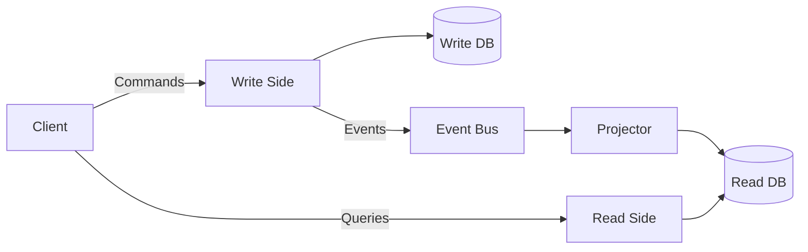
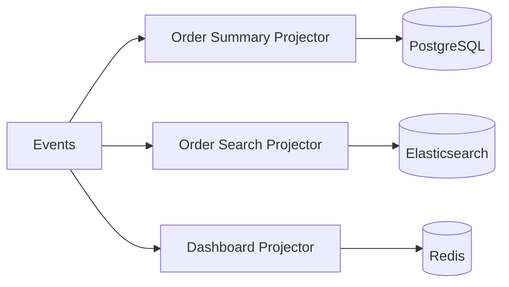
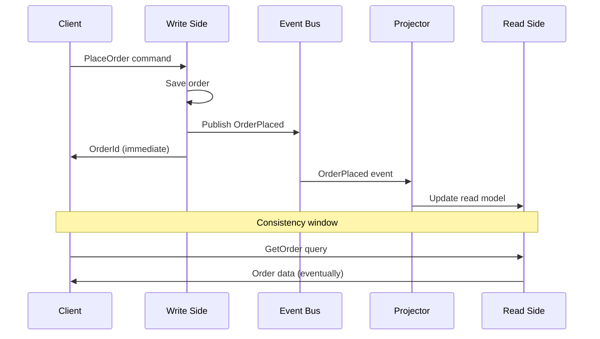
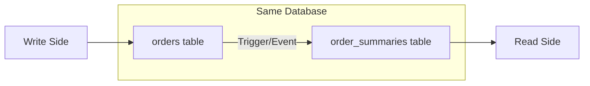
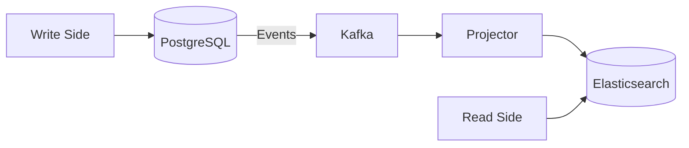
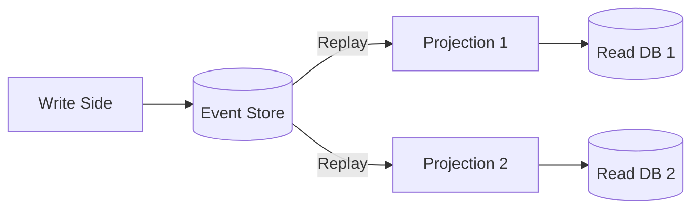
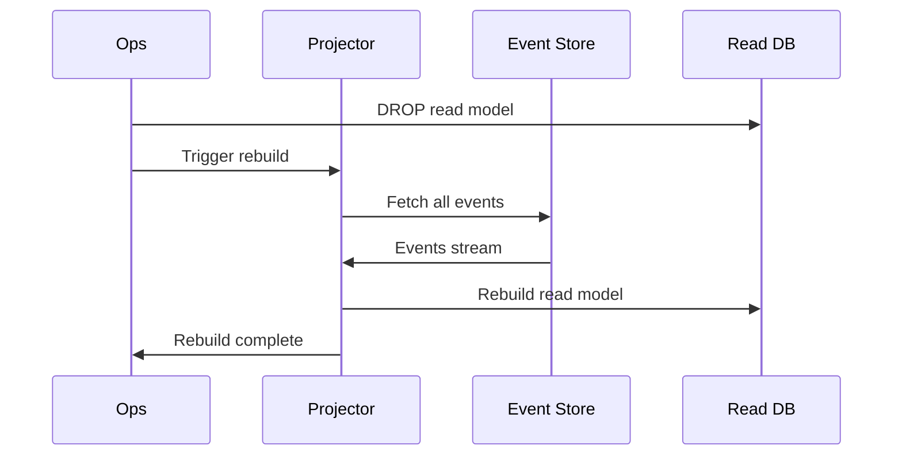

# CQRS — Deep Dive

> **Level:** Intermediate  
> **Pre-reading:** [04 · Event-Driven Architecture](04-event-driven.md) · [03.03 · Data Management Patterns](03.03-data-management-patterns.md)

---

## What is CQRS?

**CQRS** (Command Query Responsibility Segregation) separates the write model from the read model. Each is optimized for its purpose.



---

## Why CQRS?

| Challenge | CQRS Solution |
|:----------|:--------------|
| Read/write optimization conflict | Separate models; optimize each |
| Complex queries across aggregates | Denormalized read models |
| Different scaling needs | Scale read side independently |
| Multiple view requirements | Multiple projections |

### When CQRS Makes Sense

| Good Fit | Poor Fit |
|:---------|:---------|
| High read/write ratio (10:1 or more) | Simple CRUD |
| Complex queries | Single model suffices |
| Different scaling needs | Small scale |
| Multiple read representations | Team unfamiliar with pattern |

---

## CQRS Components

### Command Side (Write Model)

Handles state changes. Focuses on business rules and invariants.

```java
// Command
public record PlaceOrderCommand(
    String customerId,
    List<OrderLineDto> items
) {}

// Command Handler
@Service
public class OrderCommandHandler {
    private final OrderRepository repository;
    private final EventPublisher publisher;
    
    @Transactional
    public OrderId handle(PlaceOrderCommand cmd) {
        // Business logic
        Order order = Order.create(cmd.customerId(), cmd.items());
        order.validate();  // Invariants
        
        // Persist
        repository.save(order);
        
        // Publish event (or via Outbox)
        publisher.publish(new OrderPlaced(order));
        
        return order.getId();
    }
}
```

### Query Side (Read Model)

Handles queries. Optimized for specific read patterns.

```java
// Query
public record GetOrderSummaryQuery(String orderId) {}

// Query Handler
@Service
public class OrderQueryHandler {
    private final OrderReadRepository readRepository;
    
    public OrderSummaryDto handle(GetOrderSummaryQuery query) {
        return readRepository.findSummaryById(query.orderId())
            .orElseThrow(() -> new OrderNotFoundException(query.orderId()));
    }
}
```

### Event Projector

Consumes events and updates read models.

```java
@Component
public class OrderProjector {
    private final OrderReadRepository readRepository;
    
    @EventListener
    public void on(OrderPlaced event) {
        OrderReadModel readModel = new OrderReadModel(
            event.orderId(),
            event.customerId(),
            event.totalAmount(),
            "PLACED",
            event.occurredAt()
        );
        readRepository.save(readModel);
    }
    
    @EventListener
    public void on(OrderShipped event) {
        OrderReadModel model = readRepository.findById(event.orderId());
        model.setStatus("SHIPPED");
        model.setShippedAt(event.occurredAt());
        readRepository.save(model);
    }
}
```

---

## Read Model Strategies

### Single Denormalized Table

Flatten related data into one table for fast queries.

```sql
-- Write side: normalized
orders (id, customer_id, status, created_at)
order_lines (id, order_id, product_id, quantity, price)
customers (id, name, email)
products (id, name, sku)

-- Read side: denormalized
order_summaries (
    order_id,
    customer_name,
    customer_email,
    status,
    total_amount,
    item_count,
    created_at,
    shipped_at
)
```

### Multiple Projections

Different read models for different query patterns.



| Projection | Storage | Use Case |
|:-----------|:--------|:---------|
| **Order Summary** | PostgreSQL | Order detail page |
| **Order Search** | Elasticsearch | Full-text search |
| **Dashboard** | Redis | Real-time metrics |
| **Reporting** | Data warehouse | Analytics |

### Materialized Views

Database-level projections. Simpler but less flexible.

```sql
CREATE MATERIALIZED VIEW order_dashboard AS
SELECT 
    date_trunc('day', created_at) as day,
    status,
    COUNT(*) as order_count,
    SUM(total_amount) as revenue
FROM orders
GROUP BY 1, 2;

-- Refresh periodically or via trigger
REFRESH MATERIALIZED VIEW order_dashboard;
```

---

## Eventual Consistency

Read models are **eventually consistent** with the write model. There's a lag between write and read.



### Handling Consistency Lag

| Strategy | Implementation |
|:---------|:---------------|
| **Optimistic UI** | Show expected state; reconcile later |
| **Read-your-writes** | Query write model for just-created data |
| **Polling** | Client polls until read model updated |
| **WebSocket** | Push notification when projection ready |
| **Timestamps** | Client sends last-known version; wait if stale |

---

## CQRS Implementation Patterns

### Same Database, Different Tables

Simplest approach. Events sync tables in same database.



### Separate Databases

Full separation. Different databases optimized per side.



### CQRS + Event Sourcing

Events are the write model's source of truth. Read models are projections of events.



---

## Rebuilding Projections

Read models can be rebuilt from events. Useful for:

- Fixing bugs in projection logic
- Adding new projections
- Recovery from corruption



### Rebuild Considerations

| Concern | Mitigation |
|:--------|:-----------|
| **Long rebuild time** | Parallel processing; checkpointing |
| **Missing events** | Event store must retain all events |
| **Schema changes** | Event versioning; upcasting |
| **Downtime** | Blue-green read models |

---

## CQRS Without Events

CQRS doesn't require event sourcing. You can sync read models via:

| Method | Description |
|:-------|:------------|
| **Database triggers** | Trigger updates read table on write |
| **Scheduled sync** | Periodic job syncs data |
| **Change Data Capture** | Debezium captures changes |
| **Application-level** | Code updates both models |

```java
// Application-level sync (simpler, but coupled)
@Transactional
public void placeOrder(PlaceOrderCommand cmd) {
    Order order = Order.create(cmd);
    writeRepository.save(order);
    
    // Update read model in same transaction
    OrderSummary summary = OrderSummary.from(order);
    readRepository.save(summary);
}
```

---

## CQRS Trade-offs

| Benefit | Cost |
|:--------|:-----|
| Optimized read performance | Two models to maintain |
| Independent scaling | Eventual consistency |
| Flexible query patterns | Increased complexity |
| Right storage per use case | More infrastructure |
| Audit-friendly | Steeper learning curve |

---

## CQRS in Spring Boot

```java
// Command side
@RestController
@RequestMapping("/orders")
public class OrderCommandController {
    private final OrderCommandHandler handler;
    
    @PostMapping
    public ResponseEntity<OrderIdResponse> placeOrder(@RequestBody PlaceOrderRequest request) {
        OrderId id = handler.handle(request.toCommand());
        return ResponseEntity.created(URI.create("/orders/" + id)).body(new OrderIdResponse(id));
    }
}

// Query side
@RestController
@RequestMapping("/orders")
public class OrderQueryController {
    private final OrderQueryHandler handler;
    
    @GetMapping("/{id}")
    public OrderSummaryDto getOrder(@PathVariable String id) {
        return handler.handle(new GetOrderSummaryQuery(id));
    }
    
    @GetMapping("/search")
    public List<OrderSummaryDto> search(@RequestParam String q) {
        return handler.handle(new SearchOrdersQuery(q));
    }
}
```

---

??? question "When should you use CQRS?"
    Use CQRS when: (1) Read/write ratio is high (10:1+). (2) You need complex queries across multiple aggregates. (3) Read and write have different scaling needs. (4) You need multiple read representations (list, search, dashboard). Avoid CQRS for simple CRUD or when the team is unfamiliar with eventual consistency.

??? question "How do you handle eventual consistency in CQRS?"
    (1) **Optimistic UI**: Show expected state immediately; reconcile if different. (2) **Polling**: Client polls read side until updated. (3) **WebSocket**: Push notification when projection complete. (4) **Read-your-writes**: For just-created entities, query write side directly. (5) **Accept it**: Many use cases tolerate slight delay.

??? question "Do you need event sourcing to use CQRS?"
    No. CQRS separates read and write models — that's independent of how you persist writes. You can use CQRS with a traditional relational database and sync read models via triggers, CDC, or application code. Event sourcing is complementary but optional.


---

## 📝 Knowledge Check

<quiz>
CQRS separates write and read models. What's the *simplest* valid form of CQRS — and when must you go to separate databases?
- [ ] Always separate databases — that's the definition
- [x] Same database, different optimized paths/tables: commands hit normalized write tables; queries hit denormalized read tables or views. Separate databases are needed when read/write must scale independently, use different engines (OLTP + Elasticsearch), or have different availability/consistency requirements
- [ ] CQRS requires event sourcing
- [ ] CQRS is only for reads

CQRS is a *model* split before it's an *infrastructure* split. Most teams benefit from separating command handlers (invariant-enforcing writes) from query handlers (denormalized, join-free reads) in one DB. Splitting stores adds replication/projection pipelines — do it for concrete needs (search engine, independent scaling), not because the pattern's diagram shows two cylinders.
</quiz>
<quiz>
A report needs 'orders with customer name and last payment status.' Three options — rank them for a hot dashboard query.
- [ ] Join at query time — always freshest
- [x] Best for a hot dashboard: a materialized read model fed by events (pre-joined, indexed for the query). API composition is OK for low-QPS admin views; live joins across service DBs are the worst — coupling plus latency under load
- [ ] API composition — call all three services every dashboard load
- [ ] Cron job exporting CSVs nightly

dashboards are read-hot and latency-sensitive: precompute. The event-fed projection pays its cost at write time (subscribe, denormalize) so reads are single-table scans. Live composition multiplies tail latency and availability requirements (3 services up for 1 page). The projection's cost: lag tolerance and a rebuild path when logic changes.
</quiz>
<quiz>
Your read-model projector crashes for 3 hours. What does recovery require?
- [ ] Nothing — it picks up where it left off
- [x] Replay capability: the projection must be rebuildable from events (reprocess from last checkpoint or re-read from offset zero), plus monitoring that alerts on projection lag — and if events are only retained N days, a snapshot/seed path or longer retention for rebuilds
- [ ] Restore the read DB from backup
- [ ] Re-run the commands manually

'rebuildable projection' is a hard requirement, not a nicety: projector bugs, schema changes, and outages all demand replay. That means events must be durable and retained long enough (or snapshotted), checkpoints stored, and lag alerting in place — a projector that can't replay is a single point of unrecoverable divergence.
</quiz>
<quiz>
When is CQRS a *poor* fit — i.e., when does it add complexity without payoff?
- [ ] Always worth it
- [x] Simple CRUD domains where read and write shapes are nearly identical, low query complexity, and teams lack event-driven maturity — you gain two models, projection lag, and rebuild ops for a system that was a JOIN away from done
- [ ] High-traffic systems
- [ ] Systems with audit requirements

CQRS's bill: two models to evolve, eventual consistency UX, projector operations, rebuild tooling. It pays when reads/writes genuinely diverge (complex queries vs. invariant-heavy writes, independent scaling, different stores). On a CRUD app it's ceremony — the litmus test: 'do my query needs actually hurt the write model?' If not, a well-indexed table wins.
</quiz>
<quiz>
'CQRS without events' — what does that look like, and what limitation does it keep?
- [ ] Impossible — CQRS is events
- [x] Separate write and read paths over the same database: command handlers write normalized tables; query handlers read views/denormalized tables maintained synchronously (same transaction) or via DB mechanisms. You get model separation benefits, but reads/writes still share one store's scaling and schema-coupling limits
- [ ] It means no commands either
- [ ] It's just REST naming

synchronous read-model updates in the same transaction remove the lag problem entirely — a very pragmatic middle ground. What you don't get: independent scaling of read/write infrastructure, different storage engines per side, or event history for replay. Choose it when the win is 'clean model split' rather than 'independent scalability.'
</quiz>