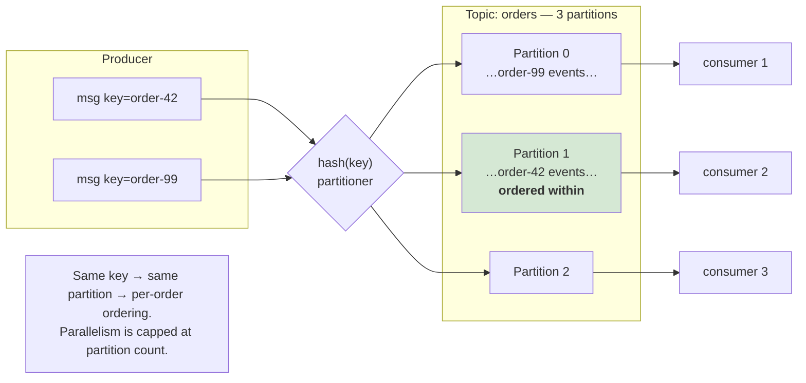
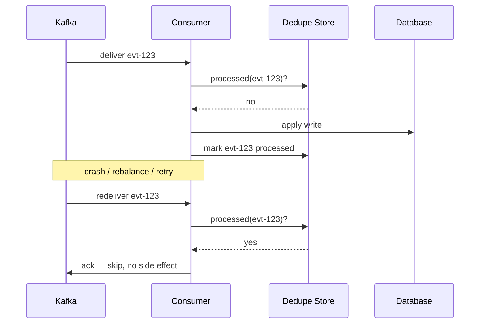
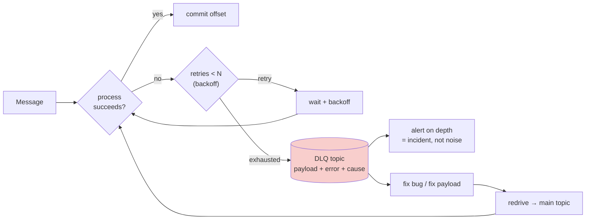
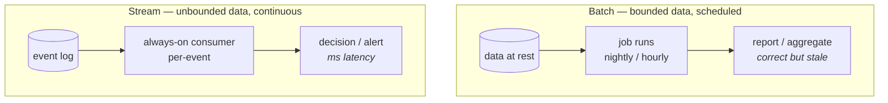

# Messaging Patterns — Deep Dive

> **Level:** Intermediate
> **Pre-reading:** [04 · Event-Driven Architecture](04-event-driven.md) · [04.02 · Kafka Deep Dive](04.02-kafka-deep-dive.md)

---

## Message Ordering Guarantees

In distributed systems, message order matters. But networks don't guarantee it.

```
Producer sends: [Event1, Event2, Event3]

Network chaos:
  Event2 arrives first
  Event3 arrives second
  Event1 arrives last ← Out of order!

Consumer sees: [Event2, Event3, Event1] ← Wrong order
```

### Kafka Ordering Guarantees

| Scope | Guarantee | How |
|:------|:-----------|:----|
| **Within one partition** | Messages ordered | Kafka appends to single log; offset increases monotonically |
| **Across partitions** | No guarantee | Different partitions = different brokers; no global ordering |
| **Consumer group** | Each partition → exactly one consumer in group | One consumer per partition preserves order |



### Ensuring Message Order

**Solution: Use partition key to route related messages to same partition.**

```java
// Spring Kafka
@RestController
public class OrderController {
    
    @Autowired
    private KafkaTemplate<String, OrderEvent> kafkaTemplate;
    
    @PostMapping("/orders")
    public Order createOrder(@RequestBody OrderRequest request) {
        Order order = saveOrder(request);
        
        // Send events; use orderId as partition key
        // All events for order-123 go to partition 0 → preserved order
        kafkaTemplate.send(
            new ProducerRecord<>(
                "order-events",
                order.getId(),           // Partition key
                new OrderCreatedEvent(order)
            )
        );
        
        return order;
    }
}
```

**Effect:**
```
orderId=ORD-123 → Partition 0
orderId=ORD-124 → Partition 1
orderId=ORD-125 → Partition 0

Partition 0 events:
  [ORD-123 created, ORD-123 paid, ORD-123 shipped]  ← Ordered within partition
```

---

## Idempotency (Exactly-Once Semantics)

**Problem:** At-least-once delivery means events might arrive twice.

```
Timeline:
  Producer sends OrderConfirmed event
  Consumer processes: updates database, sends email
  Network hiccup; Kafka doesn't receive ack from consumer
  Kafka retries: same event arrives again
  Consumer processes AGAIN: duplicate email sent ✗
```

### Solution: Idempotency Key

Every event has a **unique ID**. Consumer deduplicates using it.

```java
public class OrderConfirmedEvent {
    public String eventId;        // Unique per event
    public String orderId;
    public LocalDateTime timestamp;
}

@RestController
public class OrderConsumer {
    
    @Autowired
    private ProcessedEventRepository processedEvents;
    
    @KafkaListener(topics = "order-confirmed")
    public void handleOrderConfirmed(OrderConfirmedEvent event) {
        // Idempotency check
        if (processedEvents.exists(event.eventId)) {
            log.info("Already processed event {}", event.eventId);
            return;  // Idempotent; safe to skip
        }
        
        // Process
        Order order = orderRepository.findById(event.orderId).orElseThrow();
        sendConfirmationEmail(order);
        
        // Record that we processed this event
        processedEvents.save(new ProcessedEvent(event.eventId));
    }
}
```

### Idempotency Strategies

| Strategy | Pros | Cons |
|:---------|:-----|:-----|
| **Event ID + dedup table** | Guaranteed dedup | Requires database lookup per event |
| **Event ID + cache (Redis)** | Fast dedup; TTL cleanup | Risk of eviction; memory overhead |
| **Natural idempotency** (see below) | No dedup needed | Not all operations are naturally idempotent |

### Natural Idempotency

Some operations are naturally idempotent: calling them multiple times has same effect as once.

```java
// IDEMPOTENT: "Confirm order 123"
updateOrderStatus(order123, CONFIRMED);  // Idempotent; status stays CONFIRMED

// NOT IDEMPOTENT: "Increment order count"
order.count++;                             // First call: count=5; second call: count=6 ✗

// IDEMPOTENT: "Set order count to 5"
order.count = 5;                           // First call: count=5; second call: count=5 ✓
```

---



## Dead Letter Queue (DLQ)

**Problem:** Some messages fail processing forever (e.g., malformed JSON, missing dependency).

```
Timeline:
  Consumer receives event with malformed data
  Tries to deserialize → error
  Retries 3x → still fails
  Message buried in Kafka offset; never processed again ✗
```

### Solution: Route Failures to DLQ

```java
@RestController
public class OrderConsumer {
    
    @Autowired
    private KafkaTemplate<String, OrderEvent> kafkaTemplate;
    
    @KafkaListener(topics = "orders")
    public void handleOrder(OrderEvent event) {
        try {
            // Process order
            Order order = buildOrder(event);
            repository.save(order);
        } catch (Exception e) {
            log.error("Failed to process order event {}", event, e);
            
            // Send to DLQ for manual inspection
            kafkaTemplate.send("orders.dlq", event);
        }
    }
}
```

### DLQ Monitoring

```java
@RestController
public class DLQMonitor {
    
    @KafkaListener(topics = "orders.dlq")
    public void monitorDLQ(OrderEvent event) {
        // Alert ops team
        alerting.send(
            "Order DLQ received message: " + event.orderId +
            "\nReason: " + extractErrorFromHeader()
        );
        
        // Quarantine in separate database for manual review
        dlqRepository.save(new QuarantinedMessage(event));
    }
}
```

---



## Message Ordering + Idempotency Combined

Real-world scenario: need both ordering AND at-least-once delivery.

```java
@Component
public class OrderEventProcessor {
    
    @Autowired
    private KafkaTemplate<String, OrderEvent> kafkaTemplate;
    
    @Autowired
    private ProcessedEventRepository processedEvents;
    
    @Autowired
    private OrderRepository orderRepository;
    
    @KafkaListener(topics = "order-events")
    public void handleOrderEvent(OrderEvent event) {
        // 1. Idempotency check
        if (processedEvents.exists(event.eventId)) {
            log.info("Skipping duplicate event {}", event.eventId);
            return;
        }
        
        try {
            // 2. Process
            processEvent(event);
            
            // 3. Record as processed (inside transaction with business logic)
            processedEvents.save(new ProcessedEvent(event.eventId));
            
        } catch (RetryableException e) {
            // Transient failure; Kafka will retry
            throw e;
        } catch (Exception e) {
            // Non-retryable; send to DLQ
            kafkaTemplate.send("order-events.dlq", event);
            processedEvents.save(new ProcessedEvent(event.eventId));
        }
    }
    
    private void processEvent(OrderEvent event) {
        if (event instanceof OrderCreatedEvent) {
            Order order = new Order(event.orderId);
            orderRepository.save(order);
        } else if (event instanceof OrderPaidEvent) {
            Order order = orderRepository.findById(event.orderId)
                .orElseThrow(() -> new OrderNotFoundException());
            order.status = OrderStatus.PAID;
            orderRepository.save(order);
        }
    }
}
```

**Key design:**

- Partition key = orderId → preserves order per order
- Idempotency key (eventId) + dedup table → prevents duplicates
- DLQ for poison messages
- Transactional processing → dedup record saved with business data

---

## Batch Processing vs Stream Processing

| Aspect | Batch | Stream |
|:-------|:------|:--------|
| **Trigger** | Time-based (hourly) or size-based (1000 msgs) | Every message immediately |
| **Latency** | High (1+ hour) | Low (milliseconds) |
| **Throughput** | High (efficient batching) | Lower per-message |
| **Example** | Daily reconciliation | Real-time fraud detection |

### Batch Example

```java
@Component
public class OrderBatchProcessor {
    
    @Scheduled(cron = "0 0 * * * *")  // Every hour
    public void processOrdersBatch() {
        // Fetch 1000 orders from Kafka (batch)
        List<OrderEvent> batch = kafkaConsumer.poll(
            Duration.ofSeconds(10),
            maxRecords = 1000
        );
        
        // Process in bulk
        List<Order> orders = batch.stream()
            .map(this::buildOrder)
            .collect(Collectors.toList());
        
        orderRepository.saveAll(orders);  // Bulk insert
    }
}
```

### Stream Example

```java
@Component
public class OrderStreamProcessor {
    
    @KafkaListener(topics = "orders")
    public void processOrderStream(OrderEvent event) {
        // Process immediately
        Order order = buildOrder(event);
        orderRepository.save(order);
        
        // Publish downstream
        eventPublisher.publish(new OrderConfirmedEvent(order));
    }
}
```

---



## Consumer Group Coordination

Multiple consumers processing same topic; need to distribute partitions.

```
Topic: orders (4 partitions)

Scenario 1: 1 consumer
  Consumer 1 → Partition 0, 1, 2, 3 (handles all)

Scenario 2: 2 consumers
  Consumer 1 → Partition 0, 1
  Consumer 2 → Partition 2, 3 (rebalancing occurs)

Scenario 3: Consumer 1 crashes
  Rebalancing: partitions redistribute to healthy consumers
```

### Rebalancing Tuning

```java
@Bean
public ConsumerFactory<String, OrderEvent> consumerFactory() {
    Map<String, Object> props = new HashMap<>();
    props.put(ConsumerConfig.BOOTSTRAP_SERVERS_CONFIG, "kafka:9092");
    props.put(ConsumerConfig.GROUP_ID_CONFIG, "order-service");
    
    // Rebalancing behavior
    props.put(ConsumerConfig.SESSION_TIMEOUT_MS_CONFIG, 30000);
    props.put(ConsumerConfig.HEARTBEAT_INTERVAL_MS_CONFIG, 10000);
    props.put(ConsumerConfig.MAX_POLL_INTERVAL_MS_CONFIG, 300000);
    
    return new DefaultKafkaConsumerFactory<>(props);
}
```

| Config | Default | Tuning |
|:-------|:--------|:--------|
| **session.timeout.ms** | 30s | Increase for slow processing (max 5min) |
| **heartbeat.interval.ms** | 3s | Set to 1/3 of session timeout |
| **max.poll.interval.ms** | 5min | Increase if processing one message takes > 5min |

---

??? question "How do I choose between Kafka topics vs RabbitMQ queues?"
    Kafka: Event streaming, replay, multiple consumers. RabbitMQ: Work queues, task distribution, simpler setup. For microservices events, Kafka. For job processing, RabbitMQ.

??? question "What happens if a consumer can't keep up with message rate?"
    Consumer lag increases (offset falls behind latest). Monitor with Kafka metrics `consumer_lag`. If persistent, scale up consumer instances or optimize processing logic.

??? question "Is exactly-once processing possible in Kafka?"
    Kafka guarantees at-least-once delivery out of the box. Exactly-once requires idempotent processing (dedup key) + transactional writes. Not supported by Kafka itself; implement in application.


---

## 📝 Knowledge Check

<quiz>
A consumer is deployed twice (2 instances) on one consumer group. Both receive the same `OrderPaid` and double-credit the customer. What two-layer fix is needed?
- [ ] Run only one consumer instance
- [x] (1) Ordering/distribution is fine — the group ensures each partition goes to one instance; the real issue is REDELIVERY (rebalance, retry, offset-not-committed). Fix: idempotent processing — dedupe on the event's unique ID (store processed IDs / upsert by natural key so the second arrival no-ops)
- [ ] Use two consumer groups so each gets its own copy
- [ ] Switch to synchronous REST

note the subtlety in the scenario: two instances in *different* groups each get a copy (by design for independent consumers); within one group, duplicates come from redelivery, not double-assignment. Either way, 'exactly once' is implemented as at-least-once + idempotency. Two consumer groups is the *correct* pattern when two different consumers want the same event — that's fan-out, not duplication.
</quiz>
<quiz>
Where should a poison message (always fails deserialization) go, and what should trigger it?
- [ ] Retry forever — it might work eventually
- [x] The Dead Letter Queue: after N failed attempts (bounded retries with backoff), route it to a DLQ topic with the original payload + error metadata, alert on DLQ depth, and have a replay/redrive path after the bug is fixed — one poison message must never block the partition behind it
- [ ] Delete it — it's malformed
- [ ] Log and continue silently

a poison message retried forever is a partition-level DoS: the consumer can't commit past it, the group stalls, lag grows. Bounded retry → DLQ keeps the stream moving. Then DLQ handling is operational: monitor depth (any growth = incident), keep payloads inspectable, and redrive after the fix — silent dropping loses business events invisibly.
</quiz>
<quiz>
How do ordering and idempotency interact when a consumer processes events for a single order?
- [ ] They're independent concerns
- [x] Idempotency handles 'the same event twice' but NOT 'events in the wrong order' — `OrderCancelled` processed before `OrderPaid` needs *state-aware* handling (check current state, or buffer until predecessor seen, or version-guard: ignore events with seq < last applied). Keyed partitioning gives order; idempotency + state checks give safety when it fails
- [ ] Idempotency also fixes ordering
- [ ] Sort everything by timestamp

dedupe-by-ID catches redelivery, but a redelivered *older* event arriving after a newer one can rewind state ('Paid' re-applied over 'Cancelled'). Defenses: store last-applied sequence/version per aggregate and drop stale events, or model handlers as a state machine where illegal transitions are held/rejected. Partitioning by key minimizes but can't eliminate disorder from retries and rebalances.
</quiz>
<quiz>
Batch vs stream processing for 'fraud scoring on transactions': when is each right?
- [ ] Always stream — batch is legacy
- [x] Stream: when scoring must be real-time (block/flag before settlement) — continuous processing with per-event latency. Batch: acceptable for next-day risk reports, reconciliation, model retraining — simpler, cheaper, easier backfills. The deciding factor is the business latency requirement, not fashion
- [ ] Batch for fraud, stream for reporting
- [ ] They're the same throughput

the question is 'how stale can the decision be?' Pre-authorization fraud checks need stream latency (ms); nightly risk aggregation is fine as batch. Streaming costs: always-on infrastructure, complex windowing/exactly-once concerns, harder debugging. Batching costs: staleness. Many systems run both — stream for the decision path, batch for the analytics path.
</quiz>
<quiz>
Your consumer commits offsets, THEN processes messages ('commit-then-process'). What failure did you just sign up for?
- [ ] Duplicates
- [x] Message loss: crash after commit but before processing → the offset says 'done,' the work never happened — at-most-once semantics. The safe default for data you can't lose is process-then-commit (at-least-once) plus idempotent handling; commit-then-process is only acceptable where losing messages is cheaper than duplicating them
- [ ] Nothing — it's faster
- [ ] Rebalancing stops working

offset-commit ordering defines your guarantee: commit first = at-most-once (loss possible), process first = at-least-once (duplicates possible). There's no third option without transactions. For anything business-critical, take duplicates + idempotency over loss — a duplicate is detectable and correctable; a vanished message is invisible.
</quiz>