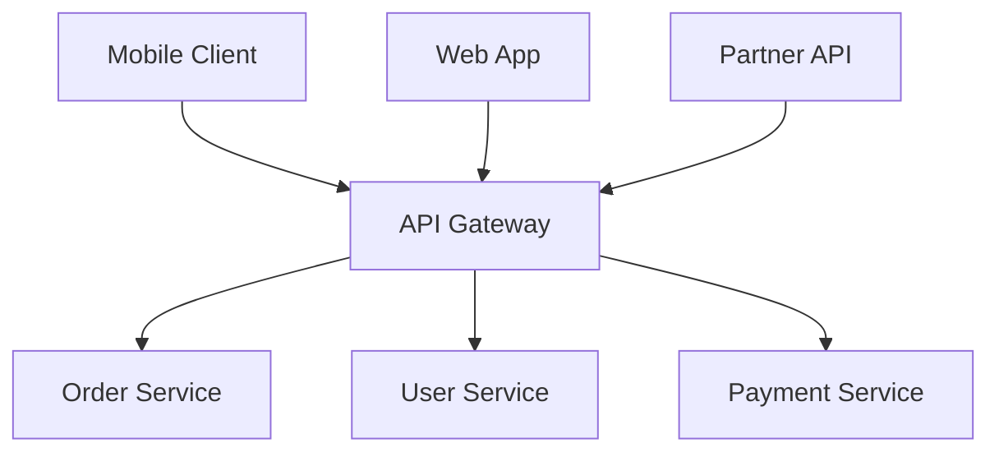
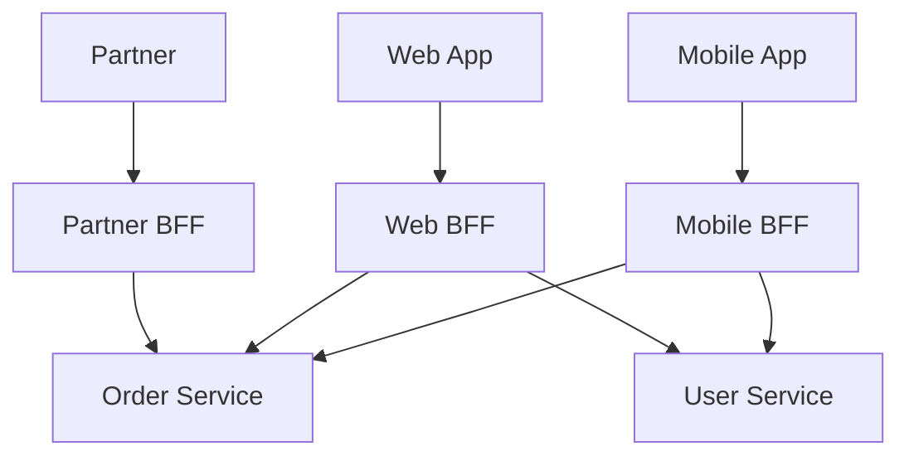

# API & Communication

> How services talk to each other and to the outside world. Choice of protocol shapes your entire system design.

## Communication Protocol Overview

| Protocol | Style | Best For |
|:----------|:-------|:---------|
| **REST** | Request/Response over HTTP | External APIs, browser clients, simplicity |
| **gRPC** | Binary RPC over HTTP/2 | Internal service-to-service, high throughput |
| **GraphQL** | Query language over HTTP | Complex frontends with varied data needs |
| **Messaging (Kafka/SQS)** | Async event streaming | Decoupled workflows, high volume |
| **WebSocket** | Persistent bidirectional connection | Real-time: chat, live dashboards |

## REST

| Concept                 | Description                                                                                       |
|:------------------------|:--------------------------------------------------------------------------------------------------|
| **Richardson Maturity** | Level 0: HTTP tunnel · Level 1: Resources · Level 2: HTTP verbs + status codes · Level 3: HATEOAS |
| **HATEOAS**             | Responses include links to next actions; true REST; rarely implemented                            |
| **Idempotency**         | GET, PUT, DELETE are idempotent; POST is not                                                      |
| **Status codes**        | 2xx success · 3xx redirect · 4xx client error · 5xx server error                                  |

→ **[Deep Dive: REST](05.01-rest-deep-dive.md)** — Richardson Maturity, HATEOAS, versioning, idempotency

### API Versioning Strategies

| Strategy                | Example                               | Pros / Cons                  |
|:------------------------|:--------------------------------------|:-----------------------------|
| **URI Path**            | `/api/v1/orders`                      | Simple, visible; not RESTful |
| **Header**              | `Accept: application/vnd.api.v1+json` | RESTful; less discoverable   |
| **Query Param**         | `/orders?version=1`                   | Easy to test; caching issues |
| **Content Negotiation** | `Accept: application/json;version=2`  | Clean; complex to implement  |

## gRPC

| Concept              | Description                                                                         |
|:---------------------|:------------------------------------------------------------------------------------|
| **Protocol Buffers** | Binary serialization; strongly typed schema; code generation for all languages      |
| **HTTP/2**           | Multiplexed streams; lower latency and overhead than HTTP/1.1                       |
| **Streaming types**  | Unary (1 req, 1 res) · Server streaming · Client streaming · Bidirectional          |
| **Use case**         | Internal service-to-service; high throughput; polyglot environments                 |
| **Trade-offs**       | Less debuggable than REST; browsers need grpc-web proxy; requires schema management |

→ **[Deep Dive: gRPC](05.02-grpc.md)** — Protocol Buffers, HTTP/2, streaming types, when to use

## GraphQL

| Concept             | Description                                                                   |
|:--------------------|:------------------------------------------------------------------------------|
| **Schema**          | Strongly typed; defines Queries, Mutations, Subscriptions                     |
| **Single endpoint** | `POST /graphql`; client specifies exact data shape                            |
| **N+1 Problem**     | Nested resolvers each trigger individual DB queries — performance killer      |
| **DataLoader**      | Batching and caching solution for N+1; groups queries into one                |
| **Introspection**   | Schema is self-documenting; disable in production                             |
| **Use case**        | Complex frontends with varied clients; BFF replacement; rapidly evolving APIs |

→ **[Deep Dive: GraphQL](05.03-graphql.md)** — Schema, N+1 problem, DataLoader, when GraphQL beats REST

## API Gateway

**Responsibilities:**

| Concern               | What Gateway Does                                       |
|:----------------------|:--------------------------------------------------------|
| **Routing**           | Path-based, header-based, method-based routing          |
| **Authentication**    | Validate JWT / API key before forwarding                |
| **Rate Limiting**     | Per-client throttling; return 429 Too Many Requests     |
| **SSL Termination**   | TLS at gateway; plain HTTP to internal services         |
| **Request Transform** | Add/remove/rewrite headers; request shaping             |
| **Caching**           | Cache idempotent GET responses                          |
| **Load Balancing**    | Round-robin, least connections across service instances |
| **Observability**     | Centralized access logs, metrics per route              |

**Tools:** Kong, AWS API Gateway, Spring Cloud Gateway, Nginx, Envoy, Traefik

→ **[Deep Dive: API Gateway](05.04-api-gateway.md)** — Routing, auth, rate limiting, aggregation patterns

## Backend for Frontend (BFF)

**Problem:** One generic API cannot optimally serve mobile, web, and partner clients simultaneously.

**Solution:** A separate gateway per client type, each tailored to that client's data shape, auth flow, and performance needs.

| Benefit                                | Cost                              |
|:---------------------------------------|:----------------------------------|
| Each BFF tailored to its client        | More services to own and deploy   |
| Reduces over-fetching / under-fetching | Logic duplication if not careful  |
| Teams own their BFF end-to-end         | Coordination when backend changes |

→ **[Deep Dive: BFF Pattern](05.05-bff-pattern.md)** — Per-client backends, ownership models, trade-offs

## Service Mesh

| Component              | Description                                                          |
|:-----------------------|:---------------------------------------------------------------------|
| **Data Plane**         | Envoy sidecar proxies injected alongside every service pod           |
| **Control Plane**      | Istiod (Istio) — distributes config to all sidecars                  |
| **VirtualService**     | Traffic routing rules: canary splits, fault injection, retries       |
| **DestinationRule**    | Load balancing policy, circuit breaking, mTLS settings               |
| **PeerAuthentication** | Enforce mutual TLS between services                                  |
| **Observability**      | Automatic metrics, distributed traces, access logs — no code changes |

**When to use:** Mature microservices with many services needing consistent security, observability, and traffic management. Overhead not worth it for < 5 services.

→ **[Deep Dive: Service Mesh](05.06-service-mesh.md)** — Istio, Envoy, mTLS, traffic management

## Sync vs Async — Decision Guide

| Factor                  | Choose Synchronous               | Choose Asynchronous                        |
|:------------------------|:---------------------------------|:-------------------------------------------|
| **Response needed now** | Yes                              | No                                         |
| **Failure isolation**   | Low — cascades                   | High — producer continues                  |
| **Temporal coupling**   | Required                         | Not required                               |
| **Throughput**          | Bounded by slowest service       | High; consumers scale independently        |
| **Example**             | User login, payment confirmation | Order processing, notifications, analytics |

---

## API Versioning & Evolution

As APIs change, clients depend on old contracts. Versioning lets you evolve APIs without breaking clients.

| Strategy | Example | Pros | Cons |
|:---------|:--------|:-----|:-----|
| **Backward Compatibility** | Add optional fields; never remove | No versioning overhead | Limited flexibility |
| **URL Path Versioning** | `/api/v1/` vs `/api/v2/` | Explicit; easy to route | Duplication; operational overhead |
| **Deprecation Headers** | `Deprecation: true`, `Sunset: Date` | Standards-based; gives clients notice | Clients must read headers |

**Best practice:** Default to backward compatibility (add optional fields). Only version when you must break clients.

→ **[Deep Dive: API Versioning & Evolution](05.07-api-versioning-and-evolution.md)** — Backward-compatible changes, deprecation strategies, multi-version support, monitoring version usage

---

## Configuration Management

Configuration (DB URLs, API keys, feature flags) must be separate from code.

| Aspect | Best Practice |
|:-------|:--------------|
| **Secrets** | External secrets manager (AWS Secrets Manager, Vault); never in Git |
| **Non-secret config** | Environment variables or Spring Cloud Config Server |
| **Feature flags** | External service (LaunchDarkly, Split.io) for gradual rollout |
| **Environment-specific** | Profiles: application.yml, application-prod.yml, application-dev.yml |

→ **[Deep Dive: Configuration Management](09.08-configuration-management.md)** — Spring Cloud Config, environment profiles, secrets managers, feature flags

---

## 📝 Knowledge Check

<quiz>
Service A calls B calls C calls D synchronously. Each has 99.9% availability. What's the chain's availability, and what's the architectural lesson?
- [ ] 99.9% — availability doesn't compound
- [x] ~99.6% (0.999⁴) and worse in practice — every synchronous hop multiplies failure probability and adds tail latency; deep sync call chains are distributed monoliths. Lesson: shorten sync chains, use async/events where the interaction doesn't need an immediate answer, and apply timeouts + circuit breakers on every hop you keep
- [ ] 100% — retries fix it
- [ ] It depends on the load balancer

sync coupling compounds availability and latency: the chain is only as available as the product of its links, and its P99 is the sum of P99s plus stragglers. Async decoupling ('does the caller need the answer now, or just eventually?') is the lever; where sync is truly needed, protect each hop deliberately.
</quiz>
<quiz>
REST vs gRPC vs GraphQL for: (a) high-frequency internal service-to-service calls, (b) a public API for unknown third-party devs, (c) a mobile app whose screens vary widely?
- [ ] REST for everything
- [x] (a) gRPC — binary, schema-first, streaming, low overhead for internal RPC; (b) REST — ubiquitous tooling, caching, and ecosystem for external consumers; (c) GraphQL or BFF — client-driven field selection avoids over/under-fetching across diverse screens
- [ ] GraphQL for everything
- [ ] gRPC for the public API — it's fastest

match the protocol to the consumer: gRPC wins inside your trust boundary (contracts, perf, streaming); REST wins at the open boundary (universal clients, HTTP caching, familiarity); GraphQL/BFF wins when one backend serves divergent client shapes. The mistake is treating it as a fashion choice rather than 'who consumes this and what do they need?'
</quiz>
<quiz>
What should an API gateway own vs. what should stay in services?
- [ ] Everything at the gateway — centralize
- [x] Gateway: cross-cutting edge concerns — routing, authN token validation, global rate limiting, TLS termination, request logging. Services: all business logic, authZ decisions scoped to the domain, and their own resilience (per-dependency timeouts/breakers — the gateway can't know your dependency's semantics)
- [ ] AuthZ at the gateway for everything
- [ ] Services shouldn't validate tokens if the gateway does

gateway = generic policy, services = domain decisions. Coarse 'is this token valid' at the edge; fine-grained 'may this user view *this* order' in the service (defense in depth — a bypassed gateway shouldn't open everything). Business rules at the gateway recreate the ESB anti-pattern.
</quiz>
<quiz>
When is a BFF the wrong answer?
- [ ] Never — more layers, more decoupling
- [x] When a team adds a BFF 'because Netflix does it' but there's only one client, or the BFF becomes a dumping ground for business logic that belongs in domain services — each BFF is another service to deploy, secure, monitor, and version; the justification must be real per-client divergence
- [ ] When you have two clients
- [ ] When using GraphQL

BFF is an answer to *client divergence*, not a default layer. One client = pointless indirection. And watch the gravity well: BFFs accumulate 'just one more rule' until pricing logic lives in the mobile BFF where the web team can't see it — BFFs transform and aggregate; they don't decide.
</quiz>
<quiz>
Service mesh vs API gateway — a new engineer uses them interchangeably. Correct them.
- [ ] They're the same product category
- [x] Gateway = north-south: traffic crossing the edge between outside clients and your system (auth, routing, rate limits at the perimeter). Mesh = east-west: service-to-service traffic inside (mTLS, retries, telemetry between workloads). They overlap on features but answer different questions — many systems run both
- [ ] The mesh replaces the gateway always
- [ ] Gateways are only for monoliths

direction of traffic is the distinction: edge policy vs. internal transport policy. Modern meshes can do ingress (Istio ingress gateway) blurring the line, but the conceptual split remains: who is this traffic and what's being enforced on it? Edge needs WAF/auth/quota semantics; internal needs identity, observability, and safe retries.
</quiz>