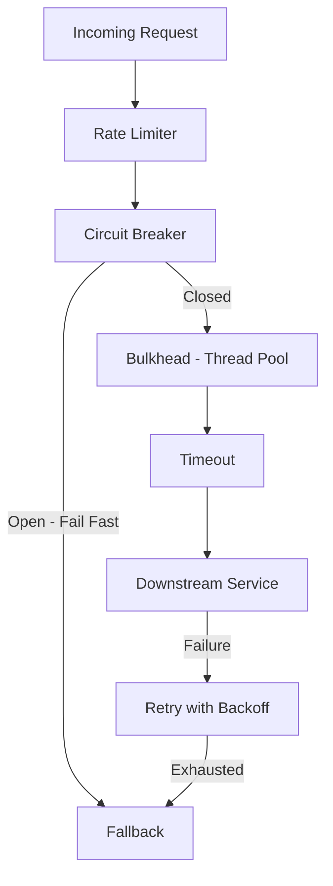
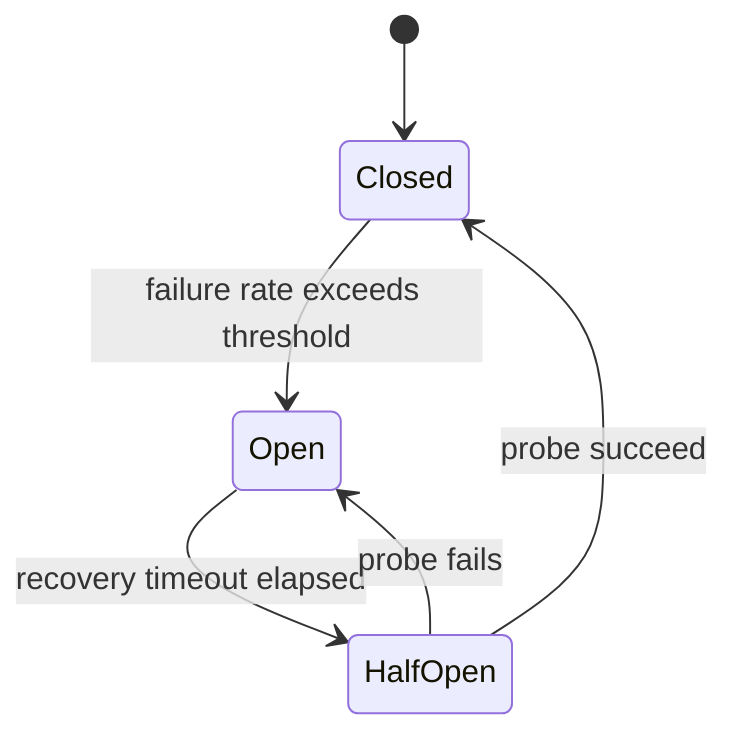

# Resilience & Reliability

> In distributed systems, failure is not an exception — it's the norm. Design for it explicitly.

---

## Resilience Patterns Overview

---

## Circuit Breaker

**States:**

| State | Behavior | Transition |
|-------|---------|-----------|
| **Closed** | Requests pass through; failures counted | → Open when threshold exceeded |
| **Open** | All requests fail immediately (fast fail); no calls made | → Half-Open after recovery timeout |
| **Half-Open** | Limited probe requests sent to test recovery | → Closed if success; → Open if fails |

- **Threshold:** Open after N failures or X% error rate in a sliding time window
- **Libraries:** Resilience4j (Spring Boot), Polly (.NET); Hystrix is deprecated
- **Key insight:** Circuit breaker *prevents* cascading failure; retry *recovers* from transient failure

→ **[Deep Dive: Circuit Breaker](06.01-circuit-breaker.md)** — States, thresholds, Resilience4j configuration, fallbacks

---

## Retry Pattern

| Concept                  | Description                                                                                     |
|:-------------------------|:------------------------------------------------------------------------------------------------|
| **Exponential backoff**  | Wait time doubles on each retry: 1s, 2s, 4s, 8s...                                              |
| **Jitter**               | Add random variance to backoff — prevents thundering herd when all clients retry simultaneously |
| **Max retries**          | Always cap retries; uncapped = infinite load on a struggling service                            |
| **Idempotency required** | Only retry operations that are safe to repeat without side effects                              |
| **Retryable errors**     | 503, 429, connection timeout — NOT 4xx client errors                                            |

> **Thundering herd:** All clients retry simultaneously after a failure, causing a traffic spike that re-causes the failure. Jitter solves this.

→ **[Deep Dive: Retry Pattern](06.02-retry-pattern.md)** — Exponential backoff, jitter, idempotency requirements

---

## Bulkhead Pattern

> Isolate resources so a failure in one area cannot exhaust the entire system.

| Type                          | Implementation                                                                           |
|:------------------------------|:-----------------------------------------------------------------------------------------|
| **Thread pool isolation**     | Separate thread pool per downstream dependency; one slow service can't starve all others |
| **Connection pool isolation** | Separate DB/HTTP connection pool per consumer group                                      |
| **Process isolation**         | Separate deployments for critical vs non-critical paths (pricing can't kill checkout)    |

Named after the watertight compartments in a ship hull.

→ **[Deep Dive: Bulkhead Pattern](06.03-bulkhead-pattern.md)** — Thread pool isolation, connection pool isolation, sizing

---

## Timeout Pattern

| Type                     | Description                                                                                      |
|:-------------------------|:-------------------------------------------------------------------------------------------------|
| **Connect timeout**      | Max time to establish a TCP connection                                                           |
| **Read timeout**         | Max time to receive a complete response                                                          |
| **Write timeout**        | Max time to send a request body                                                                  |
| **Deadline propagation** | Pass remaining timeout budget through service call chains (`grpc-timeout`, `X-Request-Deadline`) |

> Always set timeouts. An unconfigured timeout = each thread waiting indefinitely = thread pool exhaustion = service outage.

→ **[Deep Dive: Timeout Pattern](06.04-timeout-pattern.md)** — Connect/read/write timeouts, deadline propagation

---

## Rate Limiting & Throttling

| Algorithm          | How It Works                                                                          | Properties                       |
|:-------------------|:--------------------------------------------------------------------------------------|:---------------------------------|
| **Token Bucket**   | Tokens refill at fixed rate; consume one per request; burst allowed up to bucket size | Smooth average; allows bursts    |
| **Sliding Window** | Count requests in rolling time window                                                 | Precise; more memory             |
| **Fixed Window**   | Count resets at fixed interval                                                        | Simple; allows burst at boundary |
| **Leaky Bucket**   | Requests queued and processed at fixed rate                                           | Smoothest output; no burst       |

- Response: **429 Too Many Requests**
- Response headers: `Retry-After`, `X-RateLimit-Limit`, `X-RateLimit-Remaining`

→ **[Deep Dive: Rate Limiting](06.05-rate-limiting.md)** — Token bucket, sliding window, distributed rate limiting

---

## Fallback Pattern

| Type | Description | Example |
|------|-------------|---------|
| **Default value** | Return sensible constant | Empty product list, default price |
| **Cached response** | Return last known good response | Product details cache |
| **Degraded mode** | Return partial data; skip non-critical sections | Show order without real-time stock |
| **Stub response** | Hardcoded response for maintenance or testing | Feature flag disabled |

---

## Idempotency

| Concept | Description |
|---------|-------------|
| **Idempotent operation** | Call it N times = same result as calling it once |
| **Idempotency key** | Client generates unique UUID per request; server stores it and deduplicates |
| **HTTP verbs** | GET, PUT, DELETE are idempotent by specification; POST is not |
| **Why it matters** | Enables safe retries in at-least-once messaging; prevents duplicate charges |

→ **[Deep Dive: Fallback and Idempotency](06.06-fallback-and-idempotency.md)** — Fallback strategies, idempotency keys, graceful degradation

---

## Health Checks

| Type | Question | Kubernetes Probe |
|------|---------|-----------------|
| **Liveness** | Is the app alive and not deadlocked? | `livenessProbe` — restart pod if fails |
| **Readiness** | Is the app ready to serve traffic? | `readinessProbe` — remove from load balancer if fails |
| **Startup** | Has the app finished its slow initialization? | `startupProbe` — delays liveness/readiness checks |

---

## Backpressure

| Concept | Description |
|---------|-------------|
| **Problem** | Fast producer overwhelms a slow consumer |
| **Solution** | Producer slows down or stops when consumer signals it's overwhelmed |
| **Reactive Streams** | `Publisher`, `Subscriber`, `Subscription` protocol — backpressure built in |
| **Kafka signal** | Monitor consumer lag; alert when partition lag grows unbounded |

---

## Chaos Engineering

| Concept | Description |
|---------|-------------|
| **Steady state** | Define and measure normal behavior before injecting failures |
| **Blast radius** | Start small; inject failure in one pod, one AZ, one service |
| **Fault types** | Kill pods, add network latency, drop packets, exhaust resources |
| **Tools** | Netflix Chaos Monkey, Chaos Toolkit, AWS Fault Injection Simulator, Litmus (K8s) |
| **Goal** | Verify resilience claims before incidents do it for you |

→ **[Deep Dive: Chaos Engineering](06.07-chaos-engineering.md)** — GameDays, fault injection, Chaos Mesh, blast radius control

---

## 📝 Knowledge Check

<quiz>
A downstream service degrades — p99 latency goes from 100ms to 30s but still 'works.' Your service's thread pool is now exhausted. Which patterns would have contained this, in order of defense?
- [ ] Just add more threads
- [x] Timeout first (bound the wait — a 30s response is a failure you refuse to wait for), bulkhead second (isolate dependency calls to a capped pool so the rest of your service keeps running), circuit breaker third (stop calling a known-bad dependency entirely, fail fast, let it recover)
- [ ] Circuit breaker alone — it's the strongest
- [ ] Health checks — they should have caught it

'slow but alive' is the failure naive setups miss: liveness probes pass while the service drowns you. Timeout bounds each call; bulkhead caps how much of YOUR capacity it can consume; breaker stops hammering it. None is sufficient alone — resilience is layered, and each pattern covers a different failure class.
</quiz>
<quiz>
Why does a retry storm make an outage *worse*, and what two retry settings prevent it?
- [ ] Retries help — they're always good
- [x] A struggling dependency receives N×M amplified load (every client retrying at once), deepening the collapse. Prevention: exponential backoff (increasing gaps let it recover) + jitter (randomize so thousands of clients don't retry in synchronized waves) — plus a retry budget and only retrying idempotent operations
- [ ] Retry immediately — faster recovery
- [ ] Fixed 1-second retries are optimal

synchronized retries are a self-inflicted DDoS: all clients time out together, all retry together, the dependency never catches a breath. Jittered exponential backoff decorrelates clients and gives recovery room. Also cap total retries (2–3, not 10) and add a budget ('max 10% of traffic may be retries') so degradation doesn't multiply load.
</quiz>
<quiz>
Fallback vs graceful degradation vs erroring out — when is each right for a product-recommendation call inside checkout?
- [ ] Always fall back to something
- [x] Recommendations are nice-to-have → graceful degradation: skip the module and render checkout without it (a cached/default fallback is second-best if static content is acceptable). Checkout itself must NOT degrade silently — a failed payment call is an honest 5xx + retry path, never a fake success
- [ ] Error the whole checkout if recommendations fail
- [ ] Fallback to last month's cached recommendations always

the design question is 'what's this call's criticality class?' For non-critical enrichments, missing data beats a failed page — but choose the *shape* of degradation deliberately (empty module vs stale cache vs default). For the transaction itself, fake success is the worst outcome — silent degradation on a payment is data corruption, not resilience.
</quiz>
<quiz>
Why is 'make every operation idempotent' a resilience pattern, not just a correctness nicety?
- [ ] It's only about correctness
- [x] Because every resilience mechanism assumes it: retries, timeouts triggering retries upstream, redelivered messages, and client resubmissions all replay operations — non-idempotent ops turn your safety machinery into a corruption machine (double charge, double shipment). Idempotency is what makes retrying safe
- [ ] Idempotency slows systems down
- [ ] It's only for POST endpoints

resilience and idempotency are a package deal: you can't safely retry a non-idempotent op, and distributed systems WILL retry (clients, proxies, brokers, timeouts). Idempotency keys, upsert-by-natural-key, and 'check state before acting' convert 'retry = corruption' into 'retry = harmless re-delivery.'
</quiz>
<quiz>
Chaos engineering in production — what's the minimal safety bar before you inject failure on purpose?
- [ ] A signed waiver
- [x] A defined steady state ('checkout success > 99.5%'), a hypothesis, bounded blast radius (one pod/one AZ/small % of traffic), abort conditions/guardrails that halt the experiment automatically on SLO breach, and business-hours execution with the owning team present — chaos without aborts is just an outage with extra steps
- [ ] Run it at 2 a.m. — least traffic
- [ ] Only in staging — never prod

chaos is an *experiment*: hypothesis → controlled injection → measure steady state → learn. The discipline that separates it from recklessness: minimal blast radius, automated kill-switch on SLO impact, and humans watching. Staging-only chaos finds staging problems — the production-specific failures (real traffic patterns, real data scale) need prod, bounded and guarded.
</quiz>