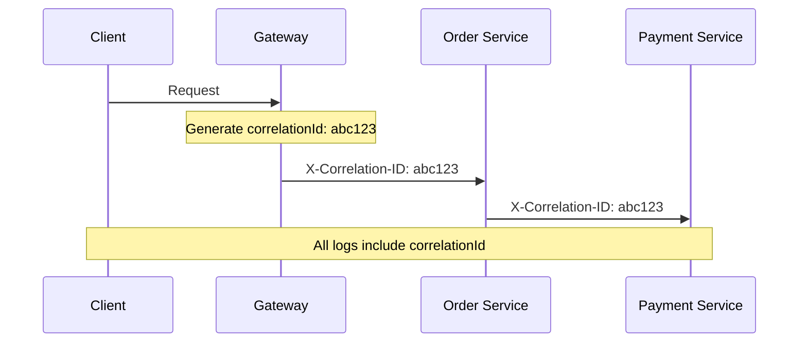
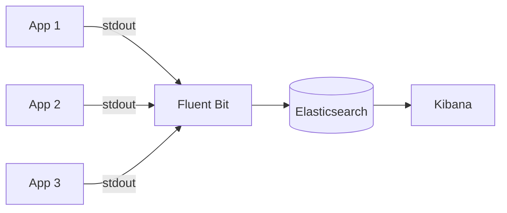

# Logging — Deep Dive

> **Level:** Beginner → Intermediate  
> **Pre-reading:** [07 · Observability](07-observability.md)

---

## Structured Logging

**Structured logging** outputs machine-parseable log entries (JSON) instead of plain text. Essential for log aggregation and querying.

### Plain Text vs Structured

```
# Plain text (hard to parse)
2024-01-15 10:23:45 INFO OrderService - Order placed: 12345 for customer 67890

# Structured (JSON)
{"timestamp":"2024-01-15T10:23:45Z","level":"INFO","service":"order-service","message":"Order placed","orderId":"12345","customerId":"67890","amount":99.99}
```

---

## Log Levels

| Level | When to Use | Example |
|:------|:------------|:--------|
| **ERROR** | Failure needing action | Payment failed, DB connection lost |
| **WARN** | Degraded but working | Cache miss, retry succeeded |
| **INFO** | Business events | Order placed, user logged in |
| **DEBUG** | Development details | Request payload, SQL query |
| **TRACE** | Fine-grained | Method entry/exit (rarely in prod) |

!!! warning "Never DEBUG in production"
    DEBUG logs are verbose and can expose sensitive data. Use INFO for production; enable DEBUG only when troubleshooting.

---

## Correlation IDs

Track requests across services with a unique **correlation ID**.



### Implementation (Spring)

```java
@Component
public class CorrelationIdFilter implements Filter {
    
    @Override
    public void doFilter(ServletRequest request, ServletResponse response, FilterChain chain) {
        HttpServletRequest req = (HttpServletRequest) request;
        String correlationId = req.getHeader("X-Correlation-ID");
        
        if (correlationId == null) {
            correlationId = UUID.randomUUID().toString();
        }
        
        MDC.put("correlationId", correlationId);
        try {
            chain.doFilter(request, response);
        } finally {
            MDC.clear();
        }
    }
}

// Logback config includes MDC
// logback-spring.xml: %d{ISO8601} [%X{correlationId}] %-5level %logger - %msg%n
```

---

## Log Aggregation Architecture



### ELK Stack

| Component | Role |
|:----------|:-----|
| **Elasticsearch** | Storage and search |
| **Logstash / Fluent Bit** | Collection and parsing |
| **Kibana** | Visualization and dashboards |

### Alternative: Grafana Loki

- Uses same labels as Prometheus
- More lightweight than Elasticsearch
- Query with LogQL

---

## What to Log

| Log | Don't Log |
|:---|:----------|
| Request ID, user ID | Passwords |
| Business events | Credit card numbers |
| Error details | PII (unless required) |
| Performance metrics | Full request bodies |
| State transitions | Sensitive tokens |

---

## Spring Boot Logging

```yaml
logging:
  level:
    root: INFO
    com.example: DEBUG
    org.springframework.web: WARN
  pattern:
    console: '{"timestamp":"%d","level":"%p","service":"${spring.application.name}","correlationId":"%X{correlationId}","logger":"%logger","message":"%m"}%n'
```

---

??? question "Why use structured logging over plain text?"
    (1) **Queryable** — filter by orderId, customerId, etc. (2) **Parseable** — automated analysis possible. (3) **Consistent** — all logs have same format. (4) **Aggregation-friendly** — works with ELK, Loki. Plain text requires regex parsing which is fragile.

??? question "How do you ensure correlation IDs propagate across async calls?"
    For async (Kafka, queues): include correlationId in message headers. Consumer extracts and sets in MDC. For reactive/WebFlux: use Context propagation. For threads: wrap executors to propagate MDC.

??? question "What's the difference between logging and distributed tracing?"
    **Logging** captures discrete events with context. **Tracing** captures the full journey of a request across services with timing. Logs tell you what happened; traces tell you where time was spent. Use both: correlate logs by trace ID.


---

## 📝 Knowledge Check

<quiz>
`User john@x.com logged in from 10.0.0.1` vs `{"event":"login","user":"john@x.com","ip":"10.0.0.1"}` — why does the second win at scale?
- [ ] It's shorter
- [x] Structured (JSON) logs are machine-queryable: `event=login AND ip=10.0.0.1` filters in the log platform; free text requires regex archaeology that breaks when someone rewords the message. Structure also enables consistent fields (trace_id, service, level) across every log line in the fleet
- [ ] JSON is smaller on disk
- [ ] ELK can't parse text

unstructured logs are write-only: humans can read them, systems can't aggregate them. Structured logging with a shared field schema (event names, correlation IDs, standard keys) turns log search into queries — 'p95 latency by endpoint' vs 'grep for slow-ish lines.'
</quiz>
<quiz>
What belongs at INFO vs WARN vs ERROR — and what's the 'log level inflation' failure mode?
- [ ] Everything at INFO — be thorough
- [x] INFO: business-meaningful events (order placed, payment settled). WARN: abnormal-but-handled (retry succeeded, fallback used, deprecated API hit). ERROR: needs human attention (unhandled exception, data inconsistency, dependency dead past retries). Inflation: logging handled conditions at ERROR — on-call pages on noise until real errors get ignored
- [ ] All errors at WARN — safer
- [ ] DEBUG in production — why not

level is a *contract with the humans*: ERROR should mean 'act now' — if your ERROR stream contains daily 'fallback to cache used' noise, the alerting built on it becomes a crying wolf. WARN for 'something unexpected survived'; ERROR for 'something is broken'; and if everything is important, nothing is.
</quiz>
<quiz>
Correlation/trace ID propagation — what breaks when a service drops it?
- [ ] Only that service's logs
- [x] The whole request narrative shatters: downstream logs are unfindable-by-trace, spans become orphans, and 'follow this user request' stops at the drop — every service must receive, propagate, and attach the ID to its MDC/log context AND outgoing calls (headers/span context), including async hops (message metadata)
- [ ] Nothing — IDs are optional
- [ ] Just the trace UI looks worse

propagation is only as strong as the weakest hop: one un-instrumented service or one event publish that drops the header splits your trace in two. The sneaky gaps: async threads (context doesn't auto-follow thread pools), message producers (must inject into headers), and scheduled jobs (need their own trace roots).
</quiz>
<quiz>
What should you deliberately NOT log — name three categories and why.
- [ ] Log everything — storage is cheap
- [x] (1) Secrets/credentials/tokens — logs become a credential leak vector readable by every ops user; (2) PII/PHI beyond what's needed — GDPR/HIPAA scope explosion, logs become regulated data; (3) full payloads at high volume — cost + noise, plus payloads often contain 1 and 2. Redact/allowlist fields, never 'log the request object'
- [ ] Only secrets — PII is fine
- [ ] Don't log errors — they're sensitive

logs are an unplanned data store: they get shipped to third-party platforms, retained for months, readable by broad teams, and *dumped in incident reports*. Anything you wouldn't put in a ticket — passwords, tokens, card numbers, patient data — doesn't belong in a log line. Mask at the logging framework, not by developer discipline.
</quiz>
<quiz>
Log aggregation (ELK vs Loki): what's the architectural difference that matters for cost?
- [ ] Just branding
- [x] ELK/Elasticsearch indexes *log content* — powerful full-text search but index-heavy (storage + memory scale with volume). Loki indexes *labels only* (service, pod, level) and stores content as chunks — much cheaper at volume, but queries filter by labels first then scan content — your label design IS your query performance
- [ ] Loki is just lighter ELK
- [ ] ELK is free

the indexing model is the cost model. Full-text indexing (ELK) buys you 'find any substring anywhere' at per-GB index prices. Label indexing (Loki) buys cheap ingestion at the cost of 'design your labels well or queries crawl' — high-cardinality labels (user_id as label) destroy Loki just like unstructured text destroys ELK usability.
</quiz>