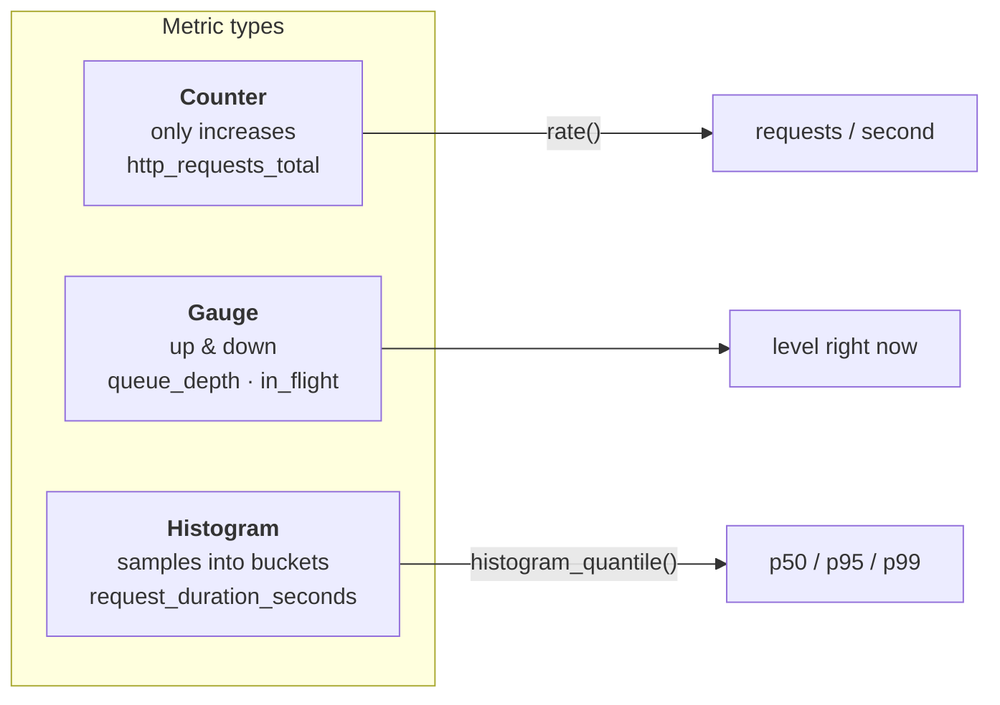
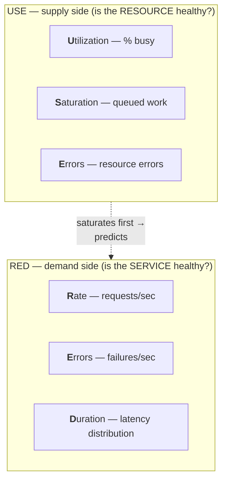
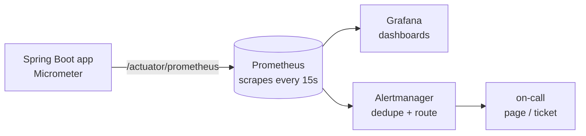

# Metrics — Deep Dive

> **Level:** Intermediate  
> **Pre-reading:** [07 · Observability](07-observability.md)

---

## Metric Types

| Type | Description | Example |
|:-----|:------------|:--------|
| **Counter** | Monotonically increasing value | Total HTTP requests |
| **Gauge** | Current snapshot value | Active connections |
| **Histogram** | Distribution of values | Request latency buckets |
| **Summary** | Pre-calculated quantiles | p50, p95, p99 latency |

---



## RED Method (Service Health)

| Metric | What It Measures | Query |
|:-------|:-----------------|:------|
| **R**ate | Requests per second | `rate(http_requests_total[5m])` |
| **E**rrors | Error rate (%) | `rate(http_requests_total{status=~"5.."}[5m]) / rate(http_requests_total[5m])` |
| **D**uration | Latency distribution | `histogram_quantile(0.99, rate(http_request_duration_seconds_bucket[5m]))` |

---

## USE Method (Resource Health)

| Metric | What It Measures |
|:-------|:-----------------|
| **U**tilization | How busy (%) |
| **S**aturation | Queued work |
| **E**rrors | Resource errors |

---



## Prometheus Metrics

```java
@Component
public class OrderMetrics {
    
    private final Counter ordersPlaced = Counter.build()
        .name("orders_placed_total")
        .help("Total orders placed")
        .labelNames("status", "payment_method")
        .register();
    
    private final Histogram orderLatency = Histogram.build()
        .name("order_processing_seconds")
        .help("Order processing time")
        .buckets(0.1, 0.25, 0.5, 1, 2.5, 5, 10)
        .register();
    
    public void recordOrder(String status, String paymentMethod, double duration) {
        ordersPlaced.labels(status, paymentMethod).inc();
        orderLatency.observe(duration);
    }
}
```

---

## Micrometer (Spring Boot)

```java
@Service
public class OrderService {
    
    private final MeterRegistry meterRegistry;
    private final Timer orderTimer;
    
    public OrderService(MeterRegistry meterRegistry) {
        this.meterRegistry = meterRegistry;
        this.orderTimer = Timer.builder("order.processing")
            .description("Order processing time")
            .register(meterRegistry);
    }
    
    public Order placeOrder(OrderRequest request) {
        return orderTimer.record(() -> {
            // Process order
            return processOrder(request);
        });
    }
}
```

---



## Key Metrics to Track

| Category | Metrics |
|:---------|:--------|
| **HTTP** | Request rate, error rate, latency (p50, p95, p99) |
| **Database** | Connection pool size, query time, errors |
| **JVM** | Heap usage, GC time, thread count |
| **Custom** | Business metrics (orders/min, revenue) |

---

## Alerting Rules

```yaml
groups:
  - name: order-service
    rules:
      - alert: HighErrorRate
        expr: rate(http_requests_total{status=~"5.."}[5m]) / rate(http_requests_total[5m]) > 0.05
        for: 5m
        labels:
          severity: critical
        annotations:
          summary: "High error rate on {{ $labels.service }}"
          
      - alert: HighLatency
        expr: histogram_quantile(0.99, rate(http_request_duration_seconds_bucket[5m])) > 2
        for: 5m
        labels:
          severity: warning
```

---

??? question "Counter vs Gauge — when to use which?"
    **Counter** for cumulative values that only increase (requests, errors). Reset on restart. **Gauge** for values that go up and down (connections, temperature). Use `rate()` with counters to get per-second rate.

??? question "Why use histograms over summaries?"
    **Histograms** can be aggregated across instances; **summaries** cannot. Histograms let you calculate percentiles server-side with `histogram_quantile()`. Use histograms for most cases; summaries only when you need exact quantiles on a single instance.

??? question "What percentiles should you track for latency?"
    At minimum: **p50** (median), **p95**, **p99**. p99 shows worst-case for most users. Consider p99.9 for critical paths. Don't rely on averages — they hide outliers.


---

## 📝 Knowledge Check

<quiz>
Counter vs Gauge vs Histogram — map to: requests served, current queue depth, request latency.
- [ ] All counters — numbers go up
- [x] Counter = monotonic, only-increases (requests served — rate() it for req/s). Gauge = goes up AND down (queue depth, temperature, in-flight requests). Histogram = distribution buckets (latency — lets you compute p50/p95/p99 server-side without storing every value)
- [ ] All gauges — most flexible
- [ ] Histograms for counts

pick by the shape of the question: 'how many total/how fast is it growing' = counter; 'what's the level right now' = gauge; 'what does the distribution look like' = histogram. Latency as a gauge is meaningless ('current latency' of what?); as a histogram it answers 'what % of requests exceeded 500ms' — the SLO question.
</quiz>
<quiz>
Why is `user_id` or `order_id` as a metric label a production incident waiting to happen?
- [ ] It's just a label — harmless
- [x] Cardinality explosion: every distinct label combination is a new time series — 1M users = 1M series × every metric that has the label, ballooning storage and crushing query performance (Prometheus OOMs). Labels must be low-cardinality dimensions (endpoint, status, region), never identifiers
- [ ] It only affects disk space slightly
- [ ] Labels have no limits

cardinality is THE metrics footgun: a single high-cardinality label multiplies your series count by its unique values. Keep labels to bounded dimensions (status codes, endpoints, instance) and put high-cardinality context in logs/traces where it belongs — metrics aggregate, they don't identify.
</quiz>
<quiz>
`rate(http_requests_total[5m])` — why rate() a counter instead of graphing it raw?
- [ ] Counters reset — rate is cosmetic
- [x] Raw counters only grow (and reset on restart) — meaningless as a graph. rate() computes per-second change over the window, smoothing noise and handling counter resets — giving you 'requests/second,' the number humans actually mean
- [ ] rate() is required syntax, nothing more
- [ ] To make graphs colorful

counter resets from restarts would look like cliffs in a raw graph; rate() handles them correctly and normalizes 'how fast is this accumulating' regardless of scrape timing. Window choice matters: too small = spiky noise, too big = lagging signal — 5m is the common sweet spot for alerting.
</quiz>
<quiz>
'Latency p99 = 2s' — what does this hide, and what histogram decision controls whether it's true?
- [ ] Nothing — p99 is the tail
- [x] p99 hides the worst 1% (which may be catastrophic) and, worse, depends entirely on your histogram buckets: if your top bucket is '1s+,' every 30s outlier lands in it and quantile math can't see past the edge — choose buckets around your SLO boundary so the percentiles you alert on are well-resolved
- [ ] Use average instead — more honest
- [ ] p99 is always accurate

histogram quantiles are interpolated *within* buckets: outside your highest bucket there's no resolution. If the SLO is 800ms, you need buckets straddling it — a sparse '100ms, 1s, 10s' scheme makes a real p99 of 950ms indistinguishable from 1.2s. Also: averages hide tails entirely; always alert on percentiles, not means.
</quiz>
<quiz>
Which metric would you alert on for 'the service is down' — and why is 'process up' insufficient?
- [ ] `up == 1` means healthy
- [x] A RED-based SLI: request success rate / error rate within a window, or traffic dropping to ~0 when it should exist — 'process running' says nothing about 'serving': a deadlocked service is up, a 100%-5xx service is up. Alert on the user's experience of the service, not the container's existence
- [ ] CPU usage — it predicts outages
- [ ] Pod restart count only

liveness ≠ serving. `up` tells you Prometheus can scrape; it says nothing about whether requests succeed. Absence-of-traffic alerts (a normally-hot endpoint going silent) catch a different failure class than error-rate spikes. The alerting question is always 'how would a user know this is broken' — page on that.
</quiz>