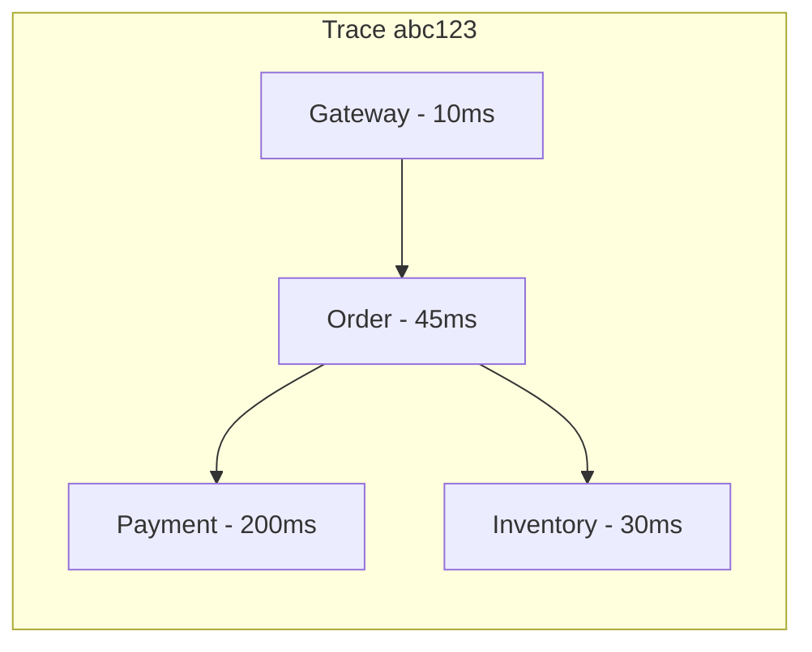
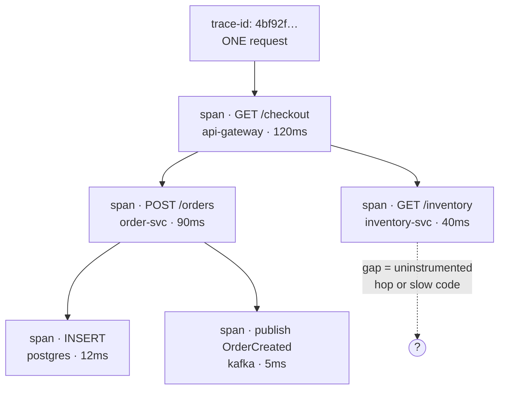
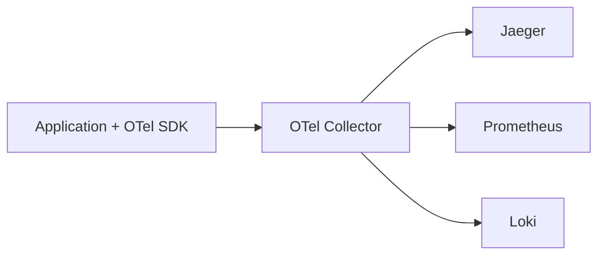

# Distributed Tracing — Deep Dive

> **Level:** Intermediate  
> **Pre-reading:** [07 · Observability](07-observability.md)

---

## What is Distributed Tracing?

**Distributed tracing** tracks a request as it flows through multiple services, showing where time is spent.



---

## Tracing Concepts

| Concept | Description |
|:--------|:------------|
| **Trace** | End-to-end journey of a request |
| **Span** | Single operation within a trace |
| **Trace ID** | Unique identifier for the trace |
| **Span ID** | Unique identifier for each span |
| **Parent Span ID** | Links child spans to parent |

---



## Context Propagation

Trace context travels in HTTP headers:

### W3C TraceContext (Standard)

```http
traceparent: 00-0af7651916cd43dd8448eb211c80319c-b7ad6b7169203331-01
tracestate: vendor=value
```

### B3 (Zipkin)

```http
X-B3-TraceId: 463ac35c9f6413ad48485a3953bb6124
X-B3-SpanId: a2fb4a1d1a96d312
X-B3-ParentSpanId: 0020000000000001
X-B3-Sampled: 1
```

---

## OpenTelemetry

**OpenTelemetry** (OTel) is the CNCF standard for traces, metrics, and logs.



### Spring Boot Integration

```xml
<dependency>
    <groupId>io.opentelemetry</groupId>
    <artifactId>opentelemetry-api</artifactId>
</dependency>
<dependency>
    <groupId>io.micrometer</groupId>
    <artifactId>micrometer-tracing-bridge-otel</artifactId>
</dependency>
```

```yaml
management:
  tracing:
    sampling:
      probability: 1.0  # 100% sampling (reduce in prod)
  otlp:
    tracing:
      endpoint: http://otel-collector:4318/v1/traces
```

---

## Sampling Strategies

| Strategy | Description | Use Case |
|:---------|:------------|:---------|
| **Head-based** | Decide at request entry | Simple; may miss errors |
| **Tail-based** | Decide after seeing full trace | Captures errors; more complex |
| **Rate limiting** | Sample N traces/second | Control cost |

---

## Tracing Tools

| Tool | Type | Notes |
|:-----|:-----|:------|
| **Jaeger** | OSS | CNCF; Kubernetes-native |
| **Zipkin** | OSS | Twitter origin; simple |
| **Tempo** | OSS | Grafana; cost-effective storage |
| **AWS X-Ray** | Managed | AWS native |
| **Honeycomb** | SaaS | High-cardinality analysis |

---

??? question "What's the difference between tracing and logging?"
    **Tracing** shows the flow and timing of a request across services. **Logging** captures discrete events with context. Traces answer "where did time go?"; logs answer "what happened?". Use both together; link logs to traces via trace ID.

??? question "How do you decide on sampling rate?"
    Start with 100% in dev. In production: (1) Cost constraints — traces are expensive. (2) Traffic volume — high-traffic needs lower rate. (3) Error capture — use tail-based to always capture errors. Common: 1-10% for high-traffic, 100% for critical paths.

??? question "Head-based vs tail-based sampling?"
    **Head-based** decides at trace start — simple but may miss errors. **Tail-based** decides after seeing complete trace — captures all errors and slow traces. Use head-based for most cases; add tail-based for critical paths to ensure error capture.


---

## 📝 Knowledge Check

<quiz>
What is a span, and how do spans become a trace across five services?
- [ ] A span is a log line
- [x] A span = one timed unit of work (an HTTP call, a DB query) with name, timestamps, attributes, and a parent link; a trace = the tree of spans sharing one trace ID — each hop propagates context headers (`traceparent`) so the next service creates child spans under the same trace, assembling the request's full path
- [ ] A span is a metric bucket
- [ ] Traces are stitched by timestamp

trace ID + parent span ID propagation is the entire mechanism: service B reads the incoming traceparent, starts a span with that trace ID and parent, then forwards the same trace context downstream. Break propagation at any hop (async thread, message publish, missing instrumentation) and the trace splits into two disconnected halves.
</quiz>
<quiz>
W3C TraceContext vs B3 — why does the header standard matter?
- [ ] Just naming preferences
- [x] Interoperability: W3C `traceparent`/`tracestate` is the vendor-neutral standard (OTel, most clouds, load balancers); B3 is Zipkin's format — mixed ecosystems silently drop context at proxy/service boundaries that only speak one format. Standardize on W3C unless you're Zipkin-bound; translation at edges otherwise
- [ ] B3 is the newer standard
- [ ] Headers don't matter — SDKs handle it

a trace that dies at an ALB or a third-party call is a broken narrative. 'The SDK handles it' fails exactly at infrastructure you don't instrument — gateways, proxies, partner services. One propagation standard end-to-end (W3C today) keeps the trace continuous through components you don't own.
</quiz>
<quiz>
100% trace sampling vs 1% vs head-based vs tail-based — when does each make sense?
- [ ] Always 100% — never miss anything
- [x] Head-based (decide at trace start): cheap, uniform — but you sample boring traffic and miss the interesting 1-in-10000 error trace. Tail-based (decide after seeing the whole trace — keep errors/slow ones): catches exactly the interesting traces at low cost, needs a collector buffering spans. 100% only for low-volume or debugging windows
- [ ] Random per-span — fairest
- [ ] 1% is always enough

the sampling question is 'which traces are worth keeping?' Head sampling is volume-proportional: at high traffic you can't afford 100%, and uniform sampling keeps statistically representative but mostly boring traces. Tail sampling (OTel Collector) is the production sweet spot — keep all errors + outliers, sample the healthy rest. Per-span sampling is the trap — it guarantees broken partial traces.
</quiz>
<quiz>
Tracing an async (Kafka) hop — what does the producer/consumer need to do to keep the trace continuous?
- [ ] Nothing — Kafka preserves context
- [x] Producer injects trace context into the message headers (metadata); the consumer extracts it and creates its span as a continuation/child — 'message in flight' becomes a span. Without header injection, every consumer starts a new root trace and the produce→consume link is invisible
- [ ] Match by timestamp in the trace UI
- [ ] Async hops can't be traced

async is where context propagation dies by default: thread pools, queues, and schedulers don't carry thread-local context. The pattern is inject-on-publish / extract-on-consume — OTel auto-instruments Kafka clients, but custom wrappers and batch processing often need manual propagation. Check for 'detached' traces in your async paths first.
</quiz>
<quiz>
A trace shows 2s inside 'OrderService' with no child spans during the gap. What are the likely explanations?
- [ ] OrderService is just slow — move on
- [x] Missing instrumentation (a call to an un-instrumented library, hand-rolled HTTP client, or a thread hop losing context), genuinely slow in-process work (CPU, lock contention, GC), or sampling dropped the children — the gap is diagnostic gold: it tells you either 'work happened here' or 'visibility stopped here,' and you need to distinguish them
- [ ] The clock is wrong
- [ ] Spans don't nest that deep

an unexplained gap is 'the request spent time nobody instrumented': common culprits are thread hops losing context (executor without propagation), un-instrumented clients (raw sockets, file I/O, external calls), or real in-process cost (serialization, GC pause). Add instrumentation or look at metrics — a GC pause chart at the same timestamp is often the tell.
</quiz>