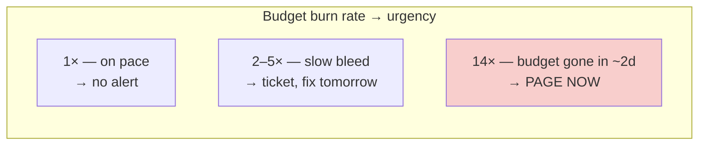

# SLI, SLO, SLA — Deep Dive

> **Level:** Intermediate  
> **Pre-reading:** [07 · Observability](07-observability.md)

---

## Definitions

| Term | Definition | Example |
|:-----|:-----------|:--------|
| **SLI** (Service Level Indicator) | The metric you measure | `successful_requests / total_requests` |
| **SLO** (Service Level Objective) | Target value for the SLI | 99.9% availability |
| **SLA** (Service Level Agreement) | Contractual commitment | 99.5% or 10% refund |


---



```mermaid
flowchart TB
    UX["user experience<br/>(can I check out? fast?)"] --> SLI["<b>SLI</b> — what's measured<br/>success rate · p99 latency"]
    SLI --> SLO["<b>SLO</b> — internal target<br/>99.9% monthly<br/>(pages us when burning)"]
    SLO --> EB["<b>error budget</b><br/>0.1% ≈ 43 min/month<br/>spend on risk: deploys, chaos, experiments"]
    SLO --> SLA["<b>SLA</b> — external contract<br/>99.5% + penalties<br/>(LOOSER than SLO = safety margin)"]
    style SLA fill:#fff2cc
```

## Error Budget

**Error budget** = `100% - SLO target`

| SLO | Error Budget | Downtime/Month |
|:----|:-------------|:---------------|
| 99.9% | 0.1% | ~43 minutes |
| 99.95% | 0.05% | ~22 minutes |
| 99.99% | 0.01% | ~4 minutes |

### Error Budget Policy

> "If we're burning error budget too fast, we freeze feature deployments and focus on reliability."

---

## Common SLIs

| Category | SLI | Measurement |
|:---------|:----|:------------|
| **Availability** | Success rate | `successful_requests / total_requests` |
| **Latency** | Response time | `requests < 500ms / total_requests` |
| **Throughput** | Capacity | `orders_processed / time` |
| **Correctness** | Data accuracy | `correct_responses / total_responses` |

---

## Setting SLOs

| Factor | Consideration |
|:-------|:--------------|
| **User expectations** | What do users consider acceptable? |
| **Dependencies** | Your SLO can't exceed dependency SLOs |
| **Cost** | Higher reliability = higher cost |
| **Current performance** | What can you realistically achieve? |

### SLO Example

```yaml
slos:
  order-service:
    - name: availability
      target: 99.9
      window: 30d
      sli:
        type: success_rate
        metric: http_requests_total
        good: status=~"2.."
        
    - name: latency
      target: 95
      window: 30d
      sli:
        type: latency_percentile
        percentile: 99
        threshold: 500ms
```

---



## SLO Burn Rate Alerting

Instead of alerting on instant failures, alert on **burn rate** — how fast you're consuming error budget.

| Burn Rate | Meaning | Alert Window |
|:----------|:--------|:-------------|
| 14.4x | Budget consumed in 2 hours | 5 min window |
| 6x | Budget consumed in 12 hours | 30 min window |
| 1x | Consuming at expected rate | 6 hour window |

### Prometheus Alert

```yaml
- alert: SLOBurnRateHigh
  expr: |
    (
      rate(http_requests_total{status=~"5.."}[5m]) 
      / rate(http_requests_total[5m])
    ) > (14.4 * 0.001)  # 14.4x burn rate for 99.9% SLO
  for: 2m
  labels:
    severity: critical
```

---

## SLO Dashboard

| Panel | Content |
|:------|:--------|
| **Current SLI** | Real-time success rate, latency |
| **Error budget remaining** | % of budget left |
| **Burn rate** | Current consumption rate |
| **Historical** | SLI over 30 days |

---

??? question "What's the difference between SLO and SLA?"
    **SLO** is an internal target — what you aim for. **SLA** is an external commitment — what you promise customers with penalties. SLO should be tighter than SLA to give buffer. Example: SLO = 99.9%, SLA = 99.5%.

??? question "How do you set an appropriate SLO?"
    (1) Measure current performance — can't promise what you can't deliver. (2) Understand user expectations — survey, analyze support tickets. (3) Consider dependencies — you can't exceed their SLOs. (4) Balance cost vs reliability — 99.99% is 10x harder than 99.9%. Start conservative; tighten as you improve.

??? question "What is error budget and how does it drive decisions?"
    Error budget is the allowed unreliability (100% - SLO). If SLO is 99.9%, budget is 0.1% (~43 min/month). When budget is healthy: deploy features. When budget is depleting: freeze deployments, focus on reliability. It aligns product and SRE teams around shared goals.


---

## 📝 Knowledge Check

<quiz>
SLI, SLO, SLA — order them by who they're FOR and what happens on breach.
- [ ] Synonyms
- [x] SLI = the measured indicator (success rate, p99 latency) — the instrument. SLO = internal target on the SLI (99.9%) — engineering's promise to itself, breach = freeze features/fix reliability. SLA = contractual commitment to customers (99.5% or lower than the SLO) — breach = credits/penalties. The SLO must be tighter than the SLA so you alert before contract breach
- [ ] SLA is internal, SLO is contractual
- [ ] SLI is the penalty clause

the layering exists so the business contract has engineering margin: SLA is what you legally promise, SLO is what you aim for with headroom, SLI is what you measure. If SLO == SLA, the first blip is a contract violation with zero warning budget — always leave a gap between 'we paged ourselves' and 'customer is owed money.'
</quiz>
<quiz>
99.9% monthly SLO ≈ 43 min error budget. The team burned 90% of it by day 10. What should happen?
- [ ] Nothing — the month isn't over
- [x] The error-budget policy kicks in: freeze risky changes/feature launches, prioritize reliability work, investigate the burn — that's the entire point of the budget: it converts 'reliability vibes' into an objective go/no-go signal for shipping
- [ ] Reset the budget — it was too strict
- [ ] Deploy more to compensate

error budget is a *policy*, not a metric: it pre-agrees what happens at thresholds ('at 50% burn by mid-month: no new releases; at 100%: reliability-only sprint'). Without the policy, the number is decoration — teams just watch it burn. With it, reliability vs. velocity is an objective negotiation, not an argument.
</quiz>
<quiz>
'p99 latency < 500ms' vs 'availability > 99.9%' — which is a better SLI, and what's the trap in each?
- [ ] Both fine
- [x] Both are valid SLIs — the trap is *measurement point and denominator*. 'Availability' measured at the LB misses app-level 200-with-error-body failures; measured by synthetic probes misses real-user patterns. p99 needs enough traffic to be meaningful (2 requests/hr makes p99 a coin flip) and can hide slow endpoints under fast ones — define the SLI where the user experiences it
- [ ] Availability is always better
- [ ] p99 is always better

SLIs are contracts about *where you measure*: edge vs. service vs. client gives three different truths. Per-endpoint SLOs on a hot-path service hide a dying low-traffic endpoint under healthy averages. Good SLIs: user-visible, defined on events not uptime, and chosen so breaches actually mean 'users hurt.'
</quiz>
<quiz>
Burn-rate alerting: why alert on 'budget consumed per hour' instead of 'error rate spiked'?
- [ ] Same thing
- [x] Raw error-rate spikes page you on transient noise; burn rate asks 'at this consumption rate, when do we run out of budget?' — fast burn (14× budget rate) = page now (budget gone in hours); slow burn (2×) = ticket tomorrow. It scales alert urgency to *budget consequence*, eliminating both noise and the too-late discovery
- [ ] Burn rate is slower to detect
- [ ] Only for monthly reports

burn-rate multi-window alerting is the SRE standard for a reason: a 10-minute blip that consumes 1% of budget doesn't page, but a sustained bleed that will exhaust the month's budget in 6 hours does. It aligns page-worthiness with SLO-meaningfulness — the alert's severity equals how fast you're spending your allowed unreliability.
</quiz>
<quiz>
Product wants 'five nines' on the checkout API. What's the honest cost conversation?
- [ ] Sure — set SLO to 99.999%
- [x] Each nine multiplies cost: 99.9% ≈ 43min/month downtime allowed; 99.99% ≈ 4.3min; 99.999% ≈ 26sec — the jump from 3→4→5 nines demands multi-region failover, zero-downtime everything, chaos-verified recovery, and 24/7 ops — ask what the user *needs* (often 99.9% + graceful degradation beats 99.99% at 10× cost)
- [ ] It's just an SLA change
- [ ] Five nines is table stakes

nines aren't linear, they're exponential in engineering: every extra nine roughly demands an order of magnitude more redundancy, verification, and operational maturity — and your SLO can never exceed the availability of your *dependencies' product* (if three 99.9% dependencies are in your critical path, your ceiling is ~99.7% regardless). Negotiate the number from user need, not aspiration.
</quiz>