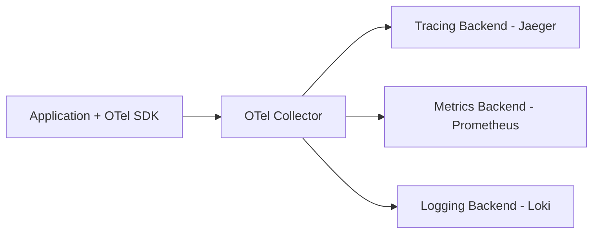
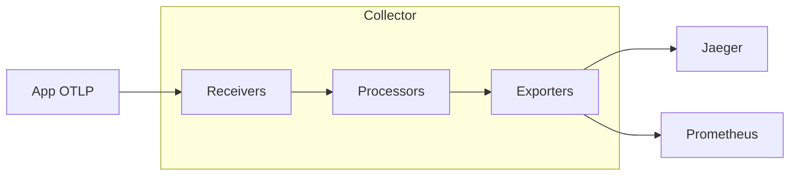

# OpenTelemetry — Deep Dive

> **Level:** Intermediate  
> **Pre-reading:** [07 · Observability](07-observability.md) · [07.03 · Distributed Tracing](07.03-distributed-tracing.md)

---

## What is OpenTelemetry?

**OpenTelemetry** (OTel) is a CNCF project providing a unified standard for collecting telemetry data: traces, metrics, and logs.



---

## OTel Components

| Component | Purpose |
|:----------|:--------|
| **API** | Vendor-neutral interfaces |
| **SDK** | Implementation of API |
| **Collector** | Receives, processes, exports telemetry |
| **Exporters** | Send data to backends |
| **Instrumentation** | Auto/manual instrumentation libraries |

---

## Collector Architecture



### Collector Config

```yaml
receivers:
  otlp:
    protocols:
      grpc:
        endpoint: 0.0.0.0:4317
      http:
        endpoint: 0.0.0.0:4318

processors:
  batch:
    timeout: 1s
    send_batch_size: 1000
  memory_limiter:
    limit_mib: 512

exporters:
  jaeger:
    endpoint: jaeger:14250
  prometheus:
    endpoint: 0.0.0.0:8889

service:
  pipelines:
    traces:
      receivers: [otlp]
      processors: [memory_limiter, batch]
      exporters: [jaeger]
    metrics:
      receivers: [otlp]
      processors: [memory_limiter, batch]
      exporters: [prometheus]
```

---

## Spring Boot Integration

```xml
<dependency>
    <groupId>io.micrometer</groupId>
    <artifactId>micrometer-tracing-bridge-otel</artifactId>
</dependency>
<dependency>
    <groupId>io.opentelemetry</groupId>
    <artifactId>opentelemetry-exporter-otlp</artifactId>
</dependency>
```

```yaml
management:
  tracing:
    sampling:
      probability: 1.0
  otlp:
    metrics:
      export:
        enabled: true
        endpoint: http://otel-collector:4318/v1/metrics
    tracing:
      endpoint: http://otel-collector:4318/v1/traces
```

### Manual Instrumentation

```java
@Service
public class OrderService {
    private final Tracer tracer;
    
    public Order processOrder(OrderRequest request) {
        Span span = tracer.spanBuilder("processOrder")
            .setAttribute("order.id", request.getOrderId())
            .setAttribute("customer.id", request.getCustomerId())
            .startSpan();
        
        try (Scope scope = span.makeCurrent()) {
            // Process order
            return doProcess(request);
        } catch (Exception e) {
            span.setStatus(StatusCode.ERROR, e.getMessage());
            span.recordException(e);
            throw e;
        } finally {
            span.end();
        }
    }
}
```

---

## Auto-Instrumentation

Use Java agent for automatic instrumentation:

```dockerfile
FROM openjdk:17
COPY opentelemetry-javaagent.jar /app/
ENV JAVA_TOOL_OPTIONS="-javaagent:/app/opentelemetry-javaagent.jar"
ENV OTEL_SERVICE_NAME=order-service
ENV OTEL_EXPORTER_OTLP_ENDPOINT=http://otel-collector:4317
```

Automatically instruments: HTTP clients, JDBC, Kafka, Redis, gRPC, and more.

---

## Semantic Conventions

OTel defines standard attribute names:

| Category | Attributes |
|:---------|:-----------|
| **HTTP** | `http.method`, `http.status_code`, `http.url` |
| **Database** | `db.system`, `db.statement`, `db.name` |
| **Messaging** | `messaging.system`, `messaging.destination` |
| **Service** | `service.name`, `service.version` |

---

??? question "Why use OpenTelemetry over vendor-specific SDKs?"
    (1) **Vendor neutral** — switch backends without code changes. (2) **Standard** — CNCF backed; industry adoption. (3) **Unified** — traces, metrics, logs in one SDK. (4) **Future-proof** — consolidates fragmented ecosystem. (5) **Wide support** — all major backends support OTel.

??? question "Should you use auto-instrumentation or manual?"
    **Auto-instrumentation** (Java agent) covers common libraries with zero code changes — start here. **Manual instrumentation** adds custom spans and attributes for business logic. Use both: auto for infrastructure, manual for business operations.

??? question "What's the role of the OTel Collector?"
    The Collector is a **vendor-agnostic proxy** that: (1) Receives telemetry from apps. (2) Processes (batching, filtering, sampling). (3) Exports to multiple backends. Benefits: apps don't need backend configs; can switch backends without redeploying apps; central place for processing.


---

## 📝 Knowledge Check

<quiz>
What does OTel standardize — and what does it deliberately NOT provide?
- [ ] It's a full backend like Datadog
- [x] OTel standardizes the *client side*: APIs/SDKs for traces/metrics/logs, instrumentation libraries, semantic conventions (attribute names), and the Collector for receiving/processing/exporting telemetry — it does NOT provide storage, querying, or dashboards; you still need a backend (Jaeger, Tempo, Prometheus, vendor)
- [ ] It's a tracing library only
- [ ] It replaces Prometheus

the point is *decoupling*: instrument once with OTel, then swap backends by changing collector exporters — vendor-neutrality is the strategic win. Teams that 'adopt OTel' expecting a full observability stack get disappointed; it's the universal adapter, not the destination.
</quiz>
<quiz>
Why run a Collector instead of exporting directly from each app's SDK?
- [ ] Just another hop — skip it
- [x] The Collector centralizes cross-cutting telemetry concerns: batching, retries, sampling (tail-based needs a buffer), enrichment (add k8s/cloud attrs), filtering PII, and fan-out to multiple backends — so app config stays dumb ('send to localhost collector') and policy lives in one place instead of N SDK configs
- [ ] SDKs can't export directly
- [ ] Only for compliance

direct export makes every app own sampling rules, credentials, endpoint config, and backend lock-in — a config mess at fleet scale. The Collector is the telemetry 'edge layer': tail-sampling needs something that sees whole traces (impossible per-app), and 'switch vendors' becomes a YAML diff, not a redeploy.
</quiz>
<quiz>
Auto-instrumentation vs manual — what does each get you?
- [ ] Auto is enough for everything
- [x] Auto (agent/annotation): HTTP frameworks, DB drivers, messaging clients instrumented free — covers the *skeleton* of a trace fast. Manual: custom spans around business operations ('priceCalculation,' 'fraudCheck') and business attributes — covers what auto can't know: what *matters* in your domain. Production needs both
- [ ] Manual is obsolete
- [ ] Auto adds business context automatically

auto-instrumentation gives you infrastructure truth ('the HTTP call to payments took 300ms'); it can't give business truth ('the fraud-scoring step was the slow part'). The 80/20: auto for the plumbing, manual spans for the business operations that answer 'which *step* is slow' — semantic naming (`order.validate`, `inventory.reserve`) beats framework naming.
</quiz>
<quiz>
Semantic conventions — why does `http.method` vs `http_method` vs `httpMethod` matter?
- [ ] Style only
- [x] Semantic conventions are the shared attribute vocabulary: if every service names things identically (`http.request.method`, `db.system`, `service.name`), queries and dashboards work fleet-wide — without conventions, each team's spans speak a different dialect and cross-service analysis is impossible
- [ ] Conventions are optional metadata
- [ ] Only matters for Java

telemetry is only correlatable if the dimensions are named the same way. SemConv turns 'trace data from 40 services in 6 languages' into a single queryable dataset — `service.name`, `deployment.environment`, `error.type` mean the same thing everywhere. Adopt conventions + your org's additions; a free-for-all makes the backend useless.
</quiz>
<quiz>
'We adopted OTel but our traces are useless' — name two common causes.
- [ ] OTel doesn't work
- [x] (1) Broken context propagation — async hops, custom clients, or middleware that drops headers, so traces fragment into orphaned spans. (2) Sampling too aggressive or per-span — you keep 1% of fragments, not complete traces. (3) No semantic consistency — can't query across services. (4) Spans created but never exported (misconfigured endpoint/credentials) — check pipeline first
- [ ] Need a different vendor
- [ ] Traces are inherently useless

'useless traces' is almost always pipeline or propagation, not the standard: verify context headers survive every hop (custom async/thread code is the usual leak), verify whole-trace sampling (tail-based if you can), verify the export path end-to-end with a synthetic request, and standardize attributes. OTel fails silently — the data you don't see looks like the system's fault.
</quiz>