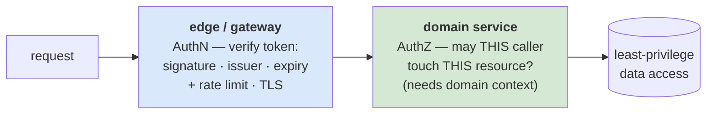
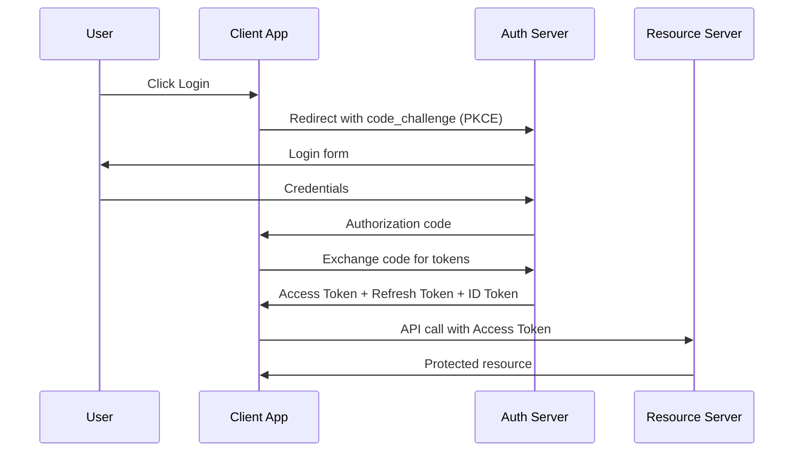

# Security

> Security is a cross-cutting concern woven through every layer — not a feature added at the end.

## Authentication vs Authorization

|                | Authentication (AuthN)              | Authorization (AuthZ)             |
|:---------------|:------------------------------------|:----------------------------------|
| **Question**   | *Who are you?*                      | *What can you do?*                |
| **Handled by** | Identity Provider (IdP)             | Permission system / Policy engine |
| **Example**    | Username + password, SSO, biometric | RBAC, ABAC, OAuth scopes          |

## OAuth2 & OIDC

**OAuth2** = authorization framework (grants access to resources).
**OIDC** = identity layer on top of OAuth2 (tells you *who* the user is via ID Token).

### OAuth2 Grant Types

| Grant Type                    | Use Case                             | Notes                             |
|:------------------------------|:-------------------------------------|:----------------------------------|
| **Authorization Code + PKCE** | Web and mobile apps with a user      | Current best practice             |
| **Client Credentials**        | Machine to machine; no user involved | Service accounts, background jobs |
| **Device Flow**               | Smart TVs, CLI tools, IoT            | Polling-based                     |
| **Implicit**                  | **(Deprecated)** — avoid             | Replaced by Auth Code + PKCE      |

### Token Types

| Token             | Lifetime                 | Purpose                                 |
|:------------------|:-------------------------|:----------------------------------------|
| **Access Token**  | Short (minutes to hours) | Prove identity to resource server       |
| **Refresh Token** | Long (days to weeks)     | Get a new access token without re-login |
| **ID Token**      | Short                    | OIDC only; contains user claims         |

→ **[Deep Dive: OAuth2 & OIDC](08.01-oauth2-and-oidc.md)** — Grant types, PKCE flow, SAML vs OAuth2 vs OIDC, common mistakes

## JWT (JSON Web Token)

Structure: `Header.Payload.Signature`

| Part          | Content                                                            |
|:--------------|:-------------------------------------------------------------------| 
| **Header**    | Algorithm (`RS256`, `HS256`), type (`JWT`)                         |
| **Payload**   | Standard claims: `sub`, `iss`, `aud`, `exp`, `iat` + custom claims |
| **Signature** | HMAC or RSA signature over header + payload                        |

**Validation checklist:**

- [ ] Signature is valid (use correct public key — never skip this)
- [ ] `exp` is in the future (token not expired)
- [ ] `iss` matches your expected issuer
- [ ] `aud` matches your service identifier
- [ ] Algorithm is what you expect (reject `alg: none` attacks)

!!! warning "JWT is NOT encrypted by default"
    JWT payload is Base64 encoded — anyone can decode it. Never put secrets, passwords, or sensitive PII in JWT claims. Use **JWE** (JSON Web Encryption) if you need encrypted tokens.

→ **[Deep Dive: JWT](08.02-jwt-deep-dive.md)** — RS256 vs HS256, JWKS rotation, token storage, security vulnerabilities

## Service-to-Service Security

| Pattern                         | Description                                                                 |
|:--------------------------------|:----------------------------------------------------------------------------|
| **mTLS**                        | Both client and server present certificates; bidirectional authentication   |
| **SPIFFE / SPIRE**              | Workload identity standard; issues SVIDs (X.509 certs) to service instances |
| **Kubernetes Service Accounts** | K8s-native identity scoped to namespace + service account; mounted as token |
| **Short-lived tokens**          | Prefer ephemeral credentials; minimize blast radius of a leak               |

Service Mesh (Istio) can automate mTLS between all services with zero code changes.

→ **[Deep Dive: Service-to-Service Auth](08.03-service-to-service-auth.md)** — mTLS, SPIFFE/SPIRE, K8s SA tokens, OAuth2 Client Credentials

## API Security Checklist

| Category             | Practice                                                                       |
|:---------------------|:-------------------------------------------------------------------------------|
| **Transport**        | HTTPS everywhere; redirect HTTP → HTTPS; HSTS header                           |
| **Input validation** | Validate and sanitize all input at system boundaries; reject unexpected fields |
| **CORS**             | Allowlist specific origins; never use `*` for credentialed requests            |
| **Rate limiting**    | At API gateway; per-client and per-IP limits                                   |
| **SQL injection**    | Parameterized queries or ORM only; never string concatenation                  |
| **Sensitive data**   | Mask PII in logs; encrypt at rest; minimize data returned (no over-fetching)   |
| **Error messages**   | Never expose stack traces or internal details to clients                       |

→ **[Deep Dive: API Security Patterns](08.04-api-security-patterns.md)** — CORS, rate limiting strategies, OWASP Top 10 detail, security headers

## Secrets Management

| Tool                          | Description                                                                     |
|:------------------------------|:--------------------------------------------------------------------------------|
| **HashiCorp Vault**           | Centralized secrets store; dynamic secrets; lease TTL; audit log                |
| **AWS Secrets Manager**       | AWS-native; automatic rotation; fine-grained IAM policies                       |
| **Kubernetes Secrets**        | Base64 stored; encrypt at rest with KMS; use External Secrets Operator for sync |
| **External Secrets Operator** | Sync secrets from Vault / AWS SM / GCP SM into K8s Secrets automatically        |

**Golden rules:**

- Never hardcode secrets in source code or Dockerfiles
- Never commit secrets to Git (use `.gitignore`; tools like `git-secrets`)
- Rotate credentials regularly and always on suspected breach
- Use least-privilege credentials — each service gets only what it needs

→ **[Deep Dive: Secrets Management](08.05-secrets-management.md)** — Vault dynamic secrets, K8s secret hardening, AWS SM rotation, anti-patterns

## Zero Trust Architecture

| Principle                      | What It Means                                                          |
|:-------------------------------|:-----------------------------------------------------------------------|
| **Never trust, always verify** | Authenticate and authorize every request, regardless of source network |
| **Assume breach**              | Design as if attackers are already inside; minimize lateral movement   |
| **Least privilege**            | Grant minimum permissions needed for the task                          |
| **Micro-segmentation**         | K8s NetworkPolicies restricting east-west traffic between services     |

→ **[Deep Dive: Zero Trust](08.06-zero-trust.md)** — Five pillars, OPA policy as code, maturity model, K8s micro-segmentation

## OWASP API Security Top 10 — Key Ones

| #  | Risk                                         | One-Line Description                                     |
|:---|:---------------------------------------------|:---------------------------------------------------------|
| 1  | **BOLA** (Broken Object Level Authorization) | Can user A access user B's data via ID manipulation?     |
| 2  | **Broken Authentication**                    | Weak or missing token validation; no expiry check        |
| 3  | **Broken Object Property Level Auth**        | API returns or accepts fields the caller shouldn't touch |
| 4  | **Unrestricted Resource Consumption**        | No rate limiting → DoS, cost explosion                   |
| 5  | **Broken Function Level Authorization**      | Regular user calling admin endpoints                     |
| 7  | **Server-Side Request Forgery (SSRF)**       | Attacker tricks server into making internal requests     |
| 8  | **Security Misconfiguration**                | Default creds, open CORS, debug endpoints in production  |

---

## 📝 Knowledge Check

<quiz>
Authentication vs authorization — where does each belong in a microservices stack?
- [ ] Same thing, same place
- [x] AuthN ('who are you') is centralized — the IdP/gateway validates identity (JWT, mTLS) so every service doesn't re-implement login. AuthZ ('may you do THIS') is decentralized — the resource-owning service decides ('can this user view *this* order?') because only it has the domain context — coarse role checks can happen at the edge, fine-grained checks cannot
- [ ] Both at the gateway
- [ ] Both in each service

the split is by *context*: identity verification is generic (any service can verify a signature); authorization needs domain knowledge the edge lacks ('is this user's subscription active for this feature?'). Centralizing authZ at the gateway means the gateway needs your business rules — the ESB trap again, with security stakes.
</quiz>
<quiz>
Authorization Code + PKCE vs Client Credentials vs implicit — which for: SPA, service-to-service, and why is implicit dead?
- [ ] Implicit for both — simplest
- [x] SPA/public clients: Auth Code + PKCE (the code-verifier protects the code exchange without a client secret). M2M/service calls: Client Credentials (no user, the service is its own principal). Implicit is deprecated because tokens in the URL fragment leak through browser history/referer logs and can't be refreshed safely
- [ ] Client credentials for the SPA — no user needed
- [ ] Password grant for everything

grant type maps to *who holds the secret*: public clients can't hold secrets (PKCE replaces secrecy with proof), confidential M2M clients can (client credentials). Implicit exposed access tokens in URLs — URL leakage is a real exfiltration path, and the flow couldn't fix it. ROPC/password grant shares the same sin: it teaches users to hand credentials to the app.
</quiz>
<quiz>
'We validate the JWT signature — so the token is trusted.' What else must be checked?
- [ ] Nothing — signature is enough
- [x] `exp`/`nbf` (is it valid *now*), `iss` (did OUR IdP issue it — not just any valid JWT), `aud` (was it minted *for this service* — a token for the photos API shouldn't unlock payments), `alg` allowlist (reject `none` and unexpected algorithms), and key rotation via JWKS — signature is necessary, claims are the contract
- [ ] Only expiry matters
- [ ] Check the issuer manually

a perfectly-signed token can still be wrong: expired, minted by a different realm, or scoped for a different audience. `aud` validation is the silent killer — token replay across your own services works when every service accepts every token the IdP mints. Validation is a checklist, not a signature check.
</quiz>
<quiz>
Service-to-service auth: mTLS vs service-account tokens vs SPIFFE/SPIRE — what does each actually authenticate?
- [ ] All authenticate the user
- [x] mTLS authenticates the *connection's identity* (both ends prove workload identity via certs — mesh does this invisibly). K8s service accounts give pods a platform-issued token for calling the API/other services. SPIFFE/SPIRE provides *portable* cryptographic workload identity (SVID) that works across platforms/clouds — identity as infrastructure, not config
- [ ] mTLS is only for browsers
- [ ] SPIFFE is a token format

the question is 'what identifies a workload': mTLS gives cryptographic identity at the transport; service accounts are platform-bound identities; SPIFFE generalizes it (spiffe://trust-domain/workload) so identity isn't tied to one cluster or vendor. They compose: SPIRE issues the SVIDs that mTLS connections then present.
</quiz>
<quiz>
A teammate stores the DB password in a Kubernetes Secret and calls it 'encrypted.' What's the correction?
- [ ] Correct — Secrets are encrypted
- [x] K8s Secrets are base64 by default — encoding, not encryption: anyone with API read access or an etcd backup reads them. Hardening requires encryption-at-rest in etcd (KMS plugin), RBAC scoping, and ideally external secret stores (Vault, cloud secret managers) via an operator — 'Secret' is a delivery mechanism, not a protection guarantee
- [ ] Use ConfigMaps instead
- [ ] Base64 IS encryption

the name 'Secret' is aspirational, not descriptive: out of the box it's plaintext-plus-a-step. The real controls: etcd encryption at rest (KMS provider), tight RBAC on `secrets` reads, no mounting as env vars where they leak to crash dumps/subprocesses (prefer volume mounts), and rotation — or externalize to a real secrets manager whose whole job is this.
</quiz>