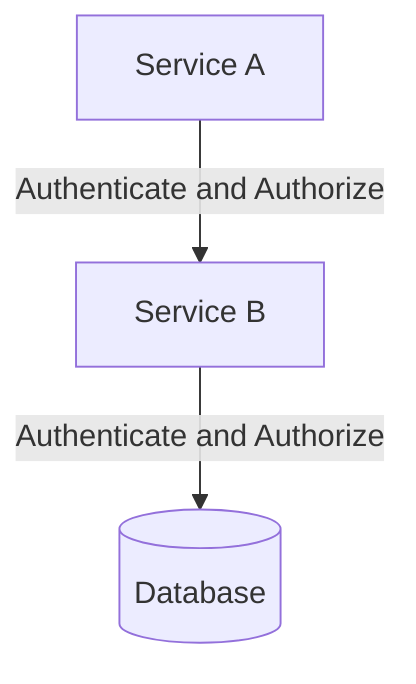
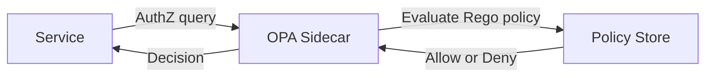

# Zero Trust Architecture — Deep Dive

> **Level:** Advanced
> **Pre-reading:** [08 · Security Summary](08-security.md) · [08.03 · Service-to-Service Auth](08.03-service-to-service-auth.md) · [08.04 · API Security Patterns](08.04-api-security-patterns.md)

---

## What Is Zero Trust?

**Zero Trust** is a security model built on the principle: **never trust, always verify** — regardless of network location. The traditional perimeter model assumed anything inside the network was trusted. Zero Trust eliminates the perimeter entirely.

---

## The Five Pillars of Zero Trust

| Pillar | Description | Implementation |
|:-------|:------------|:---------------|
| **Identity** | Every user, service, and device has a verified identity | SPIFFE, mTLS, OAuth2, MFA |
| **Device** | Only healthy, compliant devices can access resources | MDM, device attestation, posture checks |
| **Network** | Micro-segmentation; no implicit trust on the internal network | K8s NetworkPolicy, Istio AuthorizationPolicy |
| **Application** | AuthN + AuthZ at every API call, not just at the edge | JWT validation in each service, OPA |
| **Data** | Classify data; encrypt in transit and at rest; audit access | KMS, column-level encryption, audit logs |

---

## Zero Trust in Kubernetes

### Network Micro-Segmentation with NetworkPolicy

By default, all pods in K8s can talk to all other pods. NetworkPolicy adds firewall rules at L3/L4.

!!! tip "Default-deny is the starting point"
    Apply a default-deny NetworkPolicy to every namespace, then explicitly allow only required traffic.

### Istio Authorization Policy (L7 Zero Trust)

Istio AuthorizationPolicy adds L7 awareness on top of NetworkPolicy — allow/deny based on HTTP method, path, and JWT claims.

---

## Open Policy Agent (OPA) — Policy as Code

**OPA** decouples policy from application code. Policies are written in **Rego** and evaluated externally.

| OPA Integration Point | Description |
|:---------------------|:------------|
| **Kubernetes Admission** | OPA Gatekeeper validates K8s resources before creation |
| **API Gateway** | OPA evaluates requests at the gateway layer |
| **Service sidecar** | Every service queries OPA for authorization decisions |
| **Envoy External Auth** | Istio/Envoy delegates AuthZ to OPA via gRPC |

---

## Assume Breach Design Principles

| Principle | Implementation |
|:----------|:---------------|
| **Minimize blast radius** | Least privilege — each service gets only what it needs |
| **Lateral movement prevention** | Network segmentation (NetworkPolicy, VLAN) |
| **Short-lived credentials** | Auto-rotating tokens, dynamic secrets, SVIDs |
| **Immutable infrastructure** | Replace compromised components; do not patch in place |
| **Detect, not just prevent** | Anomaly detection, behavioral analytics, SIEM |
| **Incident response automation** | Auto-revoke credentials, isolate pod, trigger alert |

---

## Zero Trust Maturity Model

| Stage | Characteristics |
|:------|:----------------|
| **Traditional** | VPN-based perimeter; implicit trust inside network |
| **Initial** | MFA everywhere; basic identity checks; some segmentation |
| **Advanced** | Context-aware policies; device posture; micro-segmentation |
| **Optimal** | Full automation; continuous validation; policy as code (OPA); anomaly detection |

!!! note "Zero Trust is a journey, not a destination"
    Start with identity (MFA, strong AuthN) and network segmentation, then layer on policy automation and device posture over time.

---

## Zero Trust vs Traditional Security

| Aspect | Traditional Perimeter | Zero Trust |
|:-------|:----------------------|:-----------|
| **Trust assumption** | Internal network = trusted | No implicit trust anywhere |
| **Authentication** | At perimeter (VPN) | On every request, everywhere |
| **Lateral movement** | Easy once inside | Prevented by micro-segmentation |
| **Remote work** | VPN required | Native; identity-based access |
| **Breach impact** | Attacker has free run inside | Contained by least privilege + segmentation |

---

??? question "What is Zero Trust and why is VPN no longer sufficient?"
    Zero Trust means every request is authenticated and authorized regardless of network location. VPN creates a trusted perimeter: once inside, users and services can move laterally with minimal checks. In a cloud-native world with remote work, multi-cloud, and microservices, perimeters are meaningless. Zero Trust replaces the perimeter with continuous verification of identity, device health, and context.

??? question "How does OPA differ from RBAC?"
    RBAC assigns permissions to roles statically. OPA evaluates policies dynamically at request time with full context (user attributes, resource metadata, time, IP, device posture). OPA policies are code — version-controlled, testable, and auditable.

??? question "What is micro-segmentation?"
    Micro-segmentation divides the network into small zones and enforces strict access controls between them. In K8s, NetworkPolicies restrict pod-to-pod communication to only explicitly permitted flows. A compromised service cannot freely communicate with other services.

---

## 📝 Knowledge Check

<quiz>
'Inside the cluster, it's trusted' — what does zero trust replace that assumption with?
- [ ] VPNs for everything
- [x] 'Never trust, always verify': every request is authenticated and authorized *regardless of network location* — being inside the cluster/VPC confers no trust; a compromised pod can't call other services just because it's 'inside.' Trust derives from workload identity (mTLS/SVID) + explicit policy, not network topology
- [ ] More firewalls inside
- [ ] Zero trust means no internal network

the perimeter model fails because 'inside' is porous: supply-chain, lateral movement, misconfiguration. Zero trust moves the enforcement from 'where are you' to 'who are you and what may you do' — every hop authenticated, every access authorized, assume the attacker is already in.
</quiz>
<quiz>
NetworkPolicy vs Istio AuthorizationPolicy — what's the L4 vs L7 difference in what you can express?
- [ ] Same policies, different syntax
- [x] NetworkPolicy (L3/L4): 'pod A may open TCP to pod B on port 8080' — IP/port/pod-selector rules, enforced by the CNI. AuthorizationPolicy (L7): 'service-A may GET /orders but not DELETE' — identity + method + path-level rules, enforced by the proxy. You need both: L4 for coarse segmentation, L7 for real least-privilege
- [ ] NetworkPolicy covers HTTP methods too
- [ ] L7 makes L4 redundant

L4 knows 'who may connect to whom on which port' — blind to what's said over it; L7 knows the request itself (identity + verb + resource). A NetworkPolicy letting 'frontend talk to API:8080' permits any method on any path; the L7 policy is what distinguishes 'read catalog' from 'delete database.' Layered: L4 segments, L7 authorizes.
</quiz>
<quiz>
'Assume breach' — what design decisions follow from accepting that attackers WILL get inside?
- [ ] Give up on prevention entirely
- [x] Design to contain and detect: micro-segmentation so one compromised workload can't reach others, least-privilege so its tokens can't be used for anything else, encrypted-everything so sniffing inside yields nothing, and detection/audit so lateral movement is *seen* — the goal shifts from 'keep them out' to 'limit how far they get and how fast you notice'
- [ ] Double the perimeter firewall
- [ ] It means monitoring only

assume-breach is the operational posture behind zero trust: plan for the day a pod is compromised and ask 'what can it reach now?' If the answer is 'everything in the namespace,' segmentation failed; if 'nothing beyond its own service, and attempts get logged,' the design worked. Blast radius + time-to-detect are the metrics, not wall-strength.
</quiz>
<quiz>
OPA (Open Policy Agent) — what does 'policy as code' add that hardcoded checks don't?
- [ ] It's just a config file
- [x] Policy moves from scattered code ('if role==admin' in 40 services) to declarative, versioned, testable, auditable rules (Rego) evaluated at enforcement points — you can review policy changes like code, test them in CI, answer 'who can do what' from one source, and update policy without redeploying services
- [ ] OPA replaces authentication
- [ ] It's only for Kubernetes admission

policy-as-code is the same 'infrastructure as code' argument applied to authZ: auditable rules, versioned history, testable logic, and a single source of truth instead of logic smeared across services. OPA at the admission controller, the service, the gateway — same policy engine, different enforcement points.
</quiz>
<quiz>
Zero-trust maturity: a team 'did mTLS' — are they zero trust?
- [ ] Yes — mTLS is zero trust
- [x] mTLS is *one* pillar: you have workload identity. Zero trust also needs explicit authorization (least-privilege policies per call), micro-segmentation (the identity can't reach arbitrary services), continuous verification (re-check, don't trust a session forever), and visibility (see and alert on the denied calls) — identity without authorization just proves who's attacking you
- [ ] Zero trust is a product you buy
- [ ] Yes, plus they have a firewall

the maturity trap is 'we have a tool, we're done': mTLS proves *who's calling*; zero trust additionally asks *may they call this* (AuthorizationPolicy), *what else can they reach* (segmentation), and *would we notice* (denied-call telemetry). It's a posture across five pillars — identity, device, network, application, data — not a feature toggle.
</quiz>