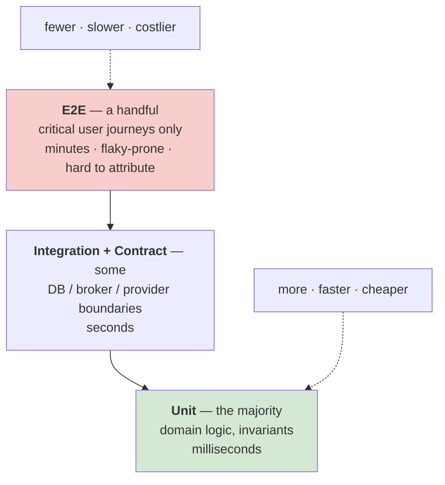
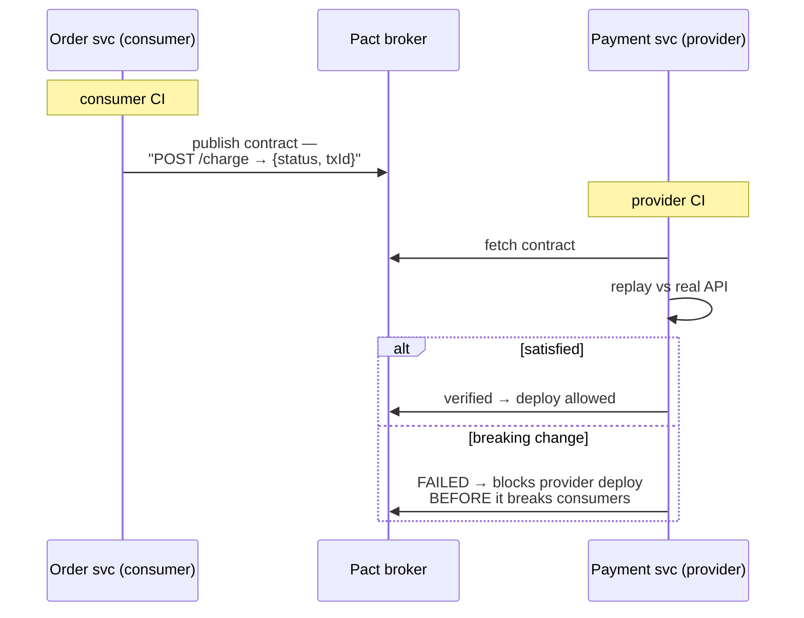
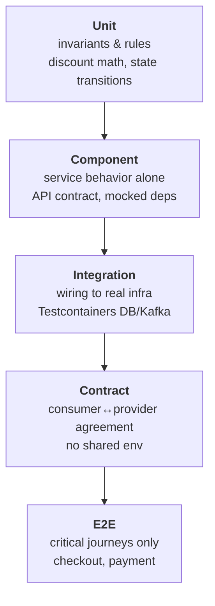

# Testing Strategies — Deep Dive

> **Level:** Intermediate
> **Pre-reading:** [09 · Deployment & Infrastructure](09-deployment.md)

---

## The Testing Pyramid

The **testing pyramid** is a framework for balancing test types by speed, cost, and coverage:

```
         /\
        /  \
       /E2E \        [Slow, Expensive, Few]
      /----- \
     /Contract\      [Medium, Moderate, More]
    /----------\
   / Integration\    [Faster, Cheaper, More]
  /--------------\
 /   Unit Tests   \  [Fast, Cheap, Many]
/------------------\
```

| Type | Speed | Cost | Coverage | Ratio |
|:-----|:------|:-----|:---------|:------|
| **Unit** | < 100ms | Cheap | Narrow (1 function) | 70% |
| **Integration** | 100ms–1s | Moderate | Medium (service) | 20% |
| **Contract** | < 1s | Moderate | API boundaries | 5% |
| **E2E** | 1s–10s | Expensive | Full system | 5% |



### Anti-Pattern: Ice Cream Cone

```
         /\
        /  \
       /E2E \     [Many slow tests]
      /------\
     /  Few   \   [Expensive, brittle]
    /----------\
   /    Few     \
  /              \
```

This inverts the pyramid: expensive tests, slow feedback, high maintenance. Result: test suite becomes a burden; people skip tests locally; quality drops.

---

## Unit Testing

**Definition:** Test a single function or class in isolation.

### Characteristics

- **Scope:** One function, one behavior
- **Speed:** < 100ms per test
- **Isolation:** Mock all dependencies; no I/O, no network
- **Framework:** JUnit, Mockito (Java); Jest (JavaScript); pytest (Python)

### Example: Order Service Discount Calculator

```java
class DiscountCalculatorTest {
    
    @Test
    void applyDiscount_validCustomer_returnsDiscountedPrice() {
        // Arrange
        DiscountCalculator calc = new DiscountCalculator();
        double price = 100.0;
        Customer customer = new Customer("gold", 5); // gold tier, 5 years
        
        // Act
        double result = calc.applyDiscount(price, customer);
        
        // Assert
        assertEquals(85.0, result); // 15% off for gold tier
    }
    
    @Test
    void applyDiscount_newCustomer_noDiscount() {
        DiscountCalculator calc = new DiscountCalculator();
        Customer customer = new Customer("bronze", 0);
        assertEquals(100.0, calc.applyDiscount(100.0, customer));
    }
}
```

### Best Practices

- **One assertion per test** (or logically related assertions)
- **AAA pattern:** Arrange, Act, Assert
- **Descriptive names:** `applyDiscount_validCustomer_returnsDiscountedPrice()` not `test1()`
- **No test interdependencies:** Each test should pass in isolation
- **Mock external dependencies:** Database, HTTP clients, message queues

### When NOT to Unit Test

- Trivial getters/setters (unless enforcing validation)
- Code that only configures frameworks (Spring beans)
- Code already covered by integration tests

---

## Integration Testing

**Definition:** Test multiple components working together; includes I/O and slow operations.

### Characteristics

- **Scope:** Service-to-database, service-to-service via HTTP
- **Speed:** 100ms–1s per test
- **Setup:** Real database, in-memory test database, or testcontainers
- **Framework:** JUnit + Testcontainers (Java); pytest fixtures (Python); Jest + mock HTTP (JavaScript)

### Example: Order Service Integration Test

```java
@SpringBootTest
@Testcontainers
class OrderServiceIntegrationTest {
    
    @Autowired
    private OrderService orderService;
    
    @Container
    static PostgreSQLContainer<?> postgres = 
        new PostgreSQLContainer<>("postgres:15");
    
    @Test
    void createOrder_validData_persistsToDatabase() throws Exception {
        // Arrange
        OrderRequest request = new OrderRequest("PROD-123", 5);
        
        // Act
        Order order = orderService.createOrder(request);
        
        // Assert
        assertNotNull(order.getId());
        assertEquals("PROD-123", order.getProductId());
        
        // Verify persisted
        Order fetched = orderRepository.findById(order.getId()).orElseThrow();
        assertEquals(5, fetched.getQuantity());
    }
    
    @Test
    void createOrder_insufficientInventory_throwsException() {
        OrderRequest request = new OrderRequest("OUT-OF-STOCK", 1000);
        
        assertThrows(InsufficientInventoryException.class,
            () -> orderService.createOrder(request));
    }
}
```

### Testcontainers Benefits

- **Real database:** Postgres, MySQL, Redis, Kafka in Docker
- **Parallel execution:** Each test gets fresh container instance
- **No external test DB:** Safer; no data pollution across teams
- **Auto-cleanup:** Container stopped and removed after test

---

## Contract Testing (Consumer-Driven)

**Definition:** Test the API contract between services before integration.

### Characteristics

- **Scope:** Service A expects Service B to return specific JSON shape
- **Speed:** < 1s per contract
- **Tool:** Pact (JVM, JavaScript, Python, Go, .NET)
- **Key insight:** Consumer defines the contract; provider proves compliance

### Problem Solved

Without contract tests:
```
Timeline:
  Day 1: Service A deployed; calls Payment API
  Day 2: Payment team refactors response: {price} → {amount}
  Day 3: A's calls to Payment start failing in prod 🔥
```

With contract tests:
```
Timeline:
  Day 1: A and Payment define contract (pact)
  Day 2: Payment refactors; Pact tests fail in CI ✓ Caught!
  Day 2b: Payment team updates contract; A's PR updated
  Day 3: Both deployed; no surprises
```

### Example: Order Service ↔ Payment Service Contract

**Consumer (Order Service) defines:**

```java
@ExtendWith(PactConsumerTestExt.class)
@PactTestFor(providerName = "PaymentService", port = "8888")
class PaymentServicePactTest {
    
    @Pact(consumer = "OrderService")
    public V4Pact createPact(PactBuilder builder) {
        return builder
            .uponReceiving("a payment request")
            .path("/api/v1/payments")
            .method("POST")
            .body(json()
                .stringValue("orderId", "ORD-123")
                .numberValue("amount", 99.99)
            )
            .willRespondWith()
            .status(200)
            .body(json()
                .stringValue("transactionId", "TXN-abc")
                .stringValue("status", "SUCCESS")
            )
            .toPact();
    }
    
    @Test
    void orderService_callsPayment_succeeds(MockServer mockServer) {
        PaymentClient client = new PaymentClient(mockServer.getUrl());
        PaymentResponse resp = client.charge("ORD-123", 99.99);
        
        assertEquals("SUCCESS", resp.getStatus());
    }
}
```

**Provider (Payment Service) verifies:**

```bash
# Run in Payment Service CI
mvn pact:verify
# Loads pact from consumer; verifies Payment API satisfies it
```



### When to Use Contract Tests

- Multiple teams; service A and B evolve independently
- Preventing silent API breaking changes
- Building confidence in service boundaries

---

## End-to-End (E2E) Testing

**Definition:** Test the full user journey through the entire system (UI → all backends → database).

### Characteristics

- **Scope:** Browser + all services + real databases
- **Speed:** 1s–10s per test (slow!)
- **Tool:** Selenium, Cypress, Playwright (browser automation)
- **Cost:** Expensive to maintain; brittle (UI changes break tests)

### Example: E2E Checkout Flow

```typescript
describe('Checkout flow', () => {
    
    it('User completes purchase end-to-end', async () => {
        // Navigate to store
        await page.goto('https://store.example.com');
        
        // Search for product
        await page.fill('[data-testid="search"]', 'laptop');
        await page.click('button:has-text("Search")');
        
        // Add to cart
        await page.click('button:has-text("Add to Cart")');
        
        // Checkout
        await page.click('button:has-text("Proceed to Checkout")');
        
        // Enter payment
        await page.fill('[data-testid="card-number"]', '4111-1111-1111-1111');
        await page.fill('[data-testid="expiry"]', '12/26');
        await page.click('button:has-text("Pay Now")');
        
        // Verify order confirmation
        await expect(page).toHaveURL(/\/order-confirmation\/\d+/);
        await expect(page.locator('text=Order Confirmed')).toBeVisible();
    });
});
```

### Best Practices

- **Minimize E2E tests:** Only happy path + critical flows
- **Use test data:** Pre-seed database; don't rely on manual setup
- **Parallel execution:** Spin up multiple browser instances
- **Retry flaky tests:** Network hiccups happen; retry 2–3 times
- **Screenshots on failure:** Capture UI state for debugging

### Anti-Patterns

- E2E tests for every code path (too slow; use unit tests)
- Tests dependent on UI HTML structure (use data-testid attributes)
- Tests that rely on exact timing (add waits for element visibility)

---

## Load Testing

**Definition:** Verify system behaves correctly under high load (high RPS, high concurrency).

### Types

| Type | Load | Purpose | Tool |
|:-----|:-----|:--------|:-----|
| **Load Test** | Realistic traffic volume | Baseline perf; identify bottleneck | JMeter, Locust, k6 |
| **Stress Test** | Push until breaking point | Find failure threshold | Same tools |
| **Spike Test** | Sudden load increase | Test auto-scaling response | Same tools |
| **Soak Test** | Sustained load for hours | Detect memory leaks, connection pool exhaustion | Same tools |

### Example: JMeter Load Test

```yaml
Test Plan:
  - Ramp-up: 0–100 concurrent users over 5 min
  - Sustained: 100 users for 10 min
  - Ramp-down: 100–0 over 2 min
  
Assertions:
  - P95 latency < 500ms
  - Error rate < 0.1%
  - Throughput > 500 RPS

Endpoints:
  - GET /api/products (40%)
  - GET /api/products/{id} (40%)
  - POST /api/orders (20%)
```

### Observations

```
Results:
  Throughput: 400 RPS
  P95 latency: 800ms ← exceeds 500ms target
  
Bottleneck: Database connection pool (max 20, depleted at ~300 RPS)

Action: Increase pool size from 20 → 50; re-test

Post-fix:
  Throughput: 600 RPS ✓
  P95 latency: 300ms ✓
  Error rate: 0.05% ✓
```

### Tools Comparison

| Tool          | Best For                         | Learning Curve  |
|:--------------|:---------------------------------|:----------------|
| **JMeter**    | Enterprise; complex scenarios    | High            |
| **Locust**    | Pythonic; large-scale            | Medium          |
| **k6**        | Developer-friendly; cloud-native | Low             |
| **Artillery** | Quick baseline tests             | Low             |

---

## Chaos Engineering

**Definition:** Intentionally inject failures to verify system handles them gracefully.

### Principles

1. **Steady state:** Define normal system behavior (latency, error rate)
2. **Hypothesis:** Assume system remains in steady state despite failure
3. **Experiment:** Inject failure (kill pod, add network latency)
4. **Observe:** Measure if steady state is maintained
5. **Learn:** If hypothesis breaks, fix it

### Example: Chaos Experiment — Pod Crash

**Hypothesis:** If one pod crashes, traffic failover to remaining replicas; error rate stays < 0.1%.

**Experiment:**
```bash
# Tool: Gremlin, Chaos Monkey, Kyverno

1. Baseline: Order service has 3 replicas, P95 latency 100ms, error rate 0.001%
2. Kill 1 pod
3. Monitor: Does error rate stay < 0.1%? Does latency spike > 200ms?
4. Observation: Error rate jumps to 5% for 10 seconds ✗ Hypothesis broken
5. Root cause: No graceful shutdown (SIGTERM handler); requests drop mid-flight
6. Fix: Add SIGTERM handler; drain in-flight requests before exit
7. Retest: Error rate stays 0.001% ✓ Hypothesis confirmed
```

### Chaos Experiments to Run (Order of Importance)

| Experiment | What Breaks | Fix |
|:-----------|:-----------|:----|
| **Kill random pod** | Graceful shutdown, PDB settings | Add SIGTERM handler; update PodDisruptionBudget |
| **Latency injection** (500ms) | Timeouts, cascading failure | Increase timeout; add bulkhead/circuit breaker |
| **Package loss** (10%) | Network retries, connection pooling | Tune retry backoff; increase pool size |
| **Database slowness** (5s queries) | Query queue, thread starvation | Add query timeout; optimize slow queries |
| **Service dependency unavailable** | Fallback logic | Implement fallback; test it regularly |

### Tools

| Tool | Scope | Ease |
|:-----|:-------|:-----|
| **Gremlin** | Cloud-agnostic; SaaS dashboard | Easy; cost |
| **Chaos Monkey** | AWS-native; random termination | Easy; basic |
| **Kyverno** | Kubernetes-native; policy-based | Medium; free |
| **Locust** | Load + chaos in code | Medium; flexible |
| **Pumba** | Docker; random container killing | Easy; local |

---

## Test Coverage Metrics

**Code coverage** (% of lines executed by tests) is a useful signal but not a goal:

| Coverage | Interpretation |
|:---------|:-----------------|
| **< 30%** | Tests are afterthought; likely missing critical paths |
| **30–60%** | Decent; focus on critical business logic paths |
| **60–80%** | Good; add E2E for critical user flows; don't obsess over edge cases |
| **> 90%** | Diminishing returns; focus on **mutation testing** instead |

### Mutation Testing

Instead of "did we run this line?", ask "does changing this line break a test?"

```java
// Original
public int calculateDiscount(int years) {
    return years > 5 ? 10 : 0;
}

// Mutation 1
public int calculateDiscount(int years) {
    return years > 4 ? 10 : 0;  // Changed 5 → 4
}

// Mutation 2
public int calculateDiscount(int years) {
    return years >= 5 ? 10 : 0;  // Changed > to >=
}
```

If tests don't catch these mutations, coverage is false confidence.

**Tool:** PIT (Java), Stryker (JavaScript).

---

## TDD vs BDD

### Test-Driven Development (TDD)

**Red-Green-Refactor cycle:**

1. **Red:** Write a failing test for the feature you want to build
2. **Green:** Write minimal code to make the test pass
3. **Refactor:** Improve code quality without changing behavior

**Example: TDD for Discount Calculator**

```java
// Step 1: Red — Write test first (test fails)
@Test
void applyDiscount_goldCustomer_returns15Percent() {
    DiscountCalculator calc = new DiscountCalculator();
    Customer customer = new Customer("gold", 5);
    
    double result = calc.applyDiscount(100.0, customer);
    
    assertEquals(85.0, result);  // Test fails: method doesn't exist yet
}

// Step 2: Green — Write minimal code to pass
public class DiscountCalculator {
    public double applyDiscount(double price, Customer customer) {
        if ("gold".equals(customer.getTier())) {
            return price * 0.85;  // Minimal code: hardcoded for gold
        }
        return price;
    }
}

// Step 3: Refactor — Add more tests; improve implementation
@Test
void applyDiscount_silverCustomer_returns10Percent() {
    // Test for silver tier
}

// Refactor: Extract to method
private double getDiscount(String tier) {
    return switch(tier) {
        case "gold" -> 0.15;
        case "silver" -> 0.10;
        default -> 0.0;
    };
}
```

**Benefits of TDD:**

- Forces you to think about API design before implementation
- 100% test coverage naturally
- Refactoring confidence: tests catch regressions
- Documents expected behavior via tests

---

### Behavior-Driven Development (BDD)

**BDD extends TDD by writing tests in business language, not code language.**

**Key principle:** Tests describe *behavior* (what the system should do), not *implementation* (how it works).

**Format: Given-When-Then (Gherkin syntax)**

```gherkin
Feature: Order checkout discount
  Scenario: Gold customer gets 15% discount
    Given a gold-tier customer with 5 years tenure
    When they checkout with $100 order
    Then they pay $85
    
  Scenario: New customer gets no discount
    Given a new customer with no history
    When they checkout with $100 order
    Then they pay $100
```

**Automated with Cucumber/Behave/Gherkin:**

```java
public class OrderSteps {
    
    private Customer customer;
    private double totalPrice;
    private double discountedPrice;
    
    @Given("a gold-tier customer with {int} years tenure")
    public void createGoldCustomer(int years) {
        customer = new Customer("gold", years);
    }
    
    @When("they checkout with ${double} order")
    public void checkout(double price) {
        totalPrice = price;
        DiscountCalculator calc = new DiscountCalculator();
        discountedPrice = calc.applyDiscount(price, customer);
    }
    
    @Then("they pay ${double}")
    public void verifyPrice(double expected) {
        assertEquals(expected, discountedPrice);
    }
}
```

**BDD Benefits:**

- **Business-readable:** Non-technical stakeholders understand tests
- **Living documentation:** Tests describe current behavior
- **Collaboration:** Developers, QA, and product managers write scenarios together
- **Catches misunderstandings:** Ambiguities surface in Given-When-Then discussions

**TDD vs BDD:**

| Aspect          | TDD                    | BDD                        |
|:----------------|:-----------------------|:---------------------------|
| **Focus**       | How to implement       | What behavior matters      |
| **Language**    | Code (Assert, etc)     | Business English (Gherkin) |
| **Test level**  | Unit/Integration       | Scenario-based (varies)    |
| **Audience**    | Developers             | Developers + QA + Business |
| **Granularity** | Fine (single function) | Coarse (user story)        |

---

## Fundamental Testing Types (By Scope)

The testing pyramid shows *types* (unit, integration, E2E). But there are other dimensions:

### Component Testing

**Definition:** Test a single component (service, module, class cluster) in isolation.

**Scope:** Larger than unit; smaller than integration.

**Example: Payment Service Component Test**

```java
@SpringBootTest
class PaymentServiceComponentTest {
    
    @Autowired
    private PaymentService paymentService;
    
    @MockBean
    private PaymentGatewayClient gatewayClient;  // Mock external API
    
    @Autowired
    private PaymentRepository repository;
    
    @Test
    void processPayment_validCard_recordsTransaction() {
        // Test the entire Payment Service; external calls mocked
        when(gatewayClient.charge(any())).thenReturn(ChargeResponse.success());
        
        Payment payment = paymentService.process(
            new PaymentRequest("4111-1111-1111-1111", 99.99)
        );
        
        assertNotNull(payment.getId());
        verify(repository).save(any());  // Verify DB interaction
    }
}
```

**What's tested:**

- Service logic: discount logic + payment flow
- Database: transactions are persisted
- Mocked: external payment gateway

**What's NOT tested:**

- How payment gateway actually works (mocked)
- How other services integrate (mocked)

---

### Functional Testing

**Definition:** Verify that a feature works as specified; any test that checks functionality qualifies.

**Scope:** Can be unit, component, integration, or E2E.

**Example: Functional Test for Order Discount**

```java
@Test
void orderCheckout_appliesLoyaltyDiscount_correctly() {
    // Functional: Does the discount feature work end-to-end?
    
    // Setup
    Customer customer = new Customer("gold", 5);
    Order order = new Order(100.0);
    
    // Execute
    OrderProcessor processor = new OrderProcessor();
    double finalPrice = processor.checkout(customer, order);
    
    // Verify
    assertEquals(85.0, finalPrice);  // 15% discount applied
}
```

**Key point:** Functional testing doesn't care about *implementation details*; only that the feature works.

---

### Regression Testing

**Definition:** Verify that changes don't break existing features.

**Scope:** Usually re-run existing test suite after code changes.

**Example:**

```
You add a new feature: "Silver customers get 10% discount"

Regression tests:
  ✓ Gold customers still get 15% (didn't break)
  ✓ New customers get 0% (didn't break)
  ✓ Silver customers get 10% (new feature)
```

**When to run:** After every code change, before release.

**Tools:** Automated test suites (unit, integration, E2E).

---

### Smoke Testing

**Definition:** Quick sanity check; verify the system is *basically working* after deployment.

**Scope:** Small subset of critical paths; fast to run.

**Example: Smoke Tests for E-commerce**

```bash
# Smoke test suite (runs in < 2 minutes)
POST /api/login → 200 OK
GET /api/products → 200 OK (not empty)
POST /api/orders → 201 OK (order created)
GET /api/orders/{id} → 200 OK (order retrieved)
```

**When to run:** After deploying to staging/prod; before running full test suite.

**Typical time:** < 5 minutes for entire smoke test suite.

**Example in code:**

```java
@SpringBootTest
class SmokeTests {
    
    @Autowired
    private WebTestClient webClient;
    
    @Test
    void systemIsUp_returnsHealthOK() {
        webClient.get()
            .uri("/actuator/health")
            .exchange()
            .expectStatus().isOk();
    }
    
    @Test
    void canCreateOrder() {
        webClient.post()
            .uri("/api/orders")
            .bodyValue(new CreateOrderRequest("PROD-123", 5))
            .exchange()
            .expectStatus().isCreated();
    }
}
```

---

### Manual Testing

**Definition:** Human testers interact with the system; not automated.

**When used:**

- Exploratory testing (finding unexpected issues)
- UX testing (does the UI feel right?)
- Complex scenarios that are hard to automate
- Ad-hoc testing after major changes

**Differs from automation:**

| Aspect | Manual | Automated |
|:-------|:-------|:----------|
| **Speed** | Slow; limited coverage | Fast; broad coverage |
| **Cost** | High (tester time) | High (initial); amortized |
| **Maintenance** | Low (scenarios change) | High (tests break with UI changes) |
| **Repeatability** | Variable (human error) | Consistent (exact same steps) |
| **Insight** | Creative; finds edge cases | Deterministic; tests spec |

**Best for:**

- New products (scenarios unknown)
- UI/UX validation (feels good?)
- Complex edge cases (hard to automate)
- Accessibility testing (screen readers, keyboard nav)

---



## Test Scope Examples by Layer

Here's a concrete example showing different test types for an Order Service:

```
┌─────────────────────────────────────────────────────┐
│  E2E Test: Full checkout flow (UI → API → DB)       │
│  "Customer adds item, checks out, sees confirmation"│
│  Tool: Selenium, Cypress                            │
│  Speed: 5–10 seconds                                │
└─────────────────────────────────────────────────────┘
                          ↓
┌─────────────────────────────────────────────────────┐
│  Contract Test: Order Service ↔ Payment Service     │
│  "Order expects Payment to return {txnId, status}"  │
│  Tool: Pact                                         │
│  Speed: < 1 second                                  │
└─────────────────────────────────────────────────────┘
                          ↓
┌─────────────────────────────────────────────────────┐
│  Component Test: Order Service (Payment mocked)     │
│  "Given order with gold customer, discount applied" │
│  Tool: Spring Boot Test                             │
│  Speed: 100ms–1s                                    │
└─────────────────────────────────────────────────────┘
                          ↓
┌─────────────────────────────────────────────────────┐
│  Unit Test: Discount calculation                    │
│  "Gold tier + $100 = $85"                           │
│  Tool: JUnit + Mockito                              │
│  Speed: < 100ms                                     │
└─────────────────────────────────────────────────────┘

Each layer tests a different scope:
- Unit: Single function
- Component: Service + internal logic
- Contract: Service boundaries
- E2E: Entire user flow
```

---

## Test Strategy by Architecture Style

### Monolith

- High % unit tests (70–80%)
- Integration tests for critical flows (15–20%)
- E2E for user journeys (5–10%)
- No contract tests needed (single codebase)

### Microservices

- Unit tests: 60–70% (smaller services)
- Integration tests: 15–20% (database + local dependencies)
- Contract tests: 5–10% (enforce API boundaries)
- E2E tests: 3–5% (expensive; only critical paths)
- Load tests: Baseline for each service
- Smoke tests: Before releases (quick sanity check)

---

??? question "What's the difference between TDD and BDD?"
    TDD writes code-level tests first (red-green-refactor). BDD extends TDD by writing business-readable scenarios (Given-When-Then) that non-technical people understand. TDD is developer-focused; BDD is team-focused (devs + QA + business).

??? question "When should I use BDD vs regular unit tests?"
    Use BDD for complex business logic and user-facing features where clarity matters. Use unit tests for utility functions and low-level logic. Often use both: BDD at scenario level; unit tests for implementation details.

??? question "What's the difference between component and integration tests?"
    Component tests mock external dependencies (payment gateway, other services). Integration tests use real dependencies (real database). Component tests run faster; integration tests catch more issues. Use component tests first; integration tests for critical paths.

??? question "How much test coverage should we aim for?"
    60–80% of critical business logic. Avoid chasing 100%; diminishing returns after 80%. Use mutation testing to validate quality over quantity.

??? question "Who writes tests: developers or QA?"
    Developers write unit, integration, and contract tests. QA writes E2E, load, and exploratory tests. With good unit/integration tests, QA focus shifts from regression to edge cases and UX.

??? question "Should we run all tests in CI or just fast ones?"
    Run unit + integration (< 5 min) on every commit. Run E2E + load on release branches or nightly. Parallel execution helps; aim for total CI time < 10 min. Always run smoke tests after deployment.


---

## 📝 Knowledge Check

<quiz>
The testing pyramid says 'many unit, fewer integration, fewest E2E.' Why is the inverse ('ice cream cone') so harmful in microservices?
- [ ] Pyramids are just aesthetics
- [x] E2E tests cross real services: slow (minutes each), flaky (timing/env), brittle (break on any service's change, hard to attribute), and expensive to maintain — a suite built mostly on them is too slow to run per-commit, so bugs are found late and suites get disabled. Unit tests are fast/isolated/cheap; invert the ratio to keep feedback fast and failures attributable
- [ ] E2E is more realistic — more is better
- [ ] Unit tests can't test services

the pyramid is about *feedback economics*: unit tests give instant, attributable signal; E2E gives slow, noisy signal. Ice-cream-cone suites rot — they take hours, flake, nobody trusts them, they get skipped. The microservices twist: contract tests (the middle layer) catch most of what teams over-rely on E2E for, at integration-test cost.
</quiz>
<quiz>
When is a unit test the WRONG tool — what should you not waste it on?
- [ ] Unit tests cover everything
- [x] Code that has no logic to test: pure orchestration/glue (call A, pass to B, return), simple mappers, and anything whose risk lives in *integration* (SQL correctness, serialization, framework wiring) — a unit test that mocks away the DB proves the mock works, not the query. Test behavior-rich domain logic with units; test the boundaries with integration tests
- [ ] Only trivial getters
- [ ] Mock everything for speed

the failure mode is '100% coverage, zero confidence': mocks that perfectly mirror what you *think* the dependency does prove nothing about what it *does*. Unit tests earn their keep on logic with branches/invariants (pricing rules, state machines); code whose only content is wiring belongs in an integration test against the real thing (or a testcontainer).
</quiz>
<quiz>
Contract testing (Pact-style) — what does a 'consumer-driven contract' test that a shared API spec doesn't?
- [ ] Same thing as OpenAPI
- [x] The consumer records what it *actually uses* ('I need fields X,Y in this shape'); the provider's CI verifies it still satisfies that — catching breaking changes the spec's authors didn't know consumers depended on. A shared spec says what's *offered*; a consumer contract says what's *used* — providers break consumers on fields the spec called 'optional' but a client required
- [ ] It tests performance
- [ ] It's just mocking

the gap is 'declared contract vs. depended-on reality': consumers silently depend on quirks (field order, exact enum values, response timing). Consumer-driven contracts turn 'we think we didn't break them' into 'their recorded expectations still pass in our CI' — the provider learns it's breaking someone *before* deploy, not after the incident.
</quiz>
<quiz>
Testcontainers vs in-memory fakes (H2, embedded brokers) for integration tests — when does the real dependency matter?
- [ ] Fakes are fine — faster
- [x] Fakes diverge: H2 accepts SQL Postgres rejects, in-memory brokers lack real partitioning/ordering semantics — tests pass against fiction. Testcontainers runs the *real* Postgres/Kafka/Redis in Docker: same engine, same quirks, same schema semantics — catching 'works on H2, dead on prod' bugs. Use fakes for pure speed in unit tests, real deps wherever integration behavior is what's being tested
- [ ] Testcontainers are slower — avoid
- [ ] Only needed for Kafka

the entire point of integration tests is fidelity to the real dependency; a fake that doesn't share the behavior is testing an imaginary system. Postgres-specific types, real transaction semantics, actual partitioning — the 'it worked in tests' bug is usually a fake diverging. Testcontainers pays a startup cost to buy realism where it matters.
</quiz>
<quiz>
A 'flaky' E2E suite keeps getting 're-run until green.' What's the underlying disease — and does more retrying cure it?
- [ ] Retry is standard practice
- [x] Flakiness is usually real signal: timing dependencies, test pollution (shared state between tests), environment non-determinism, or an actual race in the app — 're-run until pass' hides it and trains the team to distrust the suite. Fix the determinism (fixed data, explicit waits, isolated state, quarantine flaky tests) — a suite you don't trust is worse than none
- [ ] Run tests sequentially — fixes it
- [ ] It's just CI being slow

're-run until green' converts signal into noise: either the test is non-deterministic (bad test — fix or delete) or the system is (a real race you're shipping). Common diseases: `sleep()`s instead of condition-waits, shared mutable state across tests, ordering assumptions, and time-dependent logic. Quarantine + fix ruthlessly — a flaky suite teaches everyone to ignore red.
</quiz>