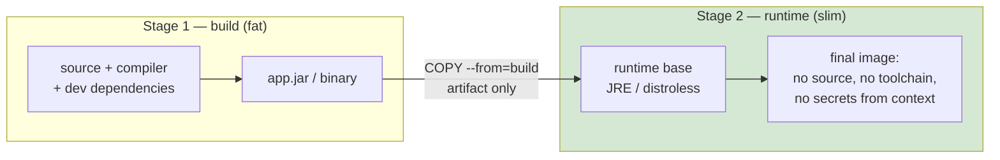
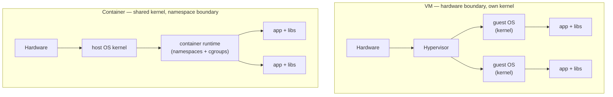

# Containers and Docker — Deep Dive

> **Level:** Beginner → Intermediate  
> **Pre-reading:** [09 · Deployment & Infrastructure](09-deployment.md)

---

## Container Concepts

| Concept | Description |
|:--------|:------------|
| **Image** | Immutable template containing app + dependencies |
| **Container** | Running instance of an image |
| **Registry** | Repository for storing images |
| **Layer** | Image built in layers; shared between images |

---

## Dockerfile Best Practices

```dockerfile
# Use specific version, not latest
FROM eclipse-temurin:17-jre-alpine

# Non-root user
RUN addgroup -S appgroup && adduser -S appuser -G appgroup
USER appuser

# Copy only what's needed
COPY --chown=appuser:appgroup target/app.jar /app/

# Expose port documentation
EXPOSE 8080

# Health check
HEALTHCHECK --interval=30s --timeout=3s \
  CMD wget -q --spider http://localhost:8080/actuator/health || exit 1

# Clear entrypoint
ENTRYPOINT ["java", "-jar", "/app/app.jar"]
```

---

## Multi-Stage Builds

```dockerfile
# Build stage
FROM maven:3.9-eclipse-temurin-17 AS build
WORKDIR /app
COPY pom.xml .
RUN mvn dependency:go-offline
COPY src ./src
RUN mvn package -DskipTests

# Runtime stage (smaller image)
FROM eclipse-temurin:17-jre-alpine
COPY --from=build /app/target/app.jar /app/app.jar
ENTRYPOINT ["java", "-jar", "/app/app.jar"]
```

| Without Multi-Stage | With Multi-Stage |
|:--------------------|:-----------------|
| 800MB+ (includes Maven, JDK) | ~150MB (JRE only) |

---



## Image Security

| Practice | Rationale |
|:---------|:----------|
| **Minimal base image** | Less attack surface (alpine, distroless) |
| **Non-root user** | Limit container privileges |
| **No secrets in image** | Use runtime injection |
| **Scan for vulnerabilities** | Trivy, Snyk |
| **Pin versions** | Reproducible builds |

---



## Container vs VM

| Aspect | Container | VM |
|:-------|:----------|:---|
| **Isolation** | Process-level | Hardware-level |
| **Size** | MBs | GBs |
| **Startup** | Seconds | Minutes |
| **Resource usage** | Shared kernel | Full OS per VM |

---

??? question "Why use multi-stage builds?"
    Multi-stage builds create smaller, more secure images by separating build dependencies from runtime. Build stage includes compilers, build tools. Runtime stage includes only what's needed to run. Result: faster pulls, smaller attack surface.

??? question "Why run containers as non-root?"
    If a container is compromised, non-root limits damage. Root in container = root on host (with certain misconfigurations). Always use non-root unless absolutely necessary.

??? question "Alpine vs Distroless — which to choose?"
    **Alpine**: Minimal Linux with shell and package manager; easy to debug. **Distroless**: No shell, no package manager; smallest attack surface. Use Alpine for development; consider Distroless for production security-critical apps.


---

## 📝 Knowledge Check

<quiz>
Why does a multi-stage build matter beyond image size?
- [ ] Just smaller images
- [x] Attack surface + build hygiene: the runtime image drops compilers, package managers, dev deps, and your source tree — fewer tools for an attacker post-compromise, no accidentally-shipped secrets from build context, faster pulls/scans, and a clear 'build artifacts vs runtime' separation
- [ ] It's cosmetic
- [ ] Only for Go binaries

size is the symptom; the disease is shipping your build toolchain to production. An image with `gcc`, `npm`, `.git`, and dev dependencies is a bigger target and a bigger pull. Multi-stage = 'build in a fat image, copy the artifact to a slim one' — the shipped image should contain the runtime and nothing else.
</quiz>
<quiz>
'Pin the base image' — `node:20` vs `node:20.11.0` vs `node:20@sha256:...`. What does each guarantee?
- [ ] Same thing
- [x] `node:20` floats on minor+patch updates (rebuilds pull whatever's current — silently changed images, 'worked last week'). `node:20.11.0` pins a version but the *tag can be re-pushed* (rare, but tags are mutable). `@sha256:digest` pins the exact content — immutable, fully reproducible; the trade-off is you must deliberately bump it for patches
- [ ] Latest is fine — updates are good
- [ ] Digest pins are overkill

reproducibility vs. patch-management is the trade: floating tags auto-get patches but change under you; digests are perfectly reproducible but freeze you on unpatched bases unless you deliberately bump. Production norm: pin digest (or Renovate-managed digest + auto-PRs) — 'deterministic builds' beats 'maybe got a security patch, maybe got a breaking change.'
</quiz>
<quiz>
`USER appuser` instead of root — what's the concrete attack it limits?
- [ ] Cosmetic — containers are already isolated
- [x] Container-as-root + a breakout/kernel vuln or a mounted sensitive path = root-adjacent on the host; a non-root USER means even a fully-owned app process has no privileges inside the container to escalate — defense in depth for the 'container escapes are real' world (also required by many PodSecurity standards)
- [ ] It prevents port conflicts
- [ ] Root is needed for logging

'containers contain' is true *until it isn't*: kernel CVEs, misconfigured mounts, `/var/run/docker.sock` exposure — a root process inside makes every one of those worse. Non-root is cheap insurance and increasingly *required* (restricted PodSecurity, admission policies). Also: write-permission discipline follows — an app that can't write its own filesystem resists tampering.
</quiz>
<quiz>
Container vs VM — what's the isolation boundary difference that matters for security?
- [ ] They're the same thing, different packaging
- [x] VMs get their own kernel (hypervisor boundary); containers *share the host kernel* and are isolated by namespaces+cgroups — lighter and faster, but the kernel is a shared attack surface: a kernel exploit or a cgroup/namespace misconfiguration is a container-to-host path, so containers need the extra discipline (non-root, seccomp, no privileged mode, minimal capabilities)
- [ ] Containers are more isolated
- [ ] VMs are deprecated

the shared-kernel trade: containers pack density and speed by trusting the host kernel's isolation features; VMs isolate at hardware-virtualization depth. This is why 'just containerize it' needs compensating controls — drop capabilities, read-only rootfs, no `--privileged` — you're hardening a shared boundary, not a private one.
</quiz>
<quiz>
HEALTHCHECK + `.dockerignore` + 'exec-form CMD' — what do these three small practices each prevent?
- [ ] They're optional polish
- [x] HEALTHCHECK lets orchestrators detect 'running but hung' (process alive, app dead — restart it). `.dockerignore` keeps secrets/.git/build-junk out of the image and build context (leak + cache-bust prevention). Exec-form (`CMD ["java","-jar"...]`) runs your app as PID 1 directly — it receives SIGTERM and shuts down gracefully; shell-form hides it behind /bin/sh, swallowing signals
- [ ] HEALTHCHECK is just for docs
- [ ] Shell-form is fine for signals

three quiet footguns: no healthcheck = hung-but-alive processes serve errors forever; missing .dockerignore = `COPY . .` ships secrets; shell-form CMD = SIGTERM hits /bin/sh, your app never hears it, and 'graceful shutdown' is a 30s SIGKILL wait instead — the reason pods 'won't drain' during rollouts.
</quiz>