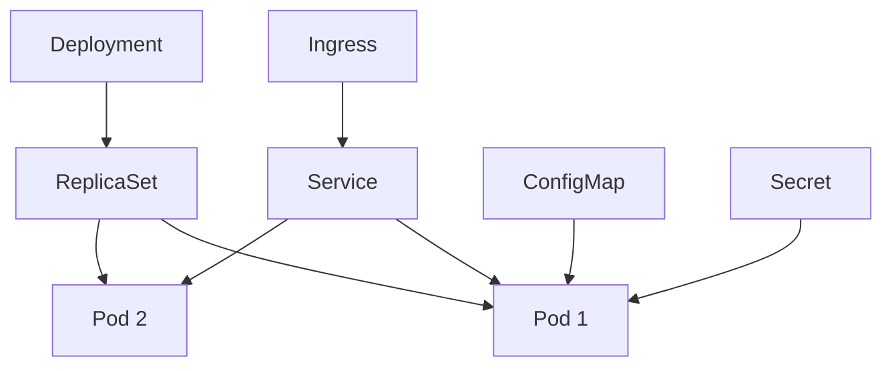
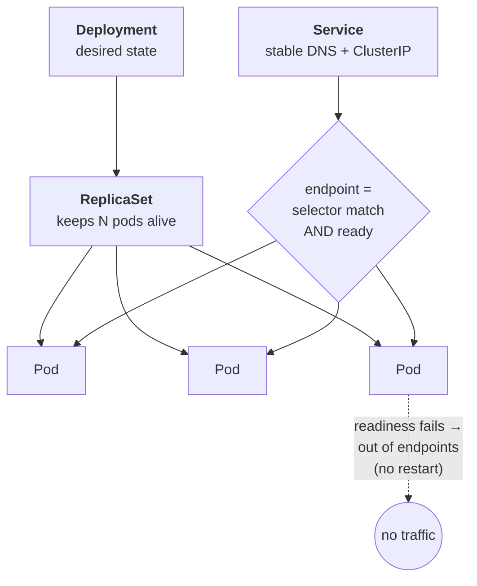
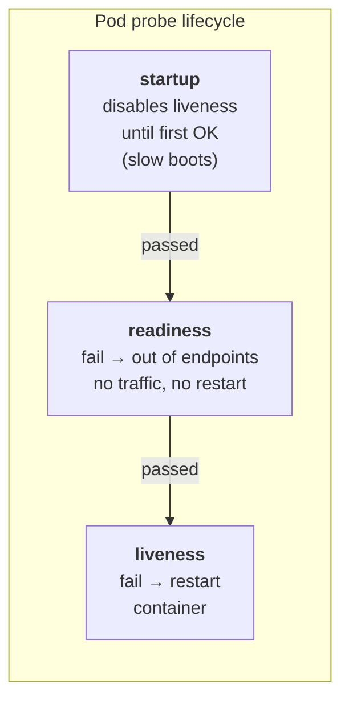

# Kubernetes Core — Deep Dive

> **Level:** Intermediate  
> **Pre-reading:** [09 · Deployment & Infrastructure](09-deployment.md)

---

## Core Objects



| Object | Purpose |
|:-------|:--------|
| **Pod** | Smallest deployable unit; 1+ containers |
| **Deployment** | Manages ReplicaSets; declarative updates |
| **Service** | Stable network endpoint for pods |
| **ConfigMap** | Non-sensitive configuration |
| **Secret** | Sensitive configuration (base64) |
| **Ingress** | HTTP routing and TLS termination |

---

## Pod Specification

```yaml
apiVersion: v1
kind: Pod
metadata:
  name: order-service
  labels:
    app: order
spec:
  containers:
    - name: order
      image: order-service:1.0
      ports:
        - containerPort: 8080
      resources:
        requests:
          memory: "256Mi"
          cpu: "250m"
        limits:
          memory: "512Mi"
          cpu: "500m"
      readinessProbe:
        httpGet:
          path: /actuator/health/readiness
          port: 8080
        initialDelaySeconds: 10
        periodSeconds: 5
      livenessProbe:
        httpGet:
          path: /actuator/health/liveness
          port: 8080
        initialDelaySeconds: 30
        periodSeconds: 10
      env:
        - name: SPRING_PROFILES_ACTIVE
          value: "production"
        - name: DB_PASSWORD
          valueFrom:
            secretKeyRef:
              name: db-secret
              key: password
```

---



## Service Types

| Type | Description | Use Case |
|:-----|:------------|:---------|
| **ClusterIP** | Internal only | Service-to-service |
| **NodePort** | Expose on each node's IP | Development |
| **LoadBalancer** | Cloud load balancer | External access |
| **ExternalName** | DNS alias | External services |

---

## Health Probes

| Probe | Question | Action on Failure |
|:------|:---------|:------------------|
| **livenessProbe** | Is app alive? | Restart pod |
| **readinessProbe** | Is app ready for traffic? | Remove from Service |
| **startupProbe** | Has app started? | Pause liveness/readiness |

---



## Resource Management

```yaml
resources:
  requests:    # Scheduling: guaranteed minimum
    memory: "256Mi"
    cpu: "250m"
  limits:      # Enforcement: maximum allowed
    memory: "512Mi"
    cpu: "500m"
```

| Scenario | Behavior |
|:---------|:---------|
| Exceeds memory limit | Pod killed (OOMKilled) |
| Exceeds CPU limit | Throttled |
| Below requests | May be evicted under pressure |

---

## HPA (Horizontal Pod Autoscaler)

```yaml
apiVersion: autoscaling/v2
kind: HorizontalPodAutoscaler
metadata:
  name: order-hpa
spec:
  scaleTargetRef:
    apiVersion: apps/v1
    kind: Deployment
    name: order-service
  minReplicas: 2
  maxReplicas: 10
  metrics:
    - type: Resource
      resource:
        name: cpu
        target:
          type: Utilization
          averageUtilization: 70
```

---

## RBAC

```yaml
apiVersion: rbac.authorization.k8s.io/v1
kind: Role
metadata:
  name: pod-reader
rules:
  - apiGroups: [""]
    resources: ["pods"]
    verbs: ["get", "list", "watch"]
---
apiVersion: rbac.authorization.k8s.io/v1
kind: RoleBinding
metadata:
  name: read-pods
subjects:
  - kind: ServiceAccount
    name: my-service-account
roleRef:
  kind: Role
  name: pod-reader
  apiGroup: rbac.authorization.k8s.io
```

---

??? question "What's the difference between requests and limits?"
    **Requests** are guaranteed resources used for scheduling — the scheduler places pods where requests can be satisfied. **Limits** are maximums — exceeding memory kills the pod; exceeding CPU throttles it. Set requests based on typical usage; limits based on acceptable peak.

??? question "When should you use readinessProbe vs livenessProbe?"
    **livenessProbe** detects deadlocks/hangs — restart the pod. **readinessProbe** detects temporary unavailability — stop sending traffic until ready. Example: liveness checks if app is alive; readiness checks if dependencies (DB) are connected.

??? question "How do you handle secrets in Kubernetes?"
    (1) K8s Secrets (base64, not encrypted by default). (2) Enable encryption at rest with KMS. (3) Use External Secrets Operator to sync from Vault/AWS SM. (4) Use sealed-secrets for GitOps. (5) Mount as volumes, not env vars for security.


---

## 📝 Knowledge Check

<quiz>
A Pod is 'running' but receiving no traffic — the Service shows no endpoints. Debug order?
- [ ] Restart the pod
- [x] Check the Service's selector labels vs pod labels (endpoint list only includes pods the selector matches), then the pod's readiness probe (unready pods are excluded from endpoints even if Running), then the container port vs Service targetPort. `kubectl get endpoints <svc>` empty = it's almost always selector-mismatch or readiness — not 'the pod is down'
- [ ] Check DNS first
- [ ] Delete and recreate the Service

the Service→Pod link is *label-based*: endpoints = pods matching selector AND passing readiness. 'Running' ≠ 'ready.' The debug path: `kubectl get endpoints` (empty?) → `kubectl describe pod` (readiness failing?) → compare labels (selector matches?). Restarting a pod that isn't broken solves nothing — the mismatch persists.
</quiz>
<quiz>
Requests vs limits — why does a pod with `limits.memory` but no `requests` sometimes get OOMKilled anyway?
- [ ] Kubernetes bug
- [x] Requests = scheduling guarantee ('reserve this much'); limits = ceiling ('kill above this'). A pod OOMKills when it *exceeds its memory limit* regardless of what was requested — but without requests, the scheduler may pack the pod on a node that can't actually sustain it, and QoS class drops (BestEffort/Burstable) making it an eviction candidate under node pressure. Set both: requests for honest scheduling, limits for containment
- [ ] Limits aren't enforced
- [ ] OOMKilled means node ran out, not pod

the subtlety: memory limits are hard caps (OOMKill on exceed — no throttling, unlike CPU); requests drive *scheduling* and eviction priority (QoS: Guaranteed > Burstable > BestEffort). Missing requests = optimistic packing + first-to-die under pressure; missing limits = a leak can starve the node. 'Both, honestly-sized' is the production default.
</quiz>
<quiz>
CPU limit throttling — a pod at '50% CPU' is mysteriously slow. Why?
- [ ] It's fine — 50% is headroom
- [x] CPU limits throttle via CFS quota: hitting the limit doesn't kill, it *stalls* the container for the rest of each period — 'average 50% utilization' can still mean brutal 99th-percentile stalls if bursts exceed quota in short windows. Options: raise limits, drop limits (keep requests for scheduling, avoid throttling), or smooth the workload's CPU bursts — check `container_cpu_cfs_throttled_seconds`, not just utilization
- [ ] Add more replicas — fixes latency
- [ ] CPU throttling doesn't happen in K8s

CPU throttling is per-*period* (100ms windows): a 1s burst budget exhausted in 20ms = 80ms of stall — 'the pod looks under-utilized' while latency spikes. This is why some teams omit CPU *limits* entirely (keeping requests for QoS/scheduling) — memory limits (hard kill) are more clearly necessary than CPU limits (stealth stalls).
</quiz>
<quiz>
Readiness vs liveness vs startup probe — map each to a real scenario.
- [ ] All check 'is it up'
- [x] Startup probe: protects slow starters — disables liveness until the app answers once (legacy apps taking 90s don't crash-loop). Liveness: 'is it stuck?' — restart on deadlock. Readiness: 'can it serve?' — pulls the endpoint during warm-up, overload, or dependency-outage without killing the pod
- [ ] Liveness is for traffic; readiness restarts
- [ ] Startup probe is optional decoration

three different questions at three lifecycle phases: startup covers boot (so liveness doesn't kill you while you warm), liveness covers 'unrecoverable — restart me,' readiness covers 'temporarily can't serve — route around me.' The classic bug: liveness that checks dependencies — a DB blip then restarts *every* pod at once.
</quiz>
<quiz>
HPA scales on CPU at 60% — but your bottleneck is a queue backlog, not CPU. What's the fix?
- [ ] Lower the CPU threshold
- [x] Scale on the *real* signal: custom/external metrics — HPA can target `messages_in_queue` (via external metrics adapter/KEDA) instead of CPU. CPU-based scaling on a queue consumer lags: backlog grows while CPU stays low (workers idle-waiting), so the autoscaler never fires — metric choice determines whether autoscaling helps at all
- [ ] HPA only supports CPU anyway
- [ ] Use VPA instead

autoscaling on the wrong metric is worse than none: it looks like scaling coverage while missing the actual pressure. Queue-depth/KEDA-based scaling tracks the work signal; CPU scaling only tracks CPU-bound load. And mind the interaction: scaling *out* consumers multiplies DB/broker load — the bottleneck moves, so watch downstream saturation as replicas grow.
</quiz>