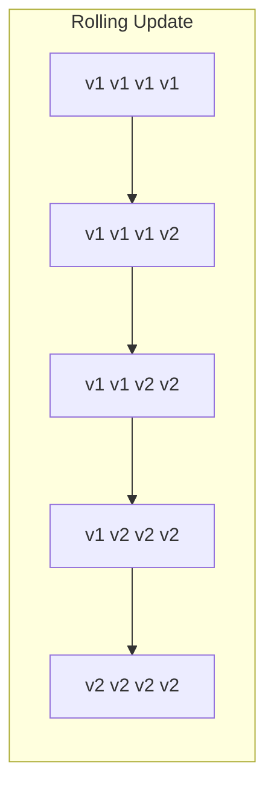
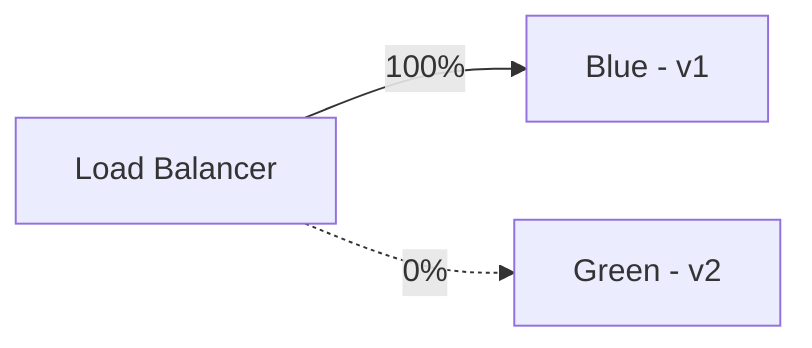
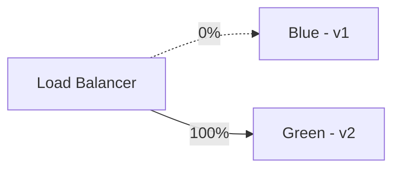
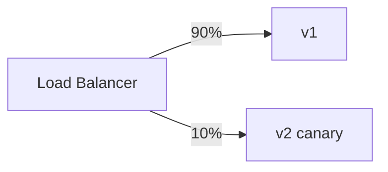

# Deployment Strategies — Deep Dive

> **Level:** Intermediate  
> **Pre-reading:** [09 · Deployment & Infrastructure](09-deployment.md)

---

## Strategy Comparison

| Strategy | Downtime | Rollback | Resource Usage | Risk |
|:---------|:---------|:---------|:---------------|:-----|
| **Recreate** | Yes | Slow | Normal | High |
| **Rolling** | No | Slow | Normal + buffer | Low |
| **Blue-Green** | No | Instant | 2x | Low |
| **Canary** | No | Fast | Normal + small | Very Low |

---

## Rolling Update

```yaml
apiVersion: apps/v1
kind: Deployment
spec:
  replicas: 4
  strategy:
    type: RollingUpdate
    rollingUpdate:
      maxSurge: 1        # Extra pods during update
      maxUnavailable: 0  # Always maintain capacity
```



---

## Blue-Green

Run two identical environments; switch traffic instantly.



After verification:



### Implementation (K8s)

```yaml
# Blue deployment
apiVersion: apps/v1
kind: Deployment
metadata:
  name: order-service-blue
  labels:
    version: blue
---
# Green deployment
apiVersion: apps/v1
kind: Deployment
metadata:
  name: order-service-green
  labels:
    version: green
---
# Service points to active version
apiVersion: v1
kind: Service
metadata:
  name: order-service
spec:
  selector:
    app: order-service
    version: blue  # Switch to green to flip
```

---

## Canary

Route small percentage to new version; expand gradually.



### Istio Canary

```yaml
apiVersion: networking.istio.io/v1beta1
kind: VirtualService
metadata:
  name: order-service
spec:
  hosts:
    - order-service
  http:
    - route:
        - destination:
            host: order-service
            subset: v1
          weight: 90
        - destination:
            host: order-service
            subset: v2
          weight: 10
```

---

## Feature Flags

Toggle features without deployment.

```java
if (featureFlags.isEnabled("new-checkout-flow", userId)) {
    return newCheckoutService.process(order);
} else {
    return legacyCheckoutService.process(order);
}
```

| Tool | Type |
|:-----|:-----|
| **LaunchDarkly** | SaaS |
| **Unleash** | OSS |
| **Split** | SaaS |
| **Flagsmith** | OSS + SaaS |

---

## Rollback

| Strategy | Rollback Method |
|:---------|:----------------|
| **Rolling** | `kubectl rollout undo deployment/order-service` |
| **Blue-Green** | Switch Service selector back |
| **Canary** | Set canary weight to 0% |
| **Feature Flag** | Toggle flag off |

---

??? question "When should you use Blue-Green vs Canary?"
    **Blue-Green**: Instant switchover; good for database migrations that need all-or-nothing. **Canary**: Gradual rollout; catch issues with small user impact. Use canary for most deployments; blue-green when you need atomic switches.

??? question "How do you decide canary percentage and duration?"
    Start small (1-5%) for initial validation. Monitor key metrics. Increase gradually (10%, 25%, 50%, 100%) over hours/days. Duration depends on traffic volume — need enough requests for statistical significance. High-traffic: faster; low-traffic: slower.

??? question "What's the difference between deployment strategy and feature flags?"
    **Deployment strategy** controls which version runs. **Feature flags** control which code path executes within a version. Use deployment strategy for infrastructure changes; feature flags for business logic changes. Often used together.


---

## 📝 Knowledge Check

<quiz>
Rolling update (`maxSurge`, `maxUnavailable`): during a rollout of a stateful web session app, what breaks that you didn't expect?
- [ ] Nothing — rolling is seamless
- [x] Version skew mid-rollout: old and new pods serve simultaneously — schema changes must be backward-compatible for both versions during the window (expand-migrate-contract DB changes, not breaking changes), and stateful sessions must survive pod churn (externalized session store, or stickiness — otherwise users get logged out mid-deploy)
- [ ] Rolling only works for stateless apps — never use it
- [ ] Surge settings cause downtime

the rolling update's hidden contract: *your code must tolerate N and N+1 coexisting*. That means DB migrations that both versions can use (add column, deploy, later drop old column — never rename/drop in the same deploy) and sessions that outlive pods. Rolling is 'safe by default' only for apps designed for coexistence.
</quiz>
<quiz>
Blue-green doubles infra cost. What's it buying that rolling doesn't?
- [ ] Just speed
- [x] Atomic cutover + instant rollback: the flip is a Service/router switch — ALL users move at once (no mixed-version window) and rollback is 'flip back' in seconds, with the old env still warm. For risky releases where 'roll back fast' beats 'roll back gradually,' that's the whole point — you pay for the standby environment to make the switch instantaneous
- [ ] Blue-green is older tech
- [ ] It avoids schema changes

blue-green's value is the *undo*: a bad release is a routing change away from gone, no redeploy, no gradual drain. The catch beyond cost: database compatibility across the cutover (blue's schema changes must still serve green's traffic if you flip back) and the flip is all-or-nothing — no gradual confidence like canary.
</quiz>
<quiz>
Canary analysis: you route 5% to v2. What metrics decide 'promote or abort' — and what ruins the signal?
- [ ] If it doesn't crash, promote
- [x] Compare error rate, latency p50/p99, and business KPIs on canary vs. baseline — automatically, with abort thresholds (e.g., 'abort if error rate > 1% above baseline for 5 min'). Signal-ruiners: too-small sample (5% of nothing is noise), non-representative traffic (internal-only cohort), too-short bake time (misses slow-burn regressions), and version-mixed metrics that hide which version erred
- [ ] Watch CPU only
- [ ] Canary is just A/B testing

a canary is only as good as its *verdict mechanism*: per-version metrics, pre-agreed thresholds, enough traffic and time to reach significance, and automation (Flagger/Argo Rollouts) so the decision isn't vibes. A 5% canary on a low-traffic endpoint 'proves' nothing — statistical power is the silent requirement.
</quiz>
<quiz>
Feature flags vs deployment strategies — when do you ship dark code behind a flag instead of a separate deployment?
- [ ] Flags replace deployments
- [x] Flags decouple *release* from *deploy*: code ships to prod dormant, activates per-user/percentage/segment at runtime — for gradual *feature* exposure, kill-switches without redeploy, and A/B tests. Deployments control *which code runs*; flags control *which code executes*. Flags accumulate tech debt — they're temporary scaffolding, not permanent config
- [ ] Flags are for config only
- [ ] Deployment strategies are obsolete

the powers are different: canary/blue-green change what's *deployed* (all users get it or none); flags change what's *enabled* per-request (this user gets it, that one doesn't) — including runtime kill-switches without a redeploy. The debt: every flag is a code path that ages — 'temporary' flags from 2021 are a production risk class of their own.
</quiz>
<quiz>
'Rollback' strategy — why is `kubectl rollout undo` not always safe?
- [ ] Undo is always safe — it's versioned
- [x] Rollback restores the *app version*, not the world: if the bad release already ran DB migrations, corrupted data, or published events consumers processed, undoing the code leaves the damage — the new schema may not even run under the old binary. Safe rollback requires DB changes designed for backward compat, and a plan for 'undo the code' vs 'undo the data'
- [ ] Rollbacks are instant — always prefer them
- [ ] You should never roll back

code rollback is easy; *state* rollback is the hard problem. Expand-migrate-contract is the enabling discipline: schema changes that both old and new code tolerate mean a rollback is just a redeploy, not a data recovery. 'Roll back the deploy' is a different operation from 'restore the data the deploy touched' — plan both.
</quiz>