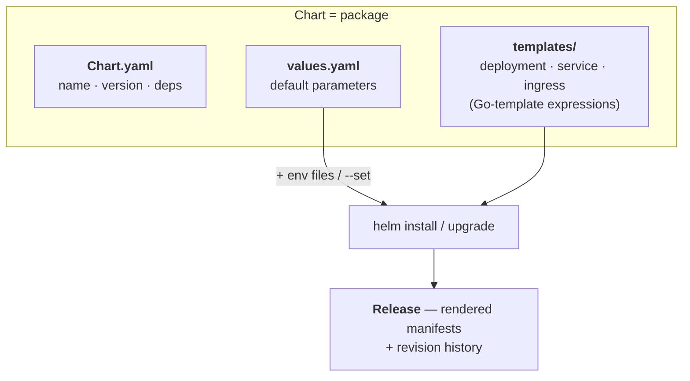
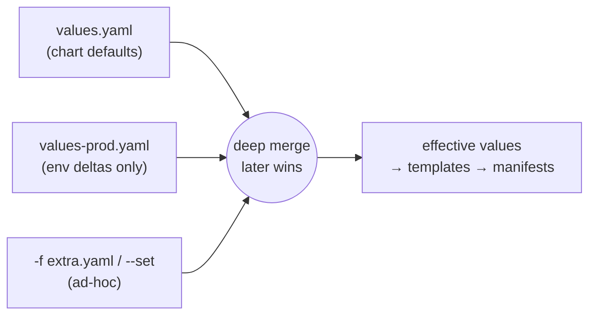
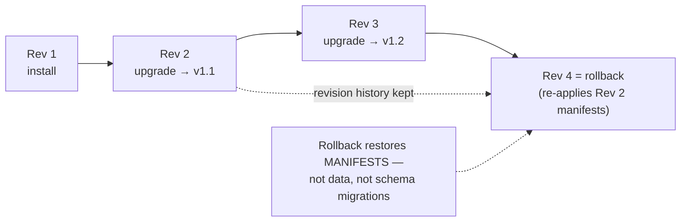

# Helm — Deep Dive

> **Level:** Intermediate  
> **Pre-reading:** [09 · Deployment & Infrastructure](09-deployment.md)

---

## What is Helm?

**Helm** is a package manager for Kubernetes. It packages K8s manifests into reusable **charts**.

---

## Helm Concepts

| Concept | Description |
|:--------|:------------|
| **Chart** | Package of K8s templates |
| **Values** | Configuration parameters |
| **Release** | Deployed instance of a chart |
| **Repository** | Chart storage (like npm registry) |

---

## Chart Structure

```
order-service/
├── Chart.yaml          # Chart metadata
├── values.yaml         # Default values
├── templates/
│   ├── deployment.yaml
│   ├── service.yaml
│   ├── configmap.yaml
│   ├── _helpers.tpl    # Template helpers
│   └── NOTES.txt       # Post-install notes
└── charts/             # Dependencies
```

### Chart.yaml

```yaml
apiVersion: v2
name: order-service
version: 1.0.0
appVersion: "1.2.3"
description: Order service deployment
dependencies:
  - name: postgresql
    version: 12.x.x
    repository: https://charts.bitnami.com/bitnami
    condition: postgresql.enabled
```

---



## Templates

```yaml
# templates/deployment.yaml
apiVersion: apps/v1
kind: Deployment
metadata:
  name: {{ include "order-service.fullname" . }}
  labels:
    {{- include "order-service.labels" . | nindent 4 }}
spec:
  replicas: {{ .Values.replicaCount }}
  selector:
    matchLabels:
      {{- include "order-service.selectorLabels" . | nindent 6 }}
  template:
    spec:
      containers:
        - name: {{ .Chart.Name }}
          image: "{{ .Values.image.repository }}:{{ .Values.image.tag }}"
          ports:
            - containerPort: {{ .Values.service.port }}
          resources:
            {{- toYaml .Values.resources | nindent 12 }}
          {{- if .Values.env }}
          env:
            {{- range $key, $value := .Values.env }}
            - name: {{ $key }}
              value: {{ $value | quote }}
            {{- end }}
          {{- end }}
```

### values.yaml

```yaml
replicaCount: 2

image:
  repository: myregistry/order-service
  tag: "1.2.3"
  pullPolicy: IfNotPresent

service:
  type: ClusterIP
  port: 8080

resources:
  requests:
    memory: "256Mi"
    cpu: "250m"
  limits:
    memory: "512Mi"
    cpu: "500m"

env:
  SPRING_PROFILES_ACTIVE: production
```

---

## Helm Commands

```bash
# Install
helm install order-release ./order-service -f values-prod.yaml

# Upgrade
helm upgrade order-release ./order-service -f values-prod.yaml

# Rollback
helm rollback order-release 1

# List releases
helm list

# Show history
helm history order-release

# Uninstall
helm uninstall order-release

# Template (dry-run)
helm template ./order-service -f values-prod.yaml
```

---



## Environment Overrides

```bash
# Base values + environment-specific
helm install order-release ./order-service \
  -f values.yaml \
  -f values-prod.yaml \
  --set image.tag=1.2.4
```

### values-prod.yaml

```yaml
replicaCount: 5
resources:
  requests:
    memory: "512Mi"
    cpu: "500m"
```

---



## Helm vs Kustomize

| Aspect | Helm | Kustomize |
|:-------|:-----|:----------|
| **Templating** | Go templates | Patches/overlays |
| **Complexity** | Higher | Lower |
| **Packaging** | Charts | Bases + overlays |
| **Built into kubectl** | No | Yes |

---

??? question "When should you use Helm vs raw manifests?"
    Use **Helm** when: (1) Deploying to multiple environments. (2) Need parameterization. (3) Managing complex applications. (4) Using third-party charts. Use **raw manifests** for simple, single-environment deployments.

??? question "How do you manage secrets with Helm?"
    (1) **helm-secrets plugin** — encrypts values files. (2) **External Secrets Operator** — reference secrets by name. (3) **Sealed Secrets** — encrypt for GitOps. Don't put secrets in plain values files in Git.

??? question "Helm vs Kustomize — which to choose?"
    **Helm**: Better for complex parameterization, third-party charts, release management. **Kustomize**: Simpler, built into kubectl, good for environment overlays. Many teams use both: Helm for base charts, Kustomize for environment-specific overlays.


---

## 📝 Knowledge Check

<quiz>
Helm 'release' vs 'chart' vs 'values' — what does `helm rollback` actually restore?
- [ ] Just the image tag
- [x] Chart = the templated package (the 'class'); release = an installed instance of it in the cluster (the 'object'), with its own history; values = the per-install parameters. `helm rollback RELEASE REVISION` re-applies a *previous release revision's rendered manifests* — it restores chart+values state, not your data (no PV restore, no DB rollback)
- [ ] Rollback restores everything including data
- [ ] Release = the git tag

release history is Helm's versioning: each upgrade snapshots rendered manifests as a revision, rollback re-applies one — but it only covers *manifests*, not state (PVCs, DBs, external effects are untouched). 'Rollback' in Helm means 'revert the deployment objects,' full stop.
</quiz>
<quiz>
`values.yaml` vs `values-prod.yaml` — how do environment overlays compose, and what's the anti-pattern?
- [ ] You copy the whole chart per env
- [x] `helm install -f values.yaml -f values-prod.yaml` — later files override earlier keys (merge semantics): base holds defaults, env files hold only deltas (replica counts, ingress hosts, resource sizes). Anti-pattern: full env-specific chart copies (drift between them) or dumping env-differences in `if eq .Environment "prod"` logic everywhere instead of values files
- [ ] values files can't be combined
- [ ] Use separate charts per env

layering is the point: defaults in `values.yaml`, deltas in env files — prod gets 'only what's different about prod.' Copying charts per env duplicates templates that then drift; env-branching inside templates buries config in logic. The test: changing a prod-only value should edit exactly one file.
</quiz>
<quiz>
`helm template` vs `helm install` — why render locally before applying?
- [ ] template is just a dry-run
- [x] `helm template` renders manifests client-side — lets you see the EXACT YAML Helm will apply before it touches the cluster (review, diff, pipe to `kubectl apply` or into GitOps). It's the answer to 'what did this chart/values combo actually produce' — essential when templates hide the manifest behind logic
- [ ] install shows the same output
- [ ] template requires cluster access

templating is code: the values you set produce YAML you can't see until render. `helm template` + `helm diff` turns 'hope the chart does what I think' into 'here's the manifest diff I'll apply.' In GitOps workflows it's how charts get committed as plain manifests — no Tiller/Helm needed in-cluster.
</quiz>
<quiz>
A `values.yaml` has `image.tag: latest`. What production bug does that set up?
- [ ] None — latest is standard
- [x] Non-reproducible deploys: `helm rollback` to revision N won't restore 'the image from then' — 'latest' now resolves to a different image than it did at deploy time; two installs of the same release get different code; imagePullPolicy decides whether you even get the new 'latest.' Pin immutable tags (or digests) in values — the version should live in the release, not float in the registry
- [ ] Always set imagePullPolicy: Always instead
- [ ] latest is fine for staging only

`latest` breaks the release-history promise: the revision record says 'latest,' the image it pointed at is gone. Every install/rollback/scale of that release resolves the mutable tag anew — 'reproducible' requires the value itself to be immutable (semver tag or digest). It's the same trap as `FROM node:latest` — versioning must live in what you version.
</quiz>
<quiz>
Helm hooks (pre-install, post-upgrade) — what are they for, and why are they operationally risky?
- [ ] Hooks are just annotations
- [x] Hooks run Jobs around the release lifecycle (DB migrations pre-upgrade, smoke tests post-deploy) — they let a release carry its own lifecycle steps, but they're outside normal reconciliation: a failed hook can wedge the release (stuck pending-upgrade, needing manual cleanup), hooks don't always show in `helm get manifest`, and they add invisible side-effects to 'just an install'
- [ ] Hooks run on every sync
- [ ] Hooks are the only way to run jobs

hooks trade visibility for lifecycle automation: a migration hook that fails leaves the release in limbo (subsequent upgrades refuse until the failed hook Job is cleaned). In GitOps especially, hooks' imperative 'run this Job once' model fights the declarative reconcile-forever model — many teams move migrations to init containers or dedicated Jobs for exactly this reason.
</quiz>