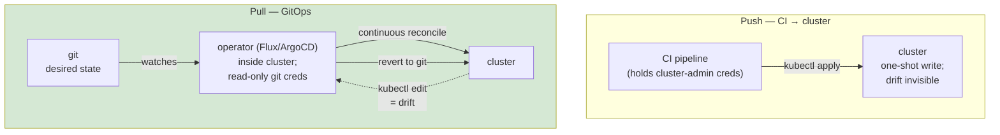

# GitOps — Deep Dive

> **Level:** Intermediate  
> **Pre-reading:** [09 · Deployment & Infrastructure](09-deployment.md)

---

## What is GitOps?

**GitOps** uses Git as the single source of truth for infrastructure and application configuration. Changes are made via Git commits; automated systems sync the desired state to the cluster.


---

## GitOps Principles

| Principle | Description |
|:----------|:------------|
| **Declarative** | Desired state described, not procedures |
| **Versioned** | All changes tracked in Git |
| **Automated** | Agents sync state automatically |
| **Auditable** | Git history = audit trail |

---

## Pull vs Push

| Aspect | Pull-Based | Push-Based |
|:-------|:-----------|:-----------|
| **Flow** | Agent pulls from Git | CI pushes to cluster |
| **Security** | No cluster creds in CI | CI needs cluster access |
| **Tools** | ArgoCD, Flux | kubectl in pipeline |
| **Drift detection** | Automatic | Manual |

---



## ArgoCD

```yaml
apiVersion: argoproj.io/v1alpha1
kind: Application
metadata:
  name: order-service
  namespace: argocd
spec:
  project: default
  source:
    repoURL: https://github.com/org/k8s-config
    path: apps/order-service
    targetRevision: main
  destination:
    server: https://kubernetes.default.svc
    namespace: production
  syncPolicy:
    automated:
      prune: true
      selfHeal: true
    syncOptions:
      - CreateNamespace=true
```

---

## Repository Structure

```
k8s-config/
├── apps/
│   ├── order-service/
│   │   ├── base/
│   │   │   ├── deployment.yaml
│   │   │   ├── service.yaml
│   │   │   └── kustomization.yaml
│   │   └── overlays/
│   │       ├── dev/
│   │       ├── staging/
│   │       └── prod/
│   └── payment-service/
└── infrastructure/
    ├── cert-manager/
    └── external-secrets/
```

---

## Sync Strategies

| Strategy | Description |
|:---------|:------------|
| **Manual** | Sync triggered by human |
| **Auto-sync** | Sync on Git change |
| **Self-heal** | Revert manual cluster changes |
| **Prune** | Delete removed resources |

---

## Image Update Automation

### Flux Image Automation

```yaml
apiVersion: image.toolkit.fluxcd.io/v1beta1
kind: ImagePolicy
metadata:
  name: order-service
spec:
  imageRepositoryRef:
    name: order-service
  policy:
    semver:
      range: ">=1.0.0"
---
apiVersion: image.toolkit.fluxcd.io/v1beta1
kind: ImageUpdateAutomation
metadata:
  name: update-images
spec:
  sourceRef:
    kind: GitRepository
    name: k8s-config
  update:
    path: ./apps
    strategy: Setters
  git:
    commit:
      author:
        name: Flux
        email: flux@example.com
```

---

## Secrets in GitOps

| Approach | Description |
|:---------|:------------|
| **Sealed Secrets** | Encrypt secrets; decrypt in cluster |
| **External Secrets** | Reference secrets from Vault/AWS SM |
| **SOPS** | Encrypt files in Git |

---

??? question "What's the advantage of pull-based GitOps over CI/CD push?"
    **Security**: No cluster credentials stored in CI systems. **Drift detection**: Agent detects and corrects manual changes. **Single source of truth**: Git is the authority. **Auditability**: All changes tracked via Git commits.

??? question "How do you handle environment-specific configurations?"
    Use **Kustomize overlays** or **Helm values files** per environment. Structure: base configuration + environment-specific overlays. ArgoCD/Flux apply the appropriate overlay based on Application configuration.

??? question "How do you promote changes across environments?"
    (1) **PR-based**: PR from dev overlay to staging overlay. (2) **Image-based**: Same manifests, different image tags per env. (3) **Branch-based**: Different branches for different envs. Most common: same repo, different directories/overlays.


---

## 📝 Knowledge Check

<quiz>
Someone runs `kubectl edit` to hotfix prod. In GitOps, what *should* happen — and what does it reveal?
- [ ] The edit persists — hotfixes override GitOps
- [x] The reconciler (ArgoCD/Flux) detects drift and reverts it to match git — that's the point: git is desired state, the cluster is a consequence. If hotfixes routinely 'need' manual edits, it reveals an emergency-change process that bypasses version control — the fix is a fast pipeline path for emergencies, not manual cluster access
- [ ] ArgoCD merges the edit into git automatically
- [ ] It creates a merge conflict

drift-correction is the feature, not the annoyance: manual cluster changes are invisible in git, unreviewable, and unreproducible. If your process *requires* them, the pipeline is too slow — invest in 'emergency deploy' speed through git, not around it. Some setups pause auto-sync during incidents deliberately; that's a declared exception, not drift.
</quiz>
<quiz>
Pull vs push deployment: why does 'the cluster pulls from git' beat 'CI pushes to cluster' on security?
- [ ] Push is simpler
- [x] Push means CI holds cluster-admin credentials — every CI job, secret-store, and developer with CI access is a cluster-compromise path. Pull inverts it: the in-cluster agent (Flux/ArgoCD) pulls git with read-only repo rights — no external system holds deploy credentials, the blast radius of 'CI is compromised' doesn't include your cluster
- [ ] Pull is slower
- [ ] They have the same attack surface

credential direction is the security difference: push gives every CI pipeline god-mode kubeconfig (leak it = own the cluster); pull needs only a read deploy-key on a repo — compromise of the git read key can't deploy anything. Add drift-reconciliation and git-as-audit, and pull wins on both security and operability.
</quiz>
<quiz>
Where do secrets live in GitOps — since you can't commit them?
- [ ] Commit them — private repo
- [x] External secret stores synced in (External Secrets Operator → Vault/cloud SM), or *sealed* secrets (SOPS/SealedSecrets — encrypted in git, decryptable only by the cluster's key): either way the secret VALUE never appears as plaintext in the repo — only the reference or the ciphertext. 'Encrypted file in git' and 'secret synced from manager' are the two GitOps-safe options
- [ ] Base64 them — that's encoding
- [ ] Skip GitOps for secrets

GitOps's 'everything in git' collides with 'nothing sensitive in git': the resolution is indirection (reference the secret by name, let an operator fetch the value) or encryption (SealedSecrets/SOPS — the ciphertext is safe in git, the private key lives in the cluster). Plaintext in git — even private — survives in history, mirrors, and every clone forever.
</quiz>
<quiz>
App-of-apps / repo structure: how do you organize 50 microservices' manifests in git — and what does the structure control?
- [ ] One giant repo, one folder — simplest
- [x] Typically: app-definition repo(s) + config/env repo(s) — an 'app-of-apps' or ApplicationSet pattern generates per-service/per-env Applications from a template, so structure = which services exist where. The structure *is* your deployment topology: a directory per env, a file per service, promotion = a git operation (copy v2 tag from staging/ to prod/)
- [ ] Put manifests in the app repos only
- [ ] Structure doesn't matter — ArgoCD scans everything

the repo layout IS the environment model: `envs/staging/` vs `envs/prod/` with per-service manifests means 'promote' = a git PR moving a version between directories — auditable, reviewable, revertible. App-of-apps or ApplicationSet generates the per-service Application objects so you're not hand-maintaining 50 of them.
</quiz>
<quiz>
Sync strategies: auto-sync+self-heal vs manual sync — when is each right?
- [ ] Always auto — that's the point
- [x] Auto-sync+selfHeal: continuously converge and revert drift — right for dev/staging and 'git is truth' shops; risk: unintended changes go live the moment they merge, and it fights legitimate manual ops during incidents. Manual/PR-gated sync: merge to git doesn't deploy until someone syncs — right for prod where you want a human in the loop; risk: git and cluster diverge by design until synced
- [ ] Manual defeats GitOps
- [ ] selfHeal is always dangerous

the choice is 'git merges = deploys' vs 'git merges = intent': auto-sync makes the merge *the* deployment (beautiful until a bad merge ships instantly); manual sync adds a deploy gate at the cost of 'git says X, cluster runs Y' divergence between merges and syncs. Common pattern: auto in lower envs, gated in prod — the *pipeline* still moves versions, a human just releases them.
</quiz>