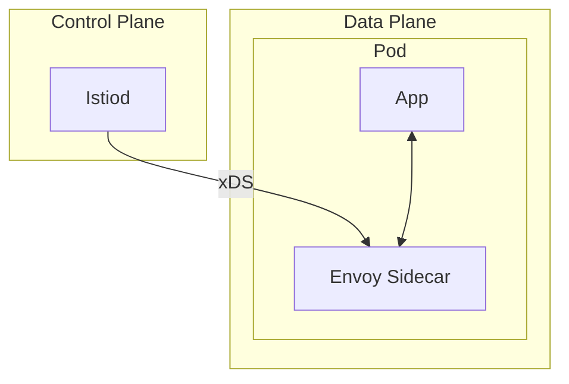
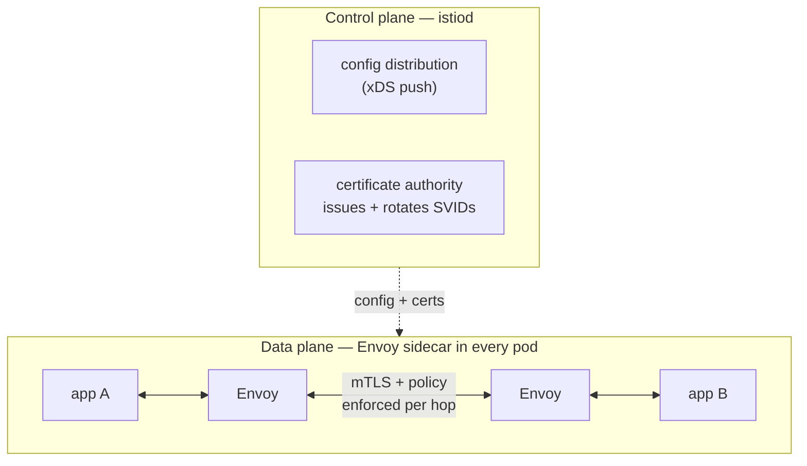

# Service Mesh with Istio — Deep Dive

> **Level:** Advanced  
> **Pre-reading:** [09 · Deployment & Infrastructure](09-deployment.md) · [05.06 · Service Mesh](05.06-service-mesh.md)

---

## Istio Architecture



---



## Key Resources

| Resource | Purpose |
|:---------|:--------|
| **VirtualService** | Traffic routing rules |
| **DestinationRule** | Load balancing, circuit breaking |
| **Gateway** | Ingress/egress configuration |
| **PeerAuthentication** | mTLS policy |
| **AuthorizationPolicy** | Access control |

---

## Traffic Management

### Canary Routing

```yaml
apiVersion: networking.istio.io/v1beta1
kind: VirtualService
metadata:
  name: order-service
spec:
  hosts:
    - order-service
  http:
    - match:
        - headers:
            x-canary:
              exact: "true"
      route:
        - destination:
            host: order-service
            subset: v2
    - route:
        - destination:
            host: order-service
            subset: v1
          weight: 90
        - destination:
            host: order-service
            subset: v2
          weight: 10
```

### Fault Injection

```yaml
http:
  - fault:
      delay:
        percentage:
          value: 10
        fixedDelay: 5s
      abort:
        percentage:
          value: 5
        httpStatus: 503
    route:
      - destination:
          host: order-service
```

---

## Security

### Strict mTLS

```yaml
apiVersion: security.istio.io/v1beta1
kind: PeerAuthentication
metadata:
  name: default
  namespace: production
spec:
  mtls:
    mode: STRICT
```

### Authorization Policy

```yaml
apiVersion: security.istio.io/v1beta1
kind: AuthorizationPolicy
metadata:
  name: order-policy
spec:
  selector:
    matchLabels:
      app: order-service
  rules:
    - from:
        - source:
            principals: ["cluster.local/ns/production/sa/payment-service"]
      to:
        - operation:
            methods: ["POST"]
            paths: ["/api/orders/*"]
```

---

## Observability

Istio provides automatic:

- **Metrics** → Prometheus
- **Traces** → Jaeger
- **Access logs** → Stdout

No code changes required.

---

??? question "When should you adopt Istio?"
    Adopt Istio when: (1) 10+ microservices. (2) Need consistent mTLS. (3) Complex traffic management (canary, fault injection). (4) Multi-language services need uniform observability. Avoid for small deployments — overhead not justified.

??? question "How does Istio mTLS work?"
    Istiod acts as CA, issuing short-lived certificates to each workload's sidecar. Sidecars automatically establish mTLS between services. Certificates rotate every 24 hours. No application changes needed.

??? question "What's the performance overhead of Istio?"
    Envoy adds ~1-3ms latency per hop. Memory: ~50-100MB per sidecar. CPU: depends on traffic. For most applications, acceptable. Profile your specific workload to measure impact.


---

## 📝 Knowledge Check

<quiz>
In Istio, which resource controls *where* traffic goes vs *how* it behaves once it gets there — VirtualService or DestinationRule?
- [ ] They're interchangeable
- [x] VirtualService = routing: match rules + traffic splits ('header x-user=beta → v2', '90/10 canary'). DestinationRule = destination policies: what a subset *is* (labels), plus LB algorithm, connection pool, outlier detection, TLS mode applied *to that subset*. A canary deploy typically needs both — VS routes to a named subset, DR defines it
- [ ] VS is for L4, DR for L7
- [ ] DR does the splitting

the pairing trips everyone: VirtualService answers 'which version/subset of reviews gets this request'; DestinationRule answers 'what is a subset called and how do I talk to it' (LB, mTLS mode, circuit-breaker outlier settings). You can't canary to a subset you haven't defined in a DestinationRule.
</quiz>
<quiz>
`PeerAuthentication: STRICT` in a namespace — what breaks if a non-meshed client calls in?
- [ ] Nothing — STRICT is advisory
- [x] Plaintext calls are refused: STRICT requires mTLS — a pod without a sidecar (no cert to present) can no longer reach meshed services. The migration pattern is PERMISSIVE → STRICT: accept both during onboarding, enforce strict once everything's meshed — STRICT applied too early is an outage you scheduled yourself
- [ ] Calls downgrade to plaintext automatically
- [ ] Only external traffic is affected

STRICT is the enforcement step of mTLS rollout: it *rejects* non-mTLS. During migration you run PERMISSIVE (mesh and non-mesh coexist), onboard all callers, then flip STRICT — the operational order that prevents 'we enabled security and prod went down.' Health probes and legacy callers are the usual forgotten plaintext sources.
</quiz>
<quiz>
AuthorizationPolicy vs NetworkPolicy — 'payments may be called only by orders on GET /charge' — which resource and why?
- [ ] NetworkPolicy can express it
- [x] AuthorizationPolicy: it's L7 + identity-aware — 'from principal spiffe://.../orders, to operation methods GET paths /charge' — NetworkPolicy can't see HTTP methods/paths or SPIFFE identities (it only knows pod selectors and ports). The AuthorizationPolicy expresses *who may do what*, not just *who may connect*
- [ ] Either — same enforcement
- [ ] Use an Ingress rule

NetworkPolicy sees 'pod A → pod B :8080'; AuthorizationPolicy sees 'workload-identity A → method GET → path /charge.' Zero-trust authorization lives at L7 because least-privilege is about *operations*, not connections — 'may connect' is not 'may DELETE /admin.'
</quiz>
<quiz>
Istio 'free' observability — what do you get without touching app code, and what's the catch?
- [ ] Nothing is automatic
- [x] The sidecar sees all traffic: automatic metrics (request counts, latency, TCP stats) in Prometheus format, distributed tracing headers propagation, and access logs — polyglot-agnostic. Catch: telemetry is only as good as context propagation INTO the app (headers must flow through your code or spans split), and per-sidecar metrics add cardinality/metrics volume to size for
- [ ] It replaces app instrumentation entirely
- [ ] Only tracing is automatic

the sidecar makes *network* truth automatic ('this hop took 30ms'); it can't make *business* truth automatic ('the fraud-check step inside was slow'). Tracing continuity still requires your app to forward `traceparent`/B3 headers — the mesh gives you the spans at the boundaries, your propagation connects them. And per-pod metrics cardinality is real at fleet scale.
</quiz>
<quiz>
Fault injection (`HTTPFaultInjection`) — what is deliberately breaking requests FOR?
- [ ] A chaos gimmick
- [x] Controlled resilience testing at L7 without app changes: inject delays ('does the caller's 2s timeout actually fire when payments slows to 5s?') or aborts ('does the fallback engage on 503s?') on a % of traffic — validates your timeouts/retries/fallbacks work in reality, not just in config. It's the 'verify the circuit breaker' knob built into the mesh
- [ ] It's for load testing
- [ ] It fixes bad upstreams

config files claim timeouts/fallbacks exist; fault injection *proves* them by creating the failure they claim to handle — the difference between 'resilience configured' and 'resilience verified.' It's chaos engineering's precise scalpel vs. pod-kill's hammer: test the *interaction* (timeout + retry + breaker + fallback chain) exactly where it matters.
</quiz>