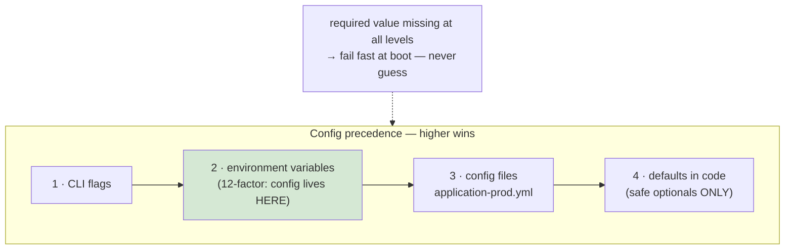
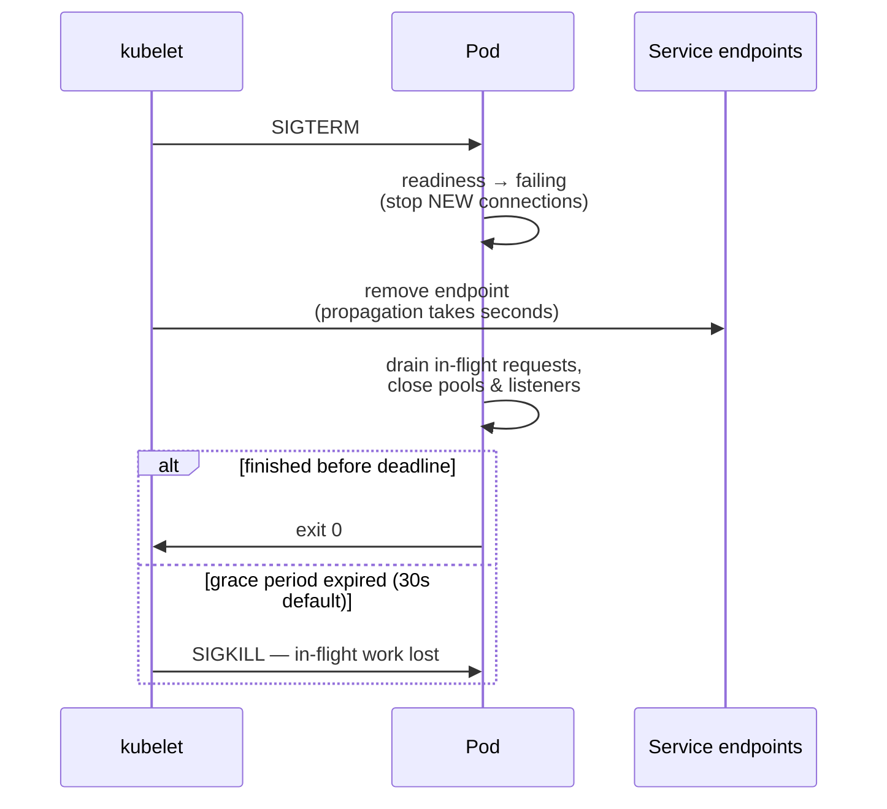
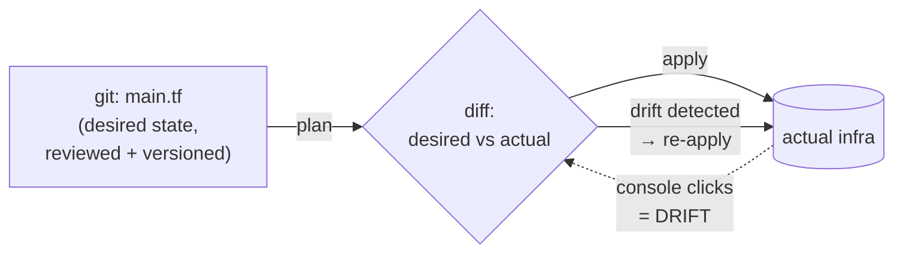

# 12-Factor App and IaC — Deep Dive

> **Level:** Intermediate  
> **Pre-reading:** [09 · Deployment & Infrastructure](09-deployment.md)

---

## The 12-Factor App

| Factor                   | Principle                 | Implementation                        |
|:-------------------------|:--------------------------|:--------------------------------------|
| **1. Codebase**          | One repo; many deploys    | Git repo → dev/staging/prod           |
| **2. Dependencies**      | Explicitly declared       | `pom.xml`, `package.json`             |
| **3. Config**            | In environment            | Env vars, ConfigMaps                  |
| **4. Backing services**  | Attached via URL          | `DATABASE_URL`                        |
| **5. Build/Release/Run** | Strictly separated        | CI builds → immutable releases        |
| **6. Processes**         | Stateless                 | No sticky sessions; state in DB/cache |
| **7. Port binding**      | Export via port           | App exposes HTTP                      |
| **8. Concurrency**       | Scale via process         | Horizontal pod scaling                |
| **9. Disposability**     | Fast start/graceful stop  | SIGTERM handling                      |
| **10. Dev/Prod parity**  | Keep environments similar | Same Docker images                    |
| **11. Logs**             | Event streams             | Write to stdout                       |
| **12. Admin processes**  | One-off tasks             | K8s Jobs                              |

---

## Config Management

```java
// 12-Factor: Configuration from environment
@Configuration
public class DatabaseConfig {
    
    @Value("${DATABASE_URL}")
    private String databaseUrl;
    
    @Value("${DATABASE_POOL_SIZE:10}")
    private int poolSize;
}
```

```yml
# Kubernetes ConfigMap
apiVersion: v1
kind: ConfigMap
metadata:
  name: order-config
data:
  SPRING_PROFILES_ACTIVE: production
  LOG_LEVEL: INFO
```

---



## Graceful Shutdown

```java
@PreDestroy
public void onShutdown() {
    log.info("Received shutdown signal");
    // Complete in-flight requests
    // Close connections
    // Flush buffers
}
```

```
# K8s gives 30s by default
spec:
  terminationGracePeriodSeconds: 60
  containers:
    - lifecycle:
        preStop:
          exec:
            command: ["sh", "-c", "sleep 10"]  # Allow LB to drain
```

---



## Infrastructure as Code (IaC)

| Tool           | Language             | Use Case                   |
|:---------------|:---------------------|:---------------------------|
| **Terraform**  | HCL                  | Multi-cloud infrastructure |
| **Pulumi**     | TypeScript/Python/Go | Programming language IaC   |
| **AWS CDK**    | TypeScript/Python    | AWS infrastructure         |
| **Crossplane** | YAML (K8s CRDs)      | K8s-native cloud resources |

### Terraform Example

```
resource "aws_eks_cluster" "main" {
  name     = "production-cluster"
  role_arn = aws_iam_role.eks.arn
  version  = "1.28"

  vpc_config {
    subnet_ids = var.subnet_ids
  }
}

resource "aws_rds_instance" "orders_db" {
  identifier           = "orders-db"
  engine              = "postgres"
  engine_version      = "15.4"
  instance_class      = "db.t3.medium"
  allocated_storage   = 100
  
  db_name  = "orders"
  username = "admin"
  password = var.db_password
  
  multi_az            = true
  skip_final_snapshot = false
}
```

---



## IaC Best Practices

| Practice            | Rationale                                |
|:--------------------|:-----------------------------------------|
| **Version control** | Track changes; review via PRs            |
| **Remote state**    | Share state; lock for safety             |
| **Modules**         | Reusable components                      |
| **Environments**    | Separate state per env                   |
| **CI/CD for infra** | `terraform plan` in PR; `apply` on merge |

---

??? question "Why is 'stateless processes' important for microservices?"
    Stateless processes enable horizontal scaling — any instance can handle any request. No sticky sessions means load balancers can distribute freely. State lives in databases/caches, not in process memory.

??? question "Terraform vs Pulumi — when to use which?"
    **Terraform**: Industry standard; large ecosystem; declarative HCL. **Pulumi**: Real programming languages; better for complex logic; smaller ecosystem. Use Terraform for standard infrastructure; consider Pulumi when you need programming constructs.

??? question "How do you handle secrets in Terraform?"
    (1) Don't commit to Git — use `.gitignore`. (2) Use `terraform.tfvars` locally; inject in CI. (3) Reference secrets from Vault/AWS SM. (4) Use SOPS for encrypted files. (5) Terraform Cloud/Enterprise has built-in secrets management.


---

## 📝 Knowledge Check

<quiz>
Which 12-factor rules does 'config hardcoded per environment with if/else in the code' violate — and what's the operational cost?
- [ ] None — config in code is fine
- [x] Config-in-environment: env-specific values (DB URLs, credentials, feature toggles) belong in the environment, not the artifact — the SAME build must run dev/stage/prod. Hardcoded config means rebuilding/promoting different artifacts per env (untested prod artifact), and secrets ending up in source — the image should be env-agnostic, config injected at runtime
- [ ] Only secrets need env vars
- [ ] Hardcoding is faster — that's the point

the invariant is 'build once, deploy anywhere': the artifact promoted to prod is byte-identical to the one tested in staging; only the env config differs. Hardcoding means either per-env builds (the prod artifact is untested) or secrets in VCS (a breach waiting for a `git clone`). ConfigMaps/env/secret-mounts exist precisely so the artifact stays clean.
</quiz>
<quiz>
Graceful shutdown: `terminationGracePeriodSeconds` default is 30s — what must your app do in that window, and what kills in-flight work?
- [ ] SIGKILL is instant — nothing to do
- [x] On SIGTERM: stop accepting NEW work (fail readiness → removed from endpoints), finish in-flight requests within the window, close pools/listeners. What kills in-flight work: the endpoint removal *lag* (kube-proxy/ingress take seconds to stop routing — so stop accepting early), not finishing before the grace period (SIGKILL then cuts work mid-flight), and keeping connections open past the deadline
- [ ] 30s always enough
- [ ] Apps can't handle SIGTERM in containers

the race is endpoint-removal vs. drain: SIGTERM → 'stop readiness' → but traffic still arrives until the Service endpoints update propagates — so apps must keep serving *briefly after* going unready, while finishing existing work, all inside the grace window. The classic bug: app exits instantly on SIGTERM, dropping the requests still in flight during the propagation gap.
</quiz>
<quiz>
IaC's core promise — what does 'the same Terraform applied twice' guarantee, and what's drift?
- [ ] IaC just automates clicking
- [x] Declarative idempotence: desired state is code, applying converges actual→desired — the same plan applied twice is a no-op (reproducibility, no hand-tuned snowflakes). Drift = actual state diverging from code (console clicks, hotfixes, manual edits) — `terraform plan` revealing drift is the audit mechanism; the discipline is routing ALL changes through code so drift never accumulates
- [ ] Drift only happens in Kubernetes
- [ ] Idempotence means it runs faster

IaC converts infrastructure from 'a state no one fully knows' to 'a spec you can diff': reproducibility, reviewability (PR on infra), and audit (git = change log). Drift is the enemy because it reintroduces unknown state — the discipline that prevents it is cultural (no console changes) more than technical.
</quiz>
<quiz>
'Config in environment' — what's the *hierarchy* when multiple sources provide the same key?
- [ ] Last one loaded wins randomly
- [x] Explicit override order: typically CLI args > env vars > config files (profile-specific) > defaults in code — the rule is 'more specific/deployment-time wins, and nothing should silently fall back to a wrong default.' The failure mode is a forgotten default masking a missing env var — fail fast on required config, don't default it
- [ ] Config file always wins
- [ ] Env var always loses

the hierarchy exists so ops can override without rebuilds: a deploy-time env var beats a baked default; a flag beats a file. The danger is *silent precedence* — the prod env var typo'd, the dev default quietly used instead, prod connects to dev's DB. The 12-factor companion rule: required config missing = crash loudly at boot, never default-and-continue.
</quiz>
<quiz>
'Logs as event streams' — why does the 12-factor app say don't write log files?
- [ ] Files are slower
- [x] The app should write to stdout/stderr and let the *environment* handle routing/aggregation (Fluent Bit, the collector, the log platform): file-writing couples the app to local disk (a stateful, ephemeral-in-containers resource), rotation, and path conventions — a containerized app writing log files loses them on pod restart and complicates the sidecar/collector pattern
- [ ] stdout is slower than files
- [ ] Log files are fine if rotated

stdout is the contract: the app emits, the platform routes. File logging makes the app own ops concerns (paths, rotation, retention) and buries logs in ephemeral container storage — gone on restart, invisible to the aggregator without a tail-sidecar. Streaming to stdout keeps the app stateless and the logs platform-agnostic.
</quiz>