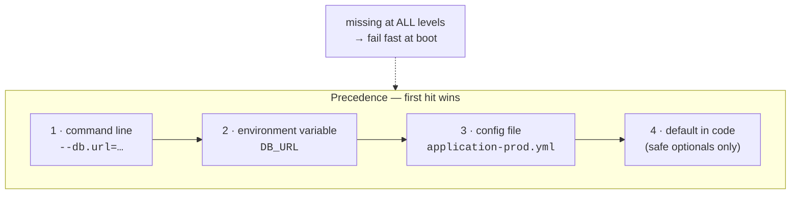
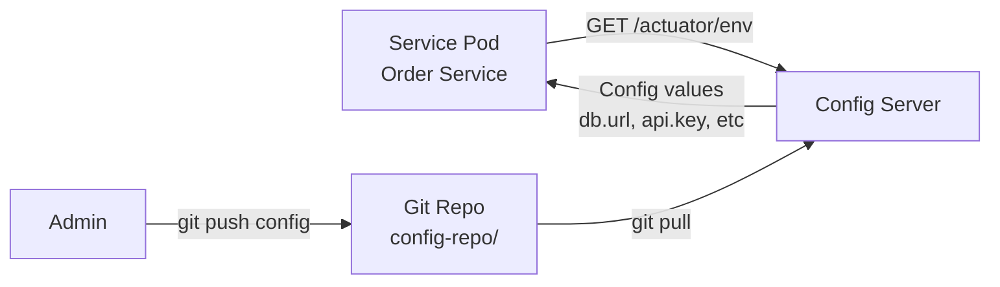
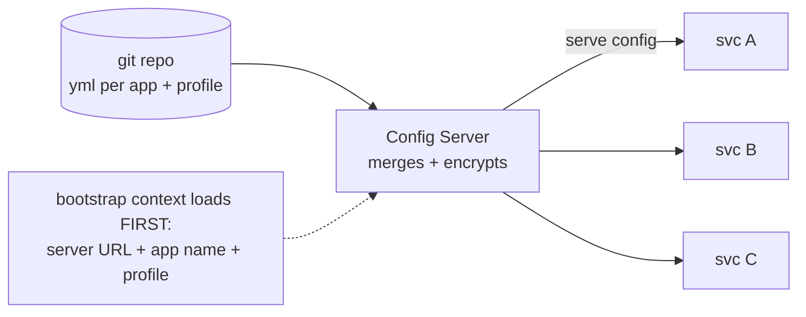

# Configuration Management — Deep Dive

> **Level:** Intermediate
> **Pre-reading:** [09 · Deployment & Infrastructure](09-deployment.md) · [12-Factor App](09.07-twelve-factor-and-iac.md)

---

## Configuration vs Code

**Configuration:** Values that change between environments (dev, staging, prod).
**Code:** Logic that stays the same.

| Item | Type | Where Stored |
|:-----|:-----|:--------------|
| Database URL | Config | Environment variable / ConfigMap |
| Feature flag | Config | ConfigServer / Feature store |
| Price calculation logic | Code | Source code |
| API response format | Code | Source code |
| Kafka broker URL | Config | Environment variable |
| Log level | Config | Environment variable / ConfigMap |

---

## The 12-Factor Rule: Store Config in Environment

Never bake configuration into code:

❌ **Bad:**
```java
public class PaymentConfig {
    public static final String DB_URL = "jdbc:mysql://prod-db:3306/payment";
    public static final String API_KEY = "sk-1234567890"; // Secret in code!
}
```

✅ **Good:**
```java
public class PaymentConfig {
    public String dbUrl = System.getenv("DB_URL");
    public String apiKey = System.getenv("API_KEY");
}
```

**Benefits:**

- Same jar/image for all environments
- Secrets not in Git history
- Change config without rebuild

---

## Configuration Sources (Priority Order)

When reading a config value, check in order:

```
1. Command-line argument      (highest priority)
2. Environment variable       
3. Config file               
4. Application defaults      
5. System properties         (lowest priority)
```



### Example: Reading DB_URL

```bash
# Priority 1: Command-line
java -Dspring.datasource.url=jdbc:mysql://mydb:3306 app.jar

# Priority 2: Environment variable
export DB_URL=jdbc:mysql://mydb:3306
java app.jar

# Priority 3: application.yml
spring:
  datasource:
    url: jdbc:mysql://mydb:3306

# Priority 4: Default in code
@Value("${spring.datasource.url:jdbc:mysql://localhost:3306}")
private String dbUrl;
```

---

## Spring Cloud Config Server

Centralized configuration management; change config without redeploying.

### Architecture



### Setup

**1. Config Server (central service)**

```java
@SpringBootApplication
@EnableConfigServer
public class ConfigServerApplication {
    public static void main(String[] args) {
        SpringApplication.run(ConfigServerApplication.class, args);
    }
}
```

```yaml
# application.yml for Config Server
server:
  port: 8888

spring:
  cloud:
    config:
      server:
        git:
          uri: https://github.com/mycompany/config-repo
          default-label: main
```

**2. Git Repo Structure**

```
config-repo/
├── application.yml                    (shared by all services)
├── order-service.yml                  (Order Service defaults)
├── order-service-dev.yml              (Order Service + dev profile)
├── order-service-staging.yml          (Order Service + staging profile)
├── order-service-prod.yml             (Order Service + prod profile)
└── payment-service.yml
```

**3. Config Client (in Order Service)**

```yaml
# bootstrap.yml (loads BEFORE application.yml)
spring:
  application:
    name: order-service
  cloud:
    config:
      uri: http://config-server:8888
      profile: ${ENVIRONMENT:dev}  # dev, staging, prod
```

**4. Client Reads Config**

```java
@RestController
public class OrderController {
    
    @Value("${database.url}")
    private String dbUrl;
    
    @Value("${payment.api.key}")
    private String apiKey;
    
    @GetMapping("/config-check")
    public Map<String, String> checkConfig() {
        return Map.of(
            "dbUrl", dbUrl,
            "apiKey", apiKey
        );
    }
}
```

---



## Environment-Specific Configuration

### Profile-Based

```yaml
# application.yml
spring:
  profiles:
    active: ${ENVIRONMENT:dev}

---
# application-dev.yml
spring:
  profiles: dev
  datasource:
    url: jdbc:h2:mem:testdb
    driver-class-name: org.h2.Driver

---
# application-prod.yml
spring:
  profiles: prod
  datasource:
    url: jdbc:mysql://prod-rds:3306/payment
    hikari:
      maximum-pool-size: 50
```

### Property Hierarchy

```
application.yml
    ↓
application-${ENVIRONMENT}.yml  (overrides application.yml)
    ↓
Environment variables           (highest priority)
```

---

## Secrets Management

**Never store secrets in ConfigServer or Git.**

### Option 1: External Secrets Manager

```java
@Configuration
public class SecretsConfig {
    
    @Bean
    public String apiKey(@Value("${secrets.api-key}") String apiKey) {
        // Read from AWS Secrets Manager, HashiCorp Vault, or Azure KeyVault
        // via a secrets agent
        return apiKey;
    }
}
```

In Kubernetes, use an External Secrets Operator:

```yaml
apiVersion: external-secrets.io/v1beta1
kind: SecretStore
metadata:
  name: aws-secrets
spec:
  provider:
    aws:
      service: SecretsManager
      region: us-east-1

---
apiVersion: external-secrets.io/v1beta1
kind: ExternalSecret
metadata:
  name: payment-api-secret
spec:
  secretStoreRef:
    name: aws-secrets
  target:
    name: payment-secret       # Create K8s Secret with this name
    template:
      type: Opaque
  data:
    - secretKey: api-key
      remoteRef:
        key: payment-service/api-key
```

Then in application:

```java
@Configuration
public class ApiKeyConfig {
    
    @Bean
    public String apiKey() {
        // Kubernetes mounts secret as file or env var
        return System.getenv("PAYMENT_API_KEY");
    }
}
```

### Option 2: Kubernetes Secrets (Encrypted)

```yaml
apiVersion: v1
kind: Secret
metadata:
  name: payment-secrets
type: Opaque
data:
  api-key: c2stMTIzNDU2Nzg5MA==  # base64 encoded
  db-password: cGFzc3dvcmQxMjM=
```

```yaml
apiVersion: v1
kind: Pod
spec:
  containers:
  - name: payment-service
    env:
    - name: PAYMENT_API_KEY
      valueFrom:
        secretKeyRef:
          name: payment-secrets
          key: api-key
```

---

## Feature Flags (Runtime Configuration)

Change behavior without redeploying.

### Manual Implementation

```java
@RestController
public class OrderController {
    
    @Autowired
    private FeatureFlagService featureFlagService;
    
    @PostMapping("/orders")
    public Order createOrder(@RequestBody OrderRequest request) {
        Order order = buildOrder(request);
        
        // Feature flag: conditionally use new payment processor
        if (featureFlagService.isEnabled("use-new-payment-processor")) {
            order = PaymentService.processWithNewProvider(order);
        } else {
            order = PaymentService.processWithLegacyProvider(order);
        }
        
        return order;
    }
}

@Service
public class FeatureFlagService {
    
    @Autowired
    private ConfigServer configServer;
    
    public boolean isEnabled(String flagName) {
        return configServer.getBoolean("feature.flags." + flagName);
    }
}
```

### External Service (LaunchDarkly, Split.io)

```java
// Evaluate flag with context (user ID, region, etc)
LDUser user = new LDUser.Builder("user-123")
    .country("US")
    .build();

boolean enabled = ldClient.boolVariation(
    "payment-processor-v2",
    user,
    false  // default
);

if (enabled) {
    // Use new payment processor for this user
}
```

**Benefits of external service:**

- Gradual rollout (10% users → 50% → 100%)
- A/B testing (variant A vs variant B)
- Kill switch (disable instantly without redeployment)

---

## Configuration Best Practices

| Practice | Benefit |
|:---------|:--------|
| **Use environment variables for secrets** | Secrets not in code/Git |
| **Store non-secret config in ConfigServer** | Changes without redeployment |
| **Use profiles for environment-specific values** | Same code, different deployments |
| **Document all config values** | Team knows what's available |
| **Validate config on startup** | Fail fast; not in production |
| **Use feature flags for risky changes** | Gradual rollout; easy rollback |
| **Version config like code** | History; audits; rollback if needed |

---

??? question "Should I use ConfigServer or environment variables?"
    Both: environment variables for secrets (API keys, passwords); ConfigServer for non-secret config that changes often (log levels, feature flags, URLs). This separates concerns and keeps secrets secure.

??? question "How do I reload config without restarting the service?"
    Spring Cloud ConfigClient supports `@RefreshScope` annotation. Change config in Git; POST to `/actuator/refresh` endpoint; client reloads. Be careful: some beans don't support refresh; test in staging first.

??? question "Can I store secrets in ConfigServer with encryption?"
    Yes, Spring Cloud ConfigServer supports encrypted values. But it's better to use external secrets manager (Vault, AWS Secrets Manager) for production. ConfigServer is for non-sensitive config.


---

## 📝 Knowledge Check

<quiz>
A required DB password is missing in prod. The app 'helpfully' defaults to `localhost`. What's the failure — and the fix?
- [ ] Convenient — dev works out of the box
- [x] Fail-fast violation: a missing required secret silently fell back to a *wrong* value — the app looks healthy while connecting to the wrong place (or crashing obscurely at first query). Fix: required config is mandatory — no defaults for secrets/endpoints; validate at startup; crash with a clear 'missing required: DB_PASSWORD' — never guess-and-continue
- [ ] Defaulting is good UX
- [ ] Use a bigger connection pool

'sensible defaults' for required config is how prod connects to dev databases and services 'work' while completely misconfigured. The rule: defaults are for *safe* optional behavior (timeouts, pool sizes), never for environment-identity values (DB hosts, secrets, endpoints) — those are required-at-boot or loud-failure.
</quiz>
<quiz>
Spring profiles (`application-prod.yml`) vs env vars vs Config Server — what does each layer solve?
- [ ] All equivalent
- [x] Profile YAML: env-specific *defaults packaged with the app* — good for shape differences (feature set per env), but they're still in the artifact (not truly external). Env vars: per-deployment values, no rebuild (the 12-factor minimum). Config Server: *centralized* external config — one place to change, refresh/encrypt, audit across many services — adds a runtime dependency + refresh complexity
- [ ] Profiles are for secrets
- [ ] Config Server is always required

the layers differ on *where the value lives*: profile YAML is still in your jar (env-specific but baked); env vars are per-deployment; Config Server is per-*running-instance*, centrally managed. Reach for central config when 'change a value for 40 services' means 40 redeploys — and accept the trade: another critical-path service plus refresh/bootstrap-order complexity.
</quiz>
<quiz>
Config Server's `bootstrap.yml` loads BEFORE `application.yml` — why does that ordering matter?
- [ ] Just naming convention
- [x] Bootstrap context resolves 'where do I get my config' *before* the main app context starts: the Config Server URL, app name, and profile must be known before normal property loading — if your config comes from a server, the *address of the server* can't live in that server's config (chicken-and-egg) — bootstrap holds the minimal 'how to find config' bits
- [ ] bootstrap is deprecated entirely
- [ ] Order doesn't matter

the bootstrap context exists because 'fetch remote config' needs its own minimal config (server URI, credentials, app identity) loaded before the main context that consumes the fetched values. It's why moving config-server settings into `application.yml` used to silently fail — the fetcher wasn't configured yet when the file loaded.
</quiz>
<quiz>
Feature flags as 'runtime config' — what governance do they need that regular config doesn't?
- [ ] None — they're just booleans
- [x] Lifecycle discipline: flags are *temporary* — they need owners, created-at/expiry dates, a removal process, and per-flag telemetry (is it on? for whom?) — because stale flags accumulate code paths nobody tests ('the 2021 flag is still checked in 4 places'). Config is declarative state; flags are *branches in production code* with a maintenance debt
- [ ] Flags are just config — same rules
- [ ] Only track them in a wiki

a config value describes the environment; a flag creates a *code path* — every flag doubles your tested states and rots. The discipline: every flag has an owner + removal date, flags are tested in both positions, and 'flag removal' is a real ticket — 'temporary' flags that live forever are a distinct production-risk class.
</quiz>
<quiz>
Secret refresh — the app caches DB creds at startup; Vault rotates them hourly. What pattern handles live rotation?
- [ ] Restart the app hourly
- [x] Dynamic refresh: either the app re-reads on each use (short-lived creds fetched per-connection via Vault agent/injector), or a refresh mechanism (Spring Cloud Bus `/actuator/refresh`, sidecar writes updated secret + app watches the file) — the invariant is 'the app never holds a stale credential past its TTL' — static creds at boot + rotating source = guaranteed auth failures at rotation time
- [ ] Rotate yearly instead
- [ ] Disable rotation — breaks things

'cache at boot' assumes creds are forever; rotation makes that assumption false. Options: vault-agent sidecar writing fresh creds to a file the app re-reads, per-connection fetch (connection pool that asks Vault per new conn), or a refresh endpoint that re-binds the datasource. Rotation without a refresh path is a scheduled outage — the two decisions must ship together.
</quiz>