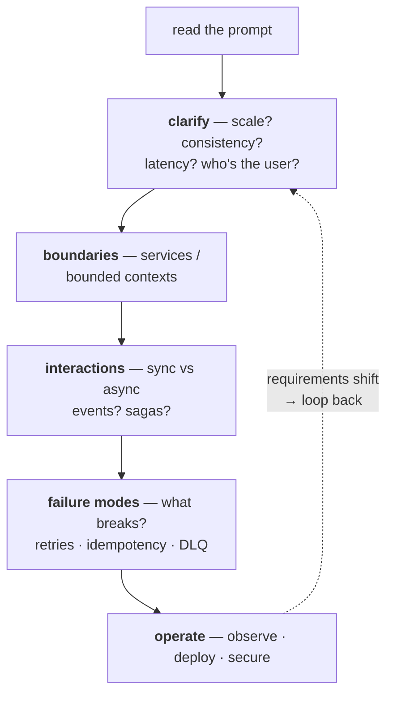

# Interview Preparation

> Use this as your final synthesis and checklist before architecture interviews.

---

## System Design Answer Template

When asked to design a system, structure your answer:

1. **Clarify requirements** — functional (what it does) vs non-functional (scale, latency, consistency, availability)
2. **Estimate scale** — users, RPS, data volume, read/write ratio
3. **High-level design** — draw service boxes and communication arrows
4. **Service decomposition** — identify bounded contexts; justify each boundary
5. **Data design** — DB per service, data model, consistency requirements
6. **Communication** — sync vs async; API contracts; event schemas
7. **Resilience** — how each service fails; circuit breaker, retry, fallback
8. **Observability** — logs, metrics, traces, health checks, alerts
9. **Security** — authentication, authorization, secrets, transport
10. **Deployment** — containers, K8s, deployment strategy, scaling

---



## Common Design Scenarios

### Distributed Transactions — Checkout Service
- Cart → Inventory → Payment → Shipping coordination
- **Pattern:** Choreography Saga or Orchestration Saga
- **Key concern:** What happens when payment succeeds but inventory reservation fails?
- **Answer:** Compensating transactions — refund payment, release reservation

### Event-Driven Notification Service
- Multiple channels: email, SMS, push
- **Pattern:** Pub-Sub; Order Service publishes `OrderConfirmed`; Notification Service subscribes
- **Key concern:** Duplicate notifications on retry
- **Answer:** Idempotency key per notification; deduplicate at consumer

### Real-Time Audit Trail
- Every state change must be recorded forever
- **Pattern:** Event Sourcing — events are the audit trail; no extra table needed
- **Key concern:** Schema evolution as events accumulate
- **Answer:** Event versioning with upcasters

### Live Inventory / Dashboard
- Read-heavy; stale data tolerable for milliseconds
- **Pattern:** CQRS — separate read model (Redis/Elasticsearch) updated via events
- **Key concern:** Eventual consistency visible to users
- **Answer:** Design UI for eventual consistency; show "last updated" timestamp

---

## Key Trade-off Questions

| Trade-off | Pick A When | Pick B When |
|-----------|------------|------------|
| **Monolith vs Microservices** | A: small team, early stage, unclear domain | B: multiple teams, proven domain, independent scaling needed |
| **REST vs gRPC** | A: external APIs, browsers, simplicity | B: internal services, high throughput, streaming |
| **Sync vs Async** | A: user-facing, needs immediate response, simple | B: workflows, heavy processing, fire-and-forget |
| **Choreography vs Orchestration** | A: few steps, low coupling more important than visibility | B: many steps, need explicit state visibility |
| **CAP: CP vs AP** | A: banking, inventory, payments | B: social feed, product catalog, analytics |
| **Event Sourcing** | A: audit required, complex state, time-travel needed | B: simple CRUD, small team, no audit requirement |
| **CQRS** | A: read/write ratio > 10:1, different scaling needs | B: simple balanced reads/writes |

---

## Architecture Interview Q&A

??? question "What is a Bounded Context?"
    An explicit boundary within which a domain model is valid and consistent. The same term (e.g., "Customer") can have different meaning and structure across different bounded contexts. Each microservice typically maps to one bounded context.

??? question "What problem does the Outbox Pattern solve?"
    The dual-write problem: writing to a database and publishing to a message broker are two separate operations. Either can fail independently. The Outbox Pattern writes both in one database transaction, with a separate process publishing the event afterward — guaranteeing at-least-once delivery.

??? question "When would you NOT use microservices?"
    Small team, early-stage product with an unclear domain, or when the team lacks operational maturity (observability, CI/CD). Start with a modular monolith. When team boundaries and domain boundaries are clear and stable — then decompose.

??? question "What is the difference between Circuit Breaker and Retry?"
    Retry is optimistic — it assumes the failure is transient and tries again. Circuit Breaker is pessimistic — after too many failures it stops trying for a period (fail fast). They work together: retry handles transient failures; circuit breaker prevents cascading overload when the downstream is genuinely down.

??? question "What is eventual consistency and when is it acceptable?"
    A system guarantee that when no new updates are made, all replicas will converge to the same value — eventually. Acceptable for read models, dashboards, notifications, product catalogs. Not acceptable for financial transactions, inventory reservations, or anything where acting on stale data has real cost.

??? question "What is an idempotency key?"
    A unique client-generated UUID sent with a request. The server stores it and uses it to detect and deduplicate retried requests. Essential for payment APIs, email sends, and any operation that should happen exactly once despite at-least-once delivery semantics.

??? question "What is the difference between Authentication and Authorization?"
    Authentication (AuthN) answers "who are you?" — verifying identity (login, JWT validation). Authorization (AuthZ) answers "what can you do?" — checking permissions after identity is established (RBAC roles, OAuth scopes).

??? question "How does mTLS differ from regular TLS?"
    Regular TLS: only the server presents a certificate; the client verifies it. mTLS (mutual TLS): both the server and the client present certificates; both verify each other. This provides cryptographic service-to-service authentication with no shared secret needed.

??? question "What are the three states of a Circuit Breaker?"
    Closed (requests pass through, failures counted), Open (all requests fail immediately — fast fail), Half-Open (probe requests sent to test recovery; if success → Closed, if fail → Open).

??? question "What is the CAP Theorem and what does it mean for microservices?"
    A distributed system can guarantee only two of: Consistency, Availability, and Partition Tolerance. Partition tolerance is non-negotiable (networks do split). So the real choice is CP (consistent but may refuse requests) vs AP (always responds but may return stale data). Design CP for financial systems; AP for feeds, catalogs.

---

## Spring Boot → Architecture Mapping

| Architecture Concept | Spring / Tool |
|---------------------|--------------|
| API Gateway | Spring Cloud Gateway |
| Service Discovery | Spring Cloud Eureka, Kubernetes DNS |
| Config Management | Spring Cloud Config Server |
| Circuit Breaker | Spring Cloud Circuit Breaker (Resilience4j) |
| Distributed Tracing | Micrometer Tracing + Zipkin / Jaeger / OTel |
| Kafka Messaging | Spring Kafka (KafkaTemplate, @KafkaListener) |
| CQRS / Event Sourcing | Axon Framework |
| AOP (cross-cutting) | Spring AOP (logging, security, transaction boundaries) |
| Security | Spring Security + Spring Authorization Server |
| Reactive / Non-blocking | Spring WebFlux (Project Reactor) |
| Observability | Spring Boot Actuator + Micrometer |
| Sidecar | Kubernetes sidecar container (not Spring) |
| Outbox Pattern | Spring Modulith, Debezium + Kafka Connect |

---

## Architecture Decision Records (ADR)

Use ADRs to document and communicate significant architecture decisions:

```markdown
# ADR-001: Saga Pattern for Order Checkout

## Status
Accepted — 2026-04

## Context
Order checkout spans three services (Inventory, Payment, Shipping).
We need distributed transaction management without 2PC.

## Decision
Use Choreography-based Saga with Kafka.
Each service publishes events on success or failure.
Compensating transactions handle rollback.

## Consequences
+ Services remain loosely coupled — no central orchestrator dependency
+ Failure visibility via Kafka DLQ
- Full saga flow harder to trace — mitigated with distributed tracing
- Compensating logic required in each service — increases service complexity
```

Store ADRs in `docs/adr/` in the repository. Use sequential numbering.

---

## "Know Cold" Checklist

Before your interview, be able to explain these without hesitation:

- [ ] CAP Theorem — which DBs are CP vs AP and why
- [ ] Bounded context, aggregate, entity, value object — definitions and differences
- [ ] Saga choreography vs orchestration — with a diagram in your head
- [ ] Circuit breaker states — Closed, Open, Half-Open transitions
- [ ] Three pillars of observability — logs, metrics, traces
- [ ] OAuth2 authorization code + PKCE flow — step by step
- [ ] What mTLS is and in what layer it applies
- [ ] Rolling vs Blue-Green vs Canary — trade-offs for each
- [ ] Why the Outbox Pattern exists and how it works
- [ ] When NOT to use event sourcing, microservices, and CQRS
- [ ] DDD context mapping patterns — especially ACL and Published Language
- [ ] 12-Factor App principles — at least factors 3, 5, 6, 9, 11

---

## 📝 Knowledge Check

<quiz>
'Design a checkout service' — the interviewer says 'and payment must not double-charge.' Which concepts do you name in the first 60 seconds?
- [ ] 'We use a queue'
- [x] Idempotency keys on the payment call, saga (the multi-service transaction), outbox for 'order saved + event published' atomicity, timeouts+retries with safe replay, and the compensating action if a step fails — name the *failure modes* these prevent, not just the pattern names
- [ ] 'Two-phase commit solves it'
- [ ] 'Use a database transaction'

the interviewer is testing whether you *start* from failure modes: 'double charge' = 'retry without idempotency' → idempotency keys; 'multi-service consistency' → saga; 'event lost between commit and publish' → outbox. 2PC shows you know the theory but not why it's avoided (blocking, coordinator SPOF); a plain DB transaction shows you missed that this is a *distributed* problem.
</quiz>
<quiz>
Asked 'how would you build a real-time audit trail,' why is event sourcing a strong answer — and what caveat must you add to sound like a senior?
- [ ] Event sourcing is always right — no caveats
- [x] The audit trail IS the event stream — complete history, temporal queries, replayable state are exactly what audit wants. The caveat: you inherit projection/snapshot/event-versioning complexity and GDPR erasure needs crypto-shredding — so 'event sourcing fits *if* you truly need replayable history, not just an audit column on a normal table'
- [ ] Use a log file — simpler
- [ ] Audit trails don't need events

senior = knowing when the pattern *isn't* worth it: audit-as-raison-d'être is event sourcing's sweet spot, but 'we also need to store customer PII' raises erasure-vs-immutability, and 'we just need created_at/updated_at' means the complexity buys nothing. The trade-off articulation is the answer — the pattern choice is almost secondary.
</quiz>
<quiz>
An ADR records 'use saga for checkout.' What separates a useful ADR from a write-only artifact?
- [ ] The decision itself is what matters
- [x] The context + rejected alternatives + consequences: 'we had N services, no distributed transactions, compensation was acceptable' + 'rejected 2PC (blocking, coordinator SPOF) and shared DB (coupling)' + 'accepted: eventual consistency, compensation complexity, idempotent steps required' — the value is future-you understanding *why* when reconsidering, not just *what*
- [ ] ADRs are for compliance — nobody reads them
- [ ] Longer is better

an ADR's job is to make the decision *revisitable*: the constraints and rejected options are what let a future team decide 'does this still hold when our context changed?' A 'decision + no context' record is a conclusion with no reasoning — useless the moment circumstances differ. Format matters less than capturing alternatives-rejected and consequences-accepted.
</quiz>
<quiz>
'Design a live inventory dashboard' — the interviewer pushes 'customers complain counts are stale.' Which trade-off do you surface?
- [ ] 'Cache more'
- [x] Read-path consistency vs. scale: live fan-out to every service = freshest + slowest + most coupled; event-fed read model = fast + stale by replication lag. The senior answer names the lag explicitly and proposes the mitigation set — read-your-writes for the writer, bounded-staleness display ('as of 2 min ago'), or CQRS only on the views that can tolerate it
- [ ] 'Make it synchronous — always fresh'
- [ ] 'Staleness is unacceptable — drop the feature'

this question tests whether you turn 'stale data' into a *designed trade-off* rather than a bug: 'freshness costs coupling and latency.' The strong answer: quantify tolerable staleness per view, pick composition vs. projection per view, and handle the writer's own-read case specifically. 'Make it synchronous' punts the actual question — how fresh does it need to be vs. what does freshness cost.
</quiz>
<quiz>
The 'know cold' list — why does an interviewer ask 'when would you NOT use microservices' more often than 'what are microservices'?
- [ ] Trick question for juniors only
- [x] Because the *boundary condition* is the knowledge: anyone can recite the pattern; knowing when it fails (unstable domains, small teams, missing CI/CD/observability maturity, monolith-not-actually-painful) proves you can apply it. Answering the 'when NOT' question correctly demonstrates the judgment the whole interview is actually measuring
- [ ] It's a trick with no right answer
- [ ] Microservices are always the answer

every architecture question is secretly 'do you understand the trade-off space well enough to know where this pattern's edges are.' The 'know cold' items are the recurring trade-off axes (consistency, coupling, failure modes) — the interviewer wants you to reason from constraints to pattern, not pattern to justification. 'When NOT' answers are what distinguish seniority.
</quiz>