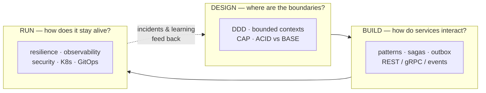

# Microservices Architecture: Interview Prep Guide

> **Goal:** Broad, systematic coverage — from design thinking to production deployment.
> Built for senior developers moving into architecture roles.

---

## The Mental Model: Design → Build → Run

---

## Sections at a Glance

| # | Section                     | Core Topics                                                             |
|---|:----------------------------|:------------------------------------------------------------------------|
| [01](01-foundations.md) | Architectural Foundations   | Styles, CAP, Conway's Law, Hexagonal, Onion, Clean                      |
| [02](02-ddd.md) | Domain-Driven Design        | Bounded Contexts, Aggregates, Context Mapping, Ubiquitous Language      |
| [03](03-microservices-patterns.md) | Microservices Patterns      | Decomposition, Integration, Service Discovery, Caching, Sidecar, Outbox |
| [04](04-event-driven.md) | Event-Driven Architecture   | Kafka, CQRS, Event Sourcing, Saga, Messaging Patterns, DLQ              |
| [05](05-api-communication.md) | API & Communication         | REST, gRPC, GraphQL, API Gateway, BFF, Versioning, Configuration        |
| [06](06-resilience.md) | Resilience & Reliability    | Circuit Breaker, Retry, Bulkhead, Timeout, Rate Limiting, Chaos         |
| [07](07-observability.md) | Observability               | Logs, Metrics, Traces, SLO, OpenTelemetry, DORA Metrics                 |
| [08](08-security.md) | Security                    | OAuth2, JWT, mTLS, Secrets, Zero Trust, Testing Strategies              |
| [09](09-deployment.md) | Deployment & Infrastructure | Kubernetes, Helm, GitOps, Blue-Green, Canary, Configuration             |
| [10](10-interview.md) | Interview Prep              | Design scenarios, Trade-offs, ADRs, Spring Boot map                     |

---

## Recommended Reading Order

1. **Sections 01–02** — Architecture thinking + DDD (the *why* behind service boundaries)
2. **Sections 03–04** — Patterns + events (the *how* of building distributed systems)
3. **Sections 05–09** — Verify and fill gaps in what you already know
4. **Section 10** — Final synthesis through the interview lens

---

## What Architecture Interviews Actually Test

- Can you **decompose** a system into coherent services? (DDD)
- Do you understand **distributed system trade-offs**? (CAP, eventual consistency)
- Can you reason about **failure scenarios**? (Resilience patterns)
- Do you know how to **observe** a running system? (Observability)
- Can you articulate **why** you'd choose one pattern over another?

!!! tip "Breadth first, depth on demand"
    This guide is intentionally wide. If a concept feels shallow, that's your signal to go deeper on that specific topic after building the mental map.

---

## 📝 Knowledge Check

<quiz>
The guide's mental model is Design → Build → Run. Where do DDD, sagas, and observability each fit — and why does the order matter?
- [ ] They're all 'build' concerns
- [x] Design: DDD, bounded contexts, capability mapping — deciding *what the services are* before any code. Build: integration patterns, sagas, outbox, APIs — the mechanics of making them work together. Run: observability, resilience, deployment, security — keeping them alive. Order matters because mistakes compound backward: a wrong boundary (design) can't be fixed by better Kubernetes (run)
- [ ] Run first — infrastructure is the foundation
- [ ] Order doesn't matter — learn what interests you

the sequence mirrors where the expensive mistakes live: wrong boundaries cost rewrites; missing patterns cost incidents; missing observability costs debugging time. Each layer assumes the previous is right — you can't 'resilience' your way out of a bad decomposition, and you can't 'observe' a system you don't understand the boundaries of.
</quiz>
<quiz>
'Architecture interviews test trade-offs, not trivia' — which answer demonstrates the right instinct: 'microservices are better' or 'it depends, here's when each wins'?
- [ ] 'Microservices are better' — shows conviction
- [x] 'It depends' — but *only* when you can name the conditions: team size, ops maturity, domain stability, consistency requirements. Senior-level answer = articulate the trade-off axes and which side of each your scenario sits on — the pattern is a conclusion, not a starting point
- [ ] Refuse to answer — trade-offs are unknowable
- [ ] List every pattern to show breadth

interviews test *judgment under constraints*, and 'it depends' is only the beginning of that answer. The senior move is naming the deciding variables: 'if boundaries are unstable → modular monolith; if teams need independent deploys → microservices.' Pattern-recitation without decision-criteria signals someone who read the guide but can't apply it.
</quiz>
<quiz>
'Breadth first, depth on demand' — in a system-design interview where you're asked to design notifications at scale, which 2-3 topics from this guide would you reach for first, and why?
- [ ] Only Kubernetes — it's where things run
- [x] Decomposition/bounded contexts (what services exist), event-driven patterns (the natural fit — notification is reaction-to-fact), and delivery semantics/reliability (at-least-once, idempotent consumers, DLQs — the questions the interviewer will push on). The 'depth' you show is in *the failure modes*, not the happy path
- [ ] CAP theorem only
- [ ] The interview is about drawing boxes

a good answer follows the guide's own map: boundaries first (what owns notification vs. what emits the trigger), then the interaction model (events fit 'react to something that happened'), then the hard parts (duplicates, ordering, delivery failure, fan-out scale). Interviewers probe the edge cases — DLQ handling, idempotency, ordering — because that's where seniority shows.
</quiz>